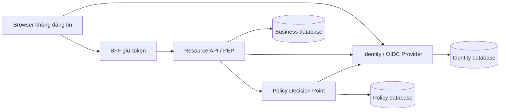

# 01 — Hiểu IAM và bài toán sản phẩm

[Trang đầu](../../README.md) · [Tiếp: nền tảng kỹ thuật](02-foundations.md)

Sau phần nhận diện bài toán ở chương này, làm [P01: yêu cầu/NFR và thiết kế](../delivery/01-requirements-solution-design.md) trước implementation. [Ma trận 10 nhóm](../reference/delivery-coverage.md) nối toàn bộ nghiệp vụ IAM với Git, hạ tầng, phát hành, dữ liệu, bảo mật, độ tin cậy và vận hành/chi phí.

## 1. Mục tiêu và điều kiện đầu vào

Bạn cần biết viết một chương trình đơn giản và dùng terminal. Chưa cần biết OAuth, Docker hoặc microservices. Cuối chương, bạn phải mô tả được hệ thống đang xây phục vụ ai, dữ liệu nào thuộc service nào, điều gì tạo quyền truy cập và bằng chứng nào cho thấy quyền đã bị thu hồi.

Giữ một file ghi chép tại máy bạn để viết câu trả lời. Chương này chưa tạo code IAM; các bài sau dùng quyết định ở đây để tạo database/API.

## 2. Từ một yêu cầu sản phẩm thành nghiệp vụ

Giả sử bạn có hai sản phẩm: Web A quản lý hóa đơn, Web B phân tích chi phí. Acme và Beta đều sử dụng chúng. Alice làm cho cả hai tổ chức; Bob chỉ làm cho Beta. Hai ứng dụng cần chung trang đăng nhập, nhưng dữ liệu và quyền giữa hai tổ chức phải cách ly.

Một login đúng chưa có nghĩa Alice được đọc mọi invoice. Để đọc invoice của Acme cần đồng thời:

1. Alice có danh tính được xác thực bằng phương thức tổ chức chấp nhận.
2. Tài khoản, organization, membership, session, client và token còn hợp lệ.
3. Token dành cho đúng API và scope.
4. Invoice thực sự thuộc Acme.
5. Policy cho Alice thực hiện action với invoice đó.
6. Invariant nghiệp vụ còn đúng, ví dụ invoice chưa bị xóa hoặc không đang chuyển trạng thái.

Khi Acme xóa membership của Alice, tài khoản global của cô ấy có thể vẫn tồn tại để làm việc với Beta. Vì vậy xóa membership, khóa user và revoke session là ba lệnh khác nhau.

## 3. Các khái niệm phải phân biệt

| Khái niệm | Câu hỏi | Ví dụ |
|---|---|---|
| Identity | Principal nào đang được nói đến? | User ID của Alice, service principal Invoice API |
| Authentication — AuthN | Principal đã chứng minh danh tính bằng cách nào? | Password + passkey, corporate IdP |
| Authorization — AuthZ | Principal có được làm action này không? | `invoice.approve` cho invoice thuộc Acme |
| Directory | Danh tính thuộc cấu trúc nào? | Organization, membership, group |
| Session | Bằng chứng đăng nhập còn được sử dụng trong thời gian nào? | IAM session, session Web A |
| Federation | Tin bằng chứng từ hệ thống danh tính nào? | Acme dùng upstream Entra IdP |
| Provisioning | Tài khoản/quyền được tạo, cập nhật, vô hiệu hóa ra sao? | SCIM deactivate nhân viên nghỉ việc |
| Governance | Ai phê duyệt, rà soát và chịu trách nhiệm về quyền? | Review hàng quý, JIT admin 30 phút |

OAuth cho phép client nhận quyền truy cập có giới hạn; OIDC bổ sung lớp đăng nhập danh tính. ID token dành cho client xác nhận lần đăng nhập; access token dành cho resource API. Chúng không hoán đổi vai trò. [OIDC Core](https://openid.net/specs/openid-connect-core-1_0.html).

## 4. Tham khảo đúng từ Azure, AWS và Google

Các cloud có nhiều sản phẩm. Azure RBAC không phải toàn bộ Entra ID; AWS IAM không phải Cognito; Google Cloud IAM không phải Identity Platform. Đọc [ma trận đầy đủ](../reference/cloud-capabilities.md), sau đó điền bảng sau vào ghi chép:

| Năng lực sản phẩm của mình | Thành phần cần xây | Checkpoint |
|---|---|---|
| Dùng chung login cho hai app | OIDC Provider, app registry, session | 06–09 |
| Cách ly tổ chức | Membership, org-bound grants, data access | 04–13 |
| Service gọi nhau | Machine principal, audience/scope | 08, 17 |
| Nhân viên nghỉ việc | Disable/revoke/provisioning workflow | 05, 08, 15–16 |
| Quản trị ít đặc quyền | RBAC, boundaries, approval, JIT | 11, 13, 16 |
| Truy vết truy cập | Audit và correlation | 03, 12, 20 |

Semantics authorization của giáo trình được công bố riêng. Chúng không mặc nhiên tương thích policy JSON hoặc API của cloud. Ví dụ explicit deny trong hệ thống này thắng allow sau tenant boundary; AWS có nhiều loại policy và quy tắc evaluation khác nhau. [AWS policy evaluation](https://docs.aws.amazon.com/IAM/latest/UserGuide/reference_policies_evaluation-logic.html).

## 5. Thiết kế actor và use case

Viết các use case dưới dạng `actor → action → resource → điều kiện → hậu quả`:

- **End user:** đăng ký/xác minh email; login; chọn organization; đọc profile; thêm passkey; xem và revoke phiên.
- **Organization admin:** mời thành viên; quản lý group; gán app; đặt yêu cầu corporate SSO/MFA; suspend membership.
- **Platform operator:** provision organization/client; quản lý khóa và deployment; không tự có quyền xem invoice khách hàng.
- **Application/resource service:** xác minh token; tải resource; gọi PDP; thực thi business invariant.
- **Governance approver:** phê duyệt role có thời hạn; review quyền; không tự phê duyệt yêu cầu của chính mình.
- **Workload:** nhận token bằng quyền của nó hoặc thay user qua delegation; audit phân biệt actor và subject.

Đặt acceptance cho một use case cụ thể:

```text
Given: Alice có active membership Acme và Beta; token hiện tại bind Acme.
When: gọi GET /v1/invoices/<invoice-Beta> bằng token đó.
Then: không trả dữ liệu Beta, kể cả Alice cũng là thành viên Beta.
And: muốn thao tác tại Beta phải cấp organization context/token mới.
```

Điểm cuối rất quan trọng: membership đa tổ chức không biến một token thành token “mọi tenant”.

## 6. Vẽ trust boundary và luồng dữ liệu



Browser được phép cung cấp input; server kiểm chứng rồi mới tạo authority. `org_id`, `owner_id`, `role`, email hoặc `is_admin` trong request body chưa phải sự thật. Resource owner lấy attributes từ database; IAM lấy membership và authentication evidence từ dữ liệu của nó.

Đọc [kiến trúc](../reference/architecture.md). Trên sơ đồ của bạn, đánh dấu riêng nơi secret đi qua, nơi dữ liệu được lưu, và boundary Internet/internal/database. Một gateway trước các service không loại bỏ trust boundary giữa service.

## 7. Production grade được đánh giá thế nào?

Tạo bốn cột trong checklist của bạn:

| Thuộc tính | Cần chứng minh |
|---|---|
| Correctness | Đổi code một lần, transaction đúng, policy deterministic |
| Security | Chống chéo tenant, replay, CSRF, credential abuse, privilege escalation |
| Reliability | Timeout, bounded concurrency, HA, no auth bypass, backlog recovery |
| Operability | Telemetry, on-call/runbook, rotation, migration, backup và restore |

Yêu cầu đã chọn là online check mọi protected request. Sau committed revoke, check bắt đầu sau đó phải thấy trạng thái mới. Khi IAM down, API phải trả 503. Không suy luận “JWT có chữ ký đúng thì vẫn cho vào” hoặc tự bật cache để tăng availability. Xem [ADR-002 và ADR-009](../reference/decisions.md).

## 8. Bài thực hành và kiểm thử thiết kế

Không cần database. Dùng bảng và sơ đồ để trả lời:

1. Alice rời Acme nhưng vẫn ở Beta: đổi bảng/trạng thái nào? Token Acme và Beta xử lý ra sao?
2. Bob lấy token Web A rồi gửi cho API khác audience: ai phải từ chối?
3. Acme bắt buộc corporate SSO; Alice có IAM session password cá nhân: có tái sử dụng ngay được không?
4. Governance gửi grant, owner đã commit nhưng response bị mất: retry tránh cấp hai lần bằng gì?
5. Event membership revoked đến chậm: request tiếp theo có được dùng cache/projection không?
6. Restore backup trước lần revoke: thao tác nào phải hoàn thành trước mở traffic?

**Đáp án kiểm tra:** membership Acme bị disable, các check Acme fail nhưng Beta còn có thể hợp lệ; resource API kiểm tra audience; evidence phải thỏa policy Acme nên cần reauthentication; operation ID và owner receipt; không dùng projection; invalidate session/grant/challenge và xử lý credential/security state sau restore.

## 9. Failure lab: bỏ một boundary

Giả sử developer bỏ điều kiện `resource.org_id === token.org_id` vì “Alice có membership cả hai”. Vẽ request đọc invoice Beta bằng token Acme. Chỉ ra vì sao audit sẽ gán sai organization và policy Acme có thể mở quyền cho tài nguyên Beta. Phục hồi bằng org-bound token, tenant-filtered query và PDP tenant boundary. Thêm scenario này vào test plan chương 04/11.

## 10. Troubleshooting

| Triệu chứng khi thiết kế | Nguyên nhân thường gặp | Sửa |
|---|---|---|
| Mọi role gom vào `isAdmin` | Lẫn platform, tenant và business privilege | Tách permission namespace và scope |
| Login API trả JWT rồi xong | Thiếu client protocol, session và lifecycle | Đặc tả Code Flow/OIDC và token lifecycle |
| Một người phải tạo lại account mỗi app | Account bị gắn vào ứng dụng | Tách global subject với app assignment |
| Permission revoke chờ event | Projection bị dùng làm authority | Online check owner state |
| Chưa biết service nào sở hữu bảng | Chia theo endpoint/kỹ thuật | Đặt lại bounded contexts theo transaction và nghiệp vụ |

## 11. Definition of Done

- [ ] Có danh sách actor/use case và capability map.
- [ ] Giải thích được ID token, access token, IAM session và app session.
- [ ] Vẽ được ba database ownership chính và trust boundaries.
- [ ] Viết acceptance cho cross-tenant, revoke, retry và restore.
- [ ] Đọc implementation map và ADR; giữ nguyên semantics giữa các chương.

Evidence gợi ý: sơ đồ, bảng use case và câu trả lời sáu scenario. Khi đã tạo Git ở chương 03, lưu lại với checkpoint `ch01-domain`.

Nguồn chính: [Microsoft authentication/authorization](https://learn.microsoft.com/en-us/entra/identity-platform/authentication-vs-authorization), [Google identity products](https://docs.cloud.google.com/docs/authentication/identity-products), [AWS identity federation](https://docs.aws.amazon.com/IAM/latest/UserGuide/id_roles_providers.html), [OIDC Core](https://openid.net/specs/openid-connect-core-1_0.html).
