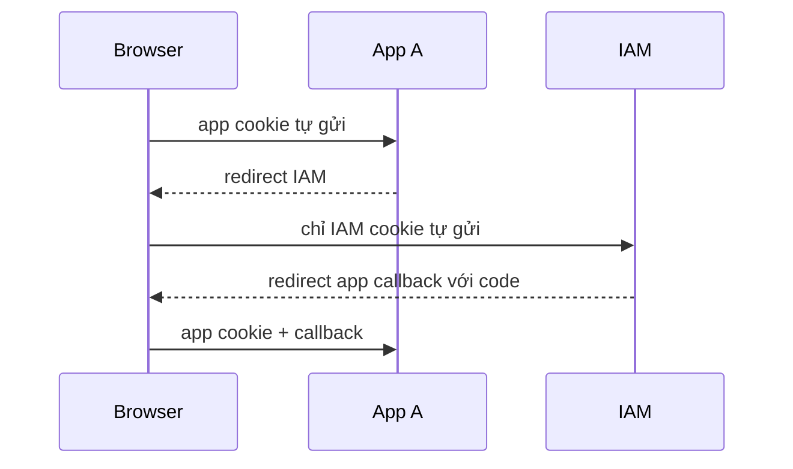

# 02 — Nền tảng TypeScript, HTTP và bảo mật

[Trước: bài toán IAM](01-domain-overview.md) · [Trang đầu](../../README.md) · [Tiếp: dựng workspace](03-workspace-bootstrap.md)

## 1. Mục tiêu và điều kiện đầu vào

Đọc xong chương 01. Chương này tạo các thí nghiệm nhỏ tại `%TEMP%`, chưa dựng hệ thống IAM. Sau bài, bạn cần đọc được code async/ESM, một HTTP exchange và phân biệt các loại secret, hash, chữ ký. Các ví dụ không nhận credential thật.

## 2. Runtime, TypeScript và ESM

TypeScript kiểm tra kiểu ở lúc build; dữ liệu HTTP vẫn cần runtime validation. Nếu khai báo `req.body as LoginRequest`, bạn chỉ nói với compiler rằng hãy tin mình; browser vẫn gửi được object khác. `unknown` ép người viết kiểm tra; `any` bỏ kiểm tra. Dùng union rõ ràng cho kết quả `active | inactive | unavailable` để không nhập nhằng inactive với outage.

```typescript
type IdentityCheck =
  | { kind: 'active'; sub: string; orgId: string }
  | { kind: 'inactive' }
  | { kind: 'unavailable'; retryAfterMs: number };

export function statusFor(check: IdentityCheck): number {
  switch (check.kind) {
    case 'active': return 200;
    case 'inactive': return 401;
    case 'unavailable': return 503;
  }
}
```

Trong ESM, package có `"type":"module"`; TypeScript `module`/`moduleResolution` là `NodeNext`. Source import `./config.js` dù file viết là `config.ts`, vì output là JavaScript cho Node chạy. Không dùng alias chỉ chạy trong editor rồi quên resolver runtime. `import type` không tạo runtime dependency.

Node phục vụ nhiều I/O bằng event loop. `await` nhường thời gian cho request khác; nó không khóa dữ liệu. Hai handler cùng `SELECT used=false`, cùng `UPDATE` vẫn có race dù mỗi handler viết tuần tự. Transaction/row lock/unique constraint mới bảo vệ state chung. Password KDF dùng worker/native implementation và concurrency limit, không gọi một vòng hash đồng bộ lớn trên event loop.

## 3. Thí nghiệm HTTP đầu tiên

Tạo file demo ngoài repository, PowerShell:

```powershell
$foundationPath = Join-Path $env:TEMP 'iam-foundations'
New-Item -ItemType Directory -Force -Path $foundationPath | Out-Null
@'
import { createServer } from 'node:http';
const server = createServer((req, res) => {
  if (req.url === '/health/live' && req.method === 'GET') {
    res.writeHead(200, {'content-type':'application/json','cache-control':'no-store'});
    res.end(JSON.stringify({status:'ok'}));
    return;
  }
  res.writeHead(404, {'content-type':'application/json'});
  res.end(JSON.stringify({error:'not_found'}));
});
server.listen(3999, '127.0.0.1');
process.on('SIGINT', () => server.close());
'@ | Set-Content -Encoding UTF8 (Join-Path $foundationPath 'http-demo.mjs')
node (Join-Path $foundationPath 'http-demo.mjs')
```

Mở terminal thứ hai:

```powershell
curl.exe -i http://127.0.0.1:3999/health/live
curl.exe -i http://127.0.0.1:3999/missing
```

Kỳ vọng: request đầu 200 với JSON `status=ok`, request sau 404. `curl.exe` chọn executable, tránh alias `curl` của Windows PowerShell. Dừng server bằng Ctrl+C ở terminal đầu. Đây là HTTP loopback demo; login/token ở các chương sau phải dùng HTTPS qua proxy local.

## 4. Request, response và input boundaries

Request có method, URL, headers, body; mỗi phần có parser và trust level riêng. Query `?scope=openid&scope=admin` chứa duplicate parameter: lấy giá trị đầu/cuối tùy parser có thể làm validation và execution nhìn hai input khác nhau. Protocol parser sẽ kiểm tra duplicate, content type, body limit và charset theo profile.

| Input | Ví dụ | Xử lý |
|---|---|---|
| Path ID | `/orgs/:orgId/users/:userId` | validate kiểu và dùng verified tenant boundary |
| Query | `redirect_uri`, `state` | parse đúng một lần, reject duplicate protocol params |
| Headers | `Authorization`, `Host` | bearer parser chặt; issuer không lấy từ Host |
| JSON | management API | Zod/runtime schema, reject field nhạy cảm không công bố |
| Form | token endpoint | `application/x-www-form-urlencoded`, một auth method |

`401` nói credential người gọi không hợp lệ; `403` nói đã xác thực nhưng không đủ quyền; `503` nói service/dependency tạm không phục vụ được. Internal machine credential cấu hình sai không phải lý do bắt user đăng nhập liên tục.

## 5. Cookie, session và browser

Cookie tự đi theo request thỏa domain/path/SameSite. Vì browser tự gửi cookie nên route dùng cookie cần chống CSRF. `HttpOnly` ngăn JavaScript đọc cookie trực tiếp; XSS vẫn có thể thao tác thay người dùng. `Secure` yêu cầu HTTPS. `SameSite=Lax` hữu ích cho top-level OIDC redirect, nhưng không thay CSRF token và kiểm tra Origin cho state-changing request.

Tên cookie `__Host-iam_session` yêu cầu Secure, Path `/`, không Domain. BFF dùng cookie riêng trên host ứng dụng. Không gắn Domain `.local.test` để chia sẻ cookie toàn bộ ứng dụng; SSO xảy ra qua OIDC redirect đến issuer, không qua đọc lén cookie của nhau.



CORS điều khiển browser có đọc được response cross-origin không; nó không xác thực caller và không cản curl/server gửi request. BFF gọi API server-side không cần mở CORS `*`. CORS có credentials phải allowlist origin cụ thể. CSP/escaping ngăn nhiều nguồn XSS nhưng vẫn cần validate/render dữ liệu an toàn.

## 6. Random, hash, KDF và chữ ký

| Công cụ | Mục đích | Không dùng để |
|---|---|---|
| CSPRNG | Sinh token/challenge/secret khó đoán | Sinh ID dựa `Math.random()` |
| SHA-256 | So khớp secret ngẫu nhiên entropy cao | Lưu password con người |
| Argon2id | Làm chậm việc đoán password offline | Hash mỗi opaque token trên đường introspection |
| Encryption | Đọc lại secret như TOTP seed | Thay password hashing |
| Digital signature | Xác minh ID token do issuer ký | Mã hóa nội dung token khỏi người đọc |

Thử bằng Node, không cài package:

```powershell
node --input-type=module -e 'import {randomBytes,createHash,timingSafeEqual} from "node:crypto"; const raw=randomBytes(32).toString("base64url"); const digest=createHash("sha256").update(raw).digest(); console.log({rawLength:raw.length,hashBytes:digest.length,same:timingSafeEqual(digest,Buffer.from(digest))});'
```

Kỳ vọng raw length 43, hash 32 byte, `same=true`. Không in raw token ra terminal ở module thực tế. `timingSafeEqual` chỉ nhận hai buffer cùng độ dài; parser/length check phải đứng trước. SHA-256 hash của token 256 bit có thể dùng index và so khớp nhanh; password entropy thấp cần KDF tốn chi phí.

JWT là định dạng có thể đọc nội dung; base64url không che PII. Header `alg` do token gửi đến không được tự chọn thuật toán server chấp nhận. Key/issuer/audience/algorithm phải đến từ trust configuration. `jose` thực hiện verification, ứng dụng vẫn phải chọn đúng policy. [JWT BCP](https://www.rfc-editor.org/rfc/rfc8725.html).

## 7. Async error và timeout

Trong Express 5, rejected promise của async handler được chuyển đến error middleware. Không `res.send()` rồi tiếp tục gọi `next()` gây response hai lần. Lỗi cần typed classification; không trả stack/SQL/private endpoint ra browser.

```typescript
export async function getJson(url: string): Promise<unknown> {
  const response = await fetch(url, {signal: AbortSignal.timeout(800)});
  if (!response.ok) throw new Error(`dependency_http_${response.status}`);
  return response.json();
}
```

Đây là helper demo; production thêm allowlisted URL, TLS trust, response size limit và runtime response schema. Timeout không đảm bảo server đích đã rollback; mutation retry phải dùng operation ID. Không retry `invalid_grant` hoặc 403 bằng exponential loop.

Budget end-to-end nhỏ hơn tổng timeout rời rạc: nếu Identity 800ms, Policy 800ms rồi retry cả hai, request có thể vượt một giây. Chương 20 đo toàn luồng và chia deadline/concurrency rõ ràng.

## 8. Kiểm thử và failure lab

Làm ba thí nghiệm:

1. Gọi `/health/live` và `/missing`; giữ status/header/body làm evidence.
2. Gửi request từ curl không có browser; giải thích vì sao CORS không chặn được.
3. Viết hai promise cùng kiểm tra biến `used`, chèn `await` giữa check/set; quan sát cả hai thành công. Sau đó mô tả constraint/row lock cần có thay vì thêm `await` khác.

Demo race (file `.mjs`, Node):

```javascript
let used = false;
const pause = () => new Promise(resolve => setTimeout(resolve, 5));
async function redeem() {
  if (used) return false;
  await pause();
  used = true;
  return true;
}
console.log(await Promise.all([redeem(), redeem()]));
```

Kỳ vọng hai `true` trong demo này. Nó minh họa lỗi, không phải pattern để copy vào token handler. Failure lab phục hồi ở chương 04/06 bằng transaction với row lock và consume condition.

## 9. Troubleshooting

| Lỗi | Nguyên nhân | Khắc phục |
|---|---|---|
| `Cannot use import outside a module` | File/package chưa dùng ESM | `.mjs` cho demo, `type:module` cho app |
| `ERR_MODULE_NOT_FOUND` sau build | Import alias/đuôi source không khớp NodeNext | Import `.js`, kiểm tra output path |
| `curl` hiển thị object PowerShell | Alias gọi Invoke-WebRequest | Dùng `curl.exe` |
| Cookie không được gửi | Secure trên HTTP, domain/path/SameSite sai | Kiểm tra browser network và TLS local |
| Cùng token được dùng hai lần | Tin async handler là lock | Row lock/constraint và transaction |
| 401 tăng khi stop IAM | Outage bị map thành inactive | Tách response validation và dependency failure |

## 10. Definition of Done

- [ ] Đã chạy HTTP demo và dừng server sạch.
- [ ] Giải thích được ESM, type checking và runtime validation.
- [ ] Phân biệt cookie/CSRF/CORS và khả năng của XSS.
- [ ] Chọn đúng CSPRNG, hash, KDF, encryption và signature cho từng dữ liệu.
- [ ] Tái hiện race và hiểu vì sao PostgreSQL phải giải quyết atomicity.
- [ ] Lưu evidence, không raw credential; sẵn sàng dựng lab ở chương 03.

Nguồn: [TypeScript NodeNext](https://www.typescriptlang.org/docs/handbook/modules/reference.html), [Node crypto](https://nodejs.org/docs/latest-v24.x/api/crypto.html), [Express 5 async errors](https://expressjs.com/en/guide/error-handling.html), [OWASP CSRF](https://cheatsheetseries.owasp.org/cheatsheets/Cross-Site_Request_Forgery_Prevention_Cheat_Sheet.html), [OWASP password storage](https://cheatsheetseries.owasp.org/cheatsheets/Password_Storage_Cheat_Sheet.html).
