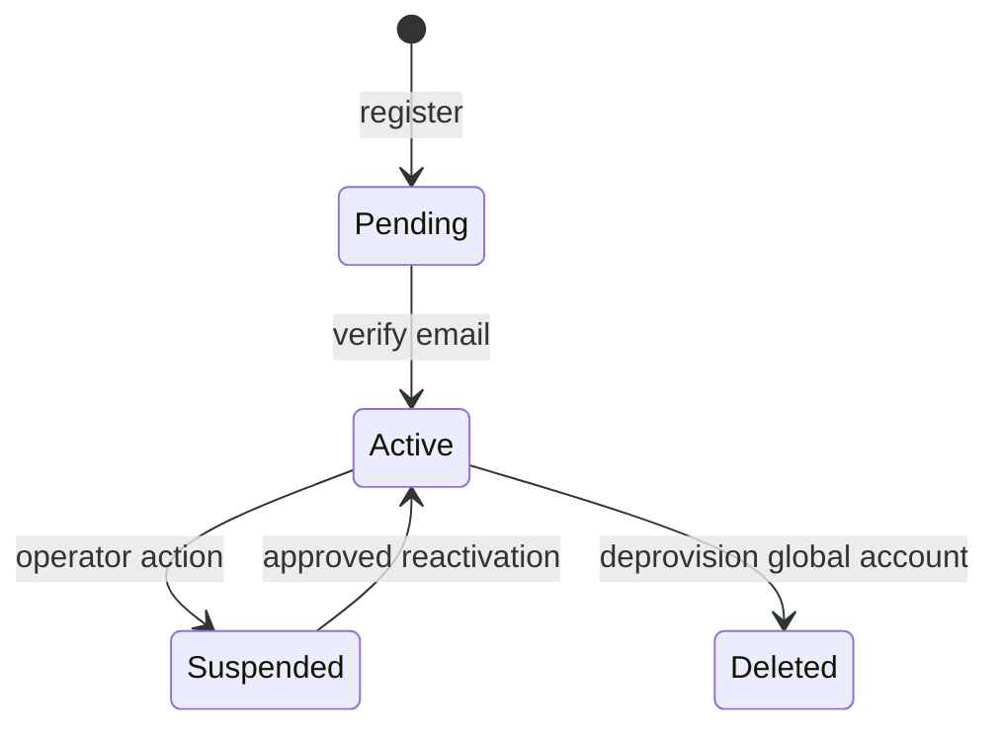

# 05 — Vòng đời tài khoản, password, challenge và session

[Trước: dữ liệu](04-data-tenancy.md) · [Trang đầu](../../README.md) · [Tiếp: OAuth Code Flow](06-oauth-authorization-code.md)

## 1. Mục tiêu và điều kiện đầu vào

Database/fixture/runtime credential chương 04 đã sẵn sàng. Chương này tạo local accounts, verification/reset, password login và IAM session. Session này được dùng cho interaction OAuth ở chương 06; **login không tự phát một loại JWT riêng**.

Bạn phải đạt ba invariant: secret một lần chỉ dùng một lần; credential đổi/suspend không làm token cũ sống lại; browser form không bị CSRF. Password verification, authentication session và permission là các lớp khác nhau.

## 2. Mô hình state và password policy



Organization membership có state riêng. Deprovision Alice khỏi Acme không chuyển global account thành suspended nếu Alice còn Beta.

Policy lab cho password: normalize NFC, tối thiểu 15 code point, tối đa 128 code point/512 UTF-8 bytes, hỗ trợ password manager/paste, kiểm tra blocklist, không ép quy tắc “một ký tự đặc biệt” hoặc đổi định kỳ. Đây là policy sản phẩm tham khảo NIST; không tự tuyên bố certification. [NIST SP 800-63B](https://pages.nist.gov/800-63-4/sp800-63b.html).

## 3. Thêm dependencies, secrets và helpers

```powershell
pnpm -C lab --filter @iam/identity add --save-exact argon2@0.45.1 cookie-parser@1.4.7 ioredis@5.8.2 nodemailer@7.0.11
pnpm -C lab --filter @iam/identity add --save-exact -D @types/cookie-parser@1.4.9 @types/nodemailer@7.0.4
docker compose --env-file lab/infra/compose/.env -f lab/infra/compose/compose.yaml --profile cache --profile mail up -d redis mailpit
$privateKeys = node --input-type=module -e 'import {randomBytes} from "node:crypto";console.log(JSON.stringify({delivery:randomBytes(32).toString("base64"),rate:randomBytes(32).toString("base64")}));' | ConvertFrom-Json
Add-Content -Encoding UTF8 lab/services/identity/.env "DELIVERY_KEY=$($privateKeys.delivery)"
Add-Content -Encoding UTF8 lab/services/identity/.env "RATE_KEY=$($privateKeys.rate)"
$redisSecret = ((Get-Content -Encoding UTF8 lab/infra/compose/.env | Where-Object {$_ -like 'REDIS_PASSWORD=*'}) -split '=',2)[1]
Add-Content -Encoding UTF8 lab/services/identity/.env "REDIS_URL=redis://:$redisSecret@127.0.0.1:6379"
```

Giữ delivery key ngoài Git và có backup/rotation plan. Chỉ ciphertext của mail payload được lưu; event/audit không chứa token gốc. Key production nằm trong secret manager/Vault, không được lấy từ database backup cùng ciphertext.

Tạo `src/security.ts`:

```typescript
import { randomBytes, createHash, createCipheriv, createDecipheriv } from 'node:crypto';
export function newOpaqueToken(): string { return randomBytes(32).toString('base64url'); }
export function hashToken(raw: string): Buffer {
  return createHash('sha256').update(raw, 'utf8').digest();
}
function deliveryKey(): Buffer {
  const key = Buffer.from(process.env.DELIVERY_KEY ?? '', 'base64');
  if (key.length !== 32) throw new Error('DELIVERY_KEY must contain 32 bytes');
  return key;
}
export type Sealed = {iv: string; tag: string; ciphertext: string};
export function sealJson(value: unknown, context: string): Sealed {
  const iv = randomBytes(12), cipher = createCipheriv('aes-256-gcm', deliveryKey(), iv);
  cipher.setAAD(Buffer.from(context));
  const ciphertext = Buffer.concat([cipher.update(JSON.stringify(value), 'utf8'), cipher.final()]);
  return {iv:iv.toString('base64'),tag:cipher.getAuthTag().toString('base64'),ciphertext:ciphertext.toString('base64')};
}
export function openJson(value: Sealed, context: string): unknown {
  const decipher = createDecipheriv('aes-256-gcm', deliveryKey(), Buffer.from(value.iv,'base64'));
  decipher.setAAD(Buffer.from(context));
  decipher.setAuthTag(Buffer.from(value.tag,'base64'));
  return JSON.parse(Buffer.concat([decipher.update(Buffer.from(value.ciphertext,'base64')),decipher.final()]).toString('utf8'));
}
```

AAD bind ciphertext với challenge ID; worker kiểm tra schema sau decrypt. Khi rotation cần key ID + keyring/transit version, giữ khả năng decrypt job chưa gửi; không thay key trong `.env` rồi bỏ toàn bộ backlog im lặng.

Tạo `src/passwords.ts`:

```typescript
import argon2 from 'argon2';
import { AppError } from './errors.js';
let running = 0;
async function slot<T>(fn: () => Promise<T>): Promise<T> {
  if (running >= 2) throw new AppError(503,'password_verifier_busy');
  running++;
  try { return await fn(); } finally { running--; }
}
const blocklist = new Set(['passwordpassword','123456789012345','letmeinletmeinletmein']);
export function normalizeEmail(email: string): string {
  return email.trim().normalize('NFC').toLowerCase();
}
export function passwordInput(raw: string): string {
  const value = raw.normalize('NFC');
  if (Array.from(value).length < 15 || Array.from(value).length > 128 || Buffer.byteLength(value)>512 || blocklist.has(value.toLowerCase()))
    throw new AppError(400,'password_policy_failed');
  return value;
}
export function hashPassword(raw: string): Promise<string> {
  const value = passwordInput(raw);
  return slot(() => argon2.hash(value,{type:argon2.argon2id,memoryCost:65536,timeCost:3,parallelism:1}));
}
export function verifyPassword(hash: string, raw: string): Promise<boolean> {
  if (Buffer.byteLength(raw)>512) return Promise.resolve(false);
  return slot(() => argon2.verify(hash,raw.normalize('NFC')));
}
```

Blocklist ba mẫu chỉ đủ minh họa wiring; trước checkpoint production phải nạp dataset mật khẩu phổ biến/rò rỉ được quản lý version và test, không gửi full password tới bên thứ ba. Calibrate Argon2 trên máy thực; 64 MiB × số worker là chi phí memory cần tính. Concurrency limit trả 503 có kiểm soát thay vì queue vô hạn. Password policy áp khi tạo/đổi; login không tự từ chối password cũ chỉ vì policy vừa tăng.

Sinh dummy hash có cùng cost cho đường user không tồn tại, tại package Identity:

```powershell
$dummyHash = pnpm -C lab --filter @iam/identity exec node --input-type=module -e 'import argon2 from "argon2";import {randomBytes} from "node:crypto";console.log(await argon2.hash(randomBytes(32),{type:argon2.argon2id,memoryCost:65536,timeCost:3,parallelism:1}));'
if ($LASTEXITCODE -ne 0 -or -not $dummyHash.StartsWith('$argon2id$')) { throw 'Cannot create dummy hash' }
Add-Content -Encoding UTF8 lab/services/identity/.env "DUMMY_PASSWORD_HASH=$dummyHash"
```

## 4. Rate limit trước KDF

Tạo `src/rate-limit.ts`; account key dùng HMAC để không lộ email trong Redis:

```typescript
import Redis from 'ioredis';
import { createHmac } from 'node:crypto';
import { AppError } from './errors.js';
const redis = new Redis(process.env.REDIS_URL ?? '', {maxRetriesPerRequest:1,connectTimeout:500,commandTimeout:500});
const counter = `local n=redis.call('INCR',KEYS[1]); if n==1 then redis.call('EXPIRE',KEYS[1],ARGV[1]); end; return n`;
export async function limit(bucket: string, value: string, maximum: number, seconds: number) {
  const key = process.env.RATE_KEY;
  if (!key) throw new Error('RATE_KEY required');
  const digest = createHmac('sha256',key).update(value).digest('hex');
  let count: number;
  try { count = Number(await redis.eval(counter,1,`iam:${bucket}:${digest}`,String(seconds))); }
  catch { throw new AppError(503,'rate_limit_unavailable'); }
  if (count>maximum) throw new AppError(429,'rate_limited');
}
export async function closeRateLimiter() { await redis.quit(); }
```

Apply IP limit và account limit độc lập, chẳng hạn 30/IP/phút và 10/account/15 phút cho login trong lab. Không khóa vĩnh viễn account vì IP lạ có thể dùng nó làm DoS. IP chỉ đáng tin sau cấu hình proxy allowlist. Redis lỗi dẫn đến 503 cho đường credential, không tắt limiter. Chương 20 bổ sung metric, Retry-After và test tải/credential stuffing.

## 5. Tạo challenge và account

Tạo `src/accounts.ts`; giữ kết quả có secret trong process, không log:

```typescript
import { randomUUID } from 'node:crypto';
import type { PoolClient } from 'pg';
import { withTransaction } from './db.js';
import { newOpaqueToken, hashToken, sealJson } from './security.js';
import { normalizeEmail, hashPassword } from './passwords.js';
import { config } from './config.js';

export async function mailChallenge(db: PoolClient, kind:'verify_email'|'reset_password',
  user:{id:string;email_normalized:string;credential_version:string|number}) {
  await db.query('UPDATE challenges SET consumed_at=clock_timestamp() WHERE user_id=$1 AND kind=$2 AND consumed_at IS NULL',[user.id,kind]);
  const id=randomUUID(), raw=newOpaqueToken();
  const pathname=kind==='verify_email'?'/verify-email':'/reset-password';
  const url=new URL(pathname,config.issuer);url.searchParams.set('token',raw);
  const delivery=sealJson({to:user.email_normalized,url:url.href,kind},id);
  await db.query(`INSERT INTO challenges(id,kind,token_hash,user_id,email,payload,expires_at)
    VALUES($1,$2,$3,$4,$5,$6,clock_timestamp()+interval '15 minutes')`,
    [id,kind,hashToken(raw),user.id,user.email_normalized,
     {credential_version:String(user.credential_version),delivery}]);
}
export async function registerAccount(email:string,password:string):Promise<void> {
  const normalized=normalizeEmail(email);
  const passwordHash=await hashPassword(password);
  await withTransaction(async db=>{
    const row=await db.query(`INSERT INTO users(email,email_normalized,password_hash)
      VALUES($1,$2,$3) ON CONFLICT(email_normalized) DO NOTHING
      RETURNING id,email_normalized,credential_version`,[email.trim(),normalized,passwordHash]);
    if(row.rows[0])await mailChallenge(db,'verify_email',row.rows[0]);
  });
}
export async function requestReset(email:string):Promise<void> {
  await withTransaction(async db=>{
    const result=await db.query(`SELECT id,email_normalized,credential_version FROM users
      WHERE email_normalized=$1 AND status='active' AND email_verified_at IS NOT NULL FOR UPDATE`,[normalizeEmail(email)]);
    if(result.rows[0])await mailChallenge(db,'reset_password',result.rows[0]);
  });
}
```

`ON CONFLICT DO NOTHING` không đổi password của account cũ. Register/reset endpoints trả cùng `202 {status:'accepted'}` cho email tồn tại/không tồn tại; limiter chạy cả hai trường hợp. Dùng response chung giúp giảm enumeration, nhưng vẫn đo phân bố timing/email side channel thay vì tuyên bố toàn hệ thống constant-time.

Verification transaction: lock challenge theo hash → kiểm tra kind/expiry/unused → lock user → kiểm tra challenge.email còn khớp user email → consume challenge → set `email_verified_at`, đổi pending→active. Không activate user suspended/deleted. Token replay phải thất bại. GET link chỉ render confirmation form; POST có CSRF mới consume, tránh mail scanner tự xác minh bằng GET.

## 6. Đổi/reset password atomically

Thêm vào `accounts.ts`:

```typescript
import { AppError } from './errors.js';
export async function completeReset(raw:string,nextPassword:string):Promise<void> {
  const nextHash=await hashPassword(nextPassword);
  const success=await withTransaction(async db=>{
    // Lookup immutable owner trước, rồi lock user → challenge theo thứ tự thống nhất.
    const lookup=await db.query("SELECT user_id FROM challenges WHERE token_hash=$1 AND kind='reset_password'",[hashToken(raw)]);
    if(!lookup.rows[0])return false;
    const u=await db.query("SELECT * FROM users WHERE id=$1 FOR UPDATE",[lookup.rows[0].user_id]);
    const c=await db.query(`SELECT *,expires_at>clock_timestamp() AS fresh FROM challenges
      WHERE token_hash=$1 AND kind='reset_password' FOR UPDATE`,[hashToken(raw)]);
    const user=u.rows[0],challenge=c.rows[0];
    if(!user||!challenge||!challenge.fresh||challenge.consumed_at||user.status!=='active'||
      String(user.credential_version)!==challenge.payload.credential_version)return false;
    await db.query('UPDATE users SET password_hash=$2,credential_version=credential_version+1,updated_at=clock_timestamp() WHERE id=$1',[user.id,nextHash]);
    await db.query("UPDATE challenges SET consumed_at=clock_timestamp() WHERE user_id=$1 AND kind IN ('reset_password','recovery') AND consumed_at IS NULL",[user.id]);
    await db.query('UPDATE sessions SET revoked_at=COALESCE(revoked_at,clock_timestamp()) WHERE user_id=$1',[user.id]);
    await db.query('UPDATE oauth_grants SET revoked_at=COALESCE(revoked_at,clock_timestamp()) WHERE user_id=$1',[user.id]);
    return true;
  });
  if(!success)throw new AppError(400,'challenge_invalid');
}
```

Reset không tự đăng nhập hoặc bỏ MFA. Với admin/corporate account, policy recovery ở chương 10/14 có thể yêu cầu bằng chứng mạnh hơn email. Đổi password đã login cần recent reauthentication, verify password hiện hành, rồi cùng mutation/revoke invariant; không tái sử dụng reset token của endpoint public làm bằng chứng admin step-up.

## 7. Login bằng cookie, CSRF và session fixation

Tạo `src/browser.ts`:

```typescript
import { Router, urlencoded } from 'express';
import cookieParser from 'cookie-parser';
import { timingSafeEqual } from 'node:crypto';
import { z } from 'zod';
import { pool, withTransaction } from './db.js';
import { config } from './config.js';
import { AppError } from './errors.js';
import { newOpaqueToken, hashToken } from './security.js';
import { normalizeEmail, verifyPassword } from './passwords.js';
import { limit } from './rate-limit.js';
export const browserRouter=Router();
browserRouter.use(cookieParser());
const cookie={httpOnly:true,secure:true,sameSite:'lax' as const,path:'/'};
const csrfCookie='__Host-iam-csrf';
function csrf(req:import('express').Request) {
  const posted=req.body?.csrf, saved=req.cookies?.[csrfCookie];
  if(req.get('origin')!==config.issuer||typeof posted!=='string'||typeof saved!=='string'||
    !/^[A-Za-z0-9_-]{43}$/.test(posted)||posted.length!==saved.length||
    !timingSafeEqual(Buffer.from(posted),Buffer.from(saved)))throw new AppError(403,'csrf_failed');
}
browserRouter.get('/login',(_req,res)=>{
  const value=newOpaqueToken();res.cookie(csrfCookie,value,{...cookie,maxAge:300_000});
  res.set('Cache-Control','no-store').type('html').send(`<!doctype html><html lang="vi"><meta charset="utf-8"><title>Đăng nhập</title>
    <form method="post" action="/login"><input type="hidden" name="csrf" value="${value}">
    <label>Email <input name="email" type="email" autocomplete="username" required></label>
    <label>Mật khẩu <input name="password" type="password" autocomplete="current-password" required></label>
    <button>Đăng nhập</button></form></html>`);
});
browserRouter.post('/login',urlencoded({extended:false,limit:'8kb'}),async(req,res)=>{
  csrf(req);
  const body=z.object({email:z.email().max(254),password:z.string().max(512),csrf:z.string()}).strict().parse(req.body);
  const email=normalizeEmail(body.email);
  await limit('login-ip',req.ip??'unknown',30,60);
  await limit('login-account',email,10,900);
  const r=await pool.query('SELECT id,password_hash,status,credential_version FROM users WHERE email_normalized=$1',[email]);
  const user=r.rows[0];const dummy=process.env.DUMMY_PASSWORD_HASH;
  if(!dummy)throw new Error('DUMMY_PASSWORD_HASH required');
  const valid=await verifyPassword(user?.password_hash??dummy,body.password);
  if(!valid||!user||user.status!=='active')throw new AppError(401,'credentials_invalid');
  const raw=newOpaqueToken();
  await withTransaction(async db=>{
    const current=await db.query('SELECT status,credential_version FROM users WHERE id=$1 FOR UPDATE',[user.id]);
    if(current.rows[0]?.status!=='active'||String(current.rows[0]?.credential_version)!==String(user.credential_version))
      throw new AppError(401,'credentials_invalid');
    const oldCookie=req.cookies?.[config.cookie.name];
    if(typeof oldCookie==='string')await db.query('UPDATE sessions SET revoked_at=clock_timestamp() WHERE cookie_hash=$1 AND user_id=$2',[hashToken(oldCookie),user.id]);
    await db.query(`INSERT INTO sessions(user_id,cookie_hash,expires_at)
      VALUES($1,$2,clock_timestamp()+interval '12 hours')`,[user.id,hashToken(raw)]);
  });
  res.cookie(config.cookie.name,raw,{...cookie,maxAge:12*60*60*1000});
  res.clearCookie(csrfCookie,cookie);
  // Đường cố định; chưa có OAuth interaction thì chỉ xác nhận login.
  if(typeof req.cookies?.['__Host-iam-interaction']==='string')res.redirect(303,'/oauth2/consent');
  else res.set('Cache-Control','no-store').json({status:'authenticated'});
});
```

Chỉ redirect tới path cố định, không nhận `returnTo` ngoài allowlist. Session ID/secret mới sau login ngăn fixation; không dùng cookie trước login làm session đã xác thực. Zod error được handler chương 03 map 400 không phản chiếu password/body. Chỉ gắn form parser trên đúng POST route; parser router-wide có thể consume body `/oauth2/token` trước parser protocol, làm mất duplicate detection.

Mount `browserRouter` ở `createApp()` **trước 404/error middleware**. Chương 06 thêm cookie parsing cho protocol router trước `browserSession` (parser của browserRouter riêng không tự bao các route khác). Cookie session đi qua HTTPS; đọc `GET /login` và POST bằng browser để giữ Origin/cookie đúng. Xóa endpoint demo và render generic error page phù hợp khi hoàn thiện UI.

## 8. Routes registration/reset và mail worker

Tạo `src/account-routes.ts` với `Router`, gắn `express.json({limit:'8kb'})` riêng. Các route có contract:

| Route | Input | Quy tắc |
|---|---|---|
| `POST /v1/registrations` | `{email,password}` | schema strict, rate limit, `registerAccount`, 202 chung |
| `POST /v1/password-resets` | `{email}` | rate limit cả email không tồn tại, `requestReset`, 202 chung |
| `POST /reset-password` | browser form `{token,password,csrf}` | Origin/CSRF, `completeReset`, không tự login |
| `GET /verify-email` | token query | render confirmation, không consume, no-store/referrer no-referrer |
| `POST /verify-email` | `{token,csrf}` | Origin/CSRF, transaction verification phần 5 |

Ví dụ route JSON hoàn chỉnh để áp dụng pattern:

```typescript
import { Router, json } from 'express';
import { z } from 'zod';
import { limit } from './rate-limit.js';
import { registerAccount, requestReset } from './accounts.js';
import { normalizeEmail } from './passwords.js';
export const accountRouter=Router();
accountRouter.use(json({limit:'8kb'}));
accountRouter.post('/v1/registrations',async(req,res)=>{
  const b=z.object({email:z.email().max(254),password:z.string().max(512)}).strict().parse(req.body);
  await limit('register-ip',req.ip??'unknown',10,900);
  await limit('register-account',normalizeEmail(b.email),3,900);
  await registerAccount(b.email,b.password);
  res.status(202).set('Cache-Control','no-store').json({status:'accepted'});
});
accountRouter.post('/v1/password-resets',async(req,res)=>{
  const b=z.object({email:z.email().max(254)}).strict().parse(req.body);
  await limit('reset-ip',req.ip??'unknown',10,900);
  await limit('reset-account',normalizeEmail(b.email),3,900);
  await requestReset(b.email);
  res.status(202).set('Cache-Control','no-store').json({status:'accepted'});
});
```

Mail worker chạy process riêng, dùng cùng Identity DB; không tạo bounded context chỉ vì gửi SMTP. Cài `src/mail-worker.ts` theo thứ tự sau:

1. Atomic claim: CTE SELECT challenges chưa delivered/consumed, còn expiry, attempts<5, lease hết hạn, `FOR UPDATE SKIP LOCKED LIMIT 1`; UPDATE lease+60 giây, attempts+1, RETURNING row, commit.
2. `openJson(row.payload.delivery,row.id)`; validate `{to,url,kind}` bằng Zod; URL phải cùng issuer và path allowlist.
3. Nodemailer transport `{host:'127.0.0.1',port:1025,secure:false,connectionTimeout:2000,socketTimeout:3000}` chỉ Mailpit local; production SMTP TLS với credential riêng.
4. `sendMail({from:'IAM <no-reply@example.test>',to,subject:'Xác nhận thao tác',text:url})` ngoài DB transaction.
5. Thành công update `delivered_at`; thất bại clear lease, đặt `next_delivery_at=now()+backoff`, ghi reason code không URL/token. attempts hết tạo metric/alarm; người dùng có thể request challenge mới.

SQL claim dùng trong worker:

```sql
WITH pending AS (
 SELECT id FROM challenges WHERE payload ? 'delivery' AND delivered_at IS NULL
  AND consumed_at IS NULL AND expires_at>clock_timestamp() AND delivery_attempts<5
  AND next_delivery_at<=clock_timestamp()
  AND (delivery_lease_until IS NULL OR delivery_lease_until<clock_timestamp())
 ORDER BY created_at FOR UPDATE SKIP LOCKED LIMIT 1
)
UPDATE challenges c SET delivery_attempts=delivery_attempts+1,
 delivery_lease_until=clock_timestamp()+interval '60 seconds'
FROM pending WHERE c.id=pending.id RETURNING c.*;
```

Khi worker chết sau gửi/trước mark, email có thể trùng nhưng challenge vẫn single-use. Không đặt raw verification token vào RabbitMQ/audit; message nếu cần chỉ mang challenge/job ID và worker đọc encrypted payload dưới quyền Identity. Chương 12 triển khai đầy đủ delivery/retry/lease pattern dùng chung.

## 9. Invitation, disable và API owner

Invitation được tạo dưới quyền organization admin đã được xác minh: challenge bind org, email và expiry; membership ban đầu `invited`. Khi accept cần session user đã chứng minh email tương ứng, challenge unused, org active; lock membership/challenge rồi chuyển active cùng transaction. Không để public registration tự thêm membership hoặc role theo body.

Disable membership: update đúng `(org_id,user_id)` và tăng version; revoke grants đúng user/org; outbox ghi org, actor đã xác thực, operation ID. Global suspend user: update user, revoke tất cả sessions/grants, consume recovery/reset challenges trong một transaction. Reactivate không bỏ các dấu revoked cũ. Owner endpoint thật được bảo vệ bằng machine credential/scope ở chương 11/15; trước đó gọi helper từ test hoặc bootstrap CLI, không mở route admin vô danh.

## 10. Chạy thử và kiểm thử

```powershell
$newAccount = @{email='learner@example.test';password='A long learning passphrase 2048'} | ConvertTo-Json
Invoke-RestMethod -Method Post -Uri 'https://iam.local.test:8443/v1/registrations' -ContentType 'application/json' -Body $newAccount | Select-Object status
# Mở http://127.0.0.1:8025 để xem Mailpit; link/token không đưa vào evidence.
pnpm -C lab --filter @iam/identity typecheck
pnpm -C lab --filter @iam/identity test
```

Để Alice/Bob fixture có password, tạo bootstrap CLI import `hashPassword`, nhập password từ secret local, `UPDATE users ... password_hash` bằng parameterized SQL dưới operational credential. Không cho CLI chạy với production DB theo default; yêu cầu `NODE_ENV=development`, host loopback và user ID thuộc fixture. Sau đó login qua browser, xác nhận cookie Secure/HttpOnly/host-only và một row session hash mới.

Bộ test cần viết bằng Vitest + real PostgreSQL:

- Existing/non-existing email cùng response 202; registration lại không thay password account cũ.
- Password Unicode normalization nhất quán; blocklist/max size; verify dummy hash khi user không tồn tại.
- Hai request consume reset/verify cùng lúc: tối đa một success; password/session/grant mutation không bị xé.
- Login verify xong nhưng credential_version đã đổi: không tạo session.
- Cookie cũ không thành session mới; thiếu/sai Origin/CSRF bị chặn.
- Reset xong session/grant cũ vẫn revoked kể cả reactivate user; MFA chưa bị reset.
- Sửa encrypted mail ciphertext/AAD: decrypt fail, không gửi link sai người.
- Redis/DB/SMTP outage phân biệt đúng; không log raw body/password/cookie/token.

## 11. Failure lab và troubleshooting

Stop Mailpit, tạo reset request: HTTP vẫn nhận 202 sau transaction, encrypted delivery còn pending và lease/retry có giới hạn. Start Mailpit, worker gửi lại. Kill worker sau SMTP accepted nhưng trước DB mark: email có thể trùng, nhưng link chỉ consume một lần. Đây là at-least-once effect có chủ đích.

| Triệu chứng | Nguyên nhân | Cách xử lý |
|---|---|---|
| Login đúng vẫn 401 | Pending/disabled user, hash fixture chưa có | Kiểm tra trạng thái qua bootstrap/test, verify email đúng luồng |
| Có session DB nhưng browser không login | Cookie HTTP/Domain sai, parser router chưa gắn | Dùng HTTPS, `__Host-` host-only, mount cookie parser |
| Reset đôi khi dùng lại được | Check và consume không cùng transaction | Row lock + credential_version + single-use tests |
| Reset trả lỗi và revoke biến mất | Throw gây rollback mutation cần commit | Return outcome, commit rồi map lỗi khi policy yêu cầu |
| CPU/memory tăng khi login | KDF không bounded | Limit trước KDF, slot và calibration |
| Mail không decrypt sau restart | Đã sinh lại delivery key | Khôi phục key/version; invalidate/resend challenge nếu mất key |

## 12. Definition of Done

- [ ] Có register/verify/reset/login qua TLS với generic public responses.
- [ ] Password Argon2id, dummy verify, rate limit và bounded KDF đã kiểm thử.
- [ ] Browser form Origin/CSRF và session rotation đúng.
- [ ] Challenge single-use, credential-version race và rollback tests có evidence.
- [ ] Encrypted mail delivery retry được, không raw token trong events/logs.
- [ ] Suspend/recovery không làm phiên cũ sống lại; membership khác tenant được giữ đúng.
- [ ] Commit `ch05-account-lifecycle`; chuyển sang OAuth interaction, chưa tự mint JWT ở login.

Nguồn: [OWASP Authentication](https://cheatsheetseries.owasp.org/cheatsheets/Authentication_Cheat_Sheet.html), [Forgot Password](https://cheatsheetseries.owasp.org/cheatsheets/Forgot_Password_Cheat_Sheet.html), [Session Management](https://cheatsheetseries.owasp.org/cheatsheets/Session_Management_Cheat_Sheet.html), [Argon2 Node](https://github.com/ranisalt/node-argon2), [NIST authenticator guidance](https://pages.nist.gov/800-63-4/sp800-63b.html).
