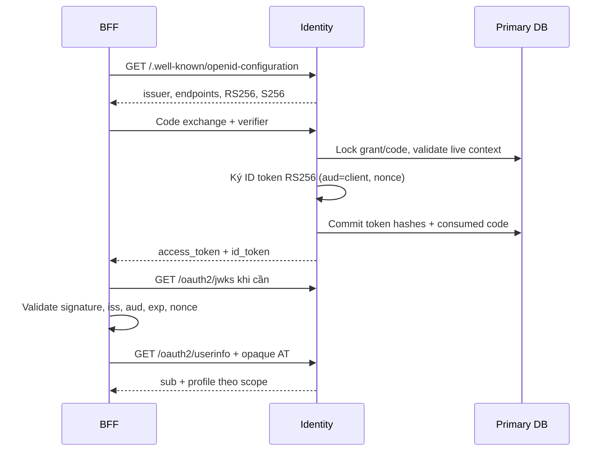

# 07 — Tự xây OpenID Connect: ID token, Discovery, JWKS, UserInfo

[Trước: OAuth Code + PKCE](06-oauth-authorization-code.md) · [Mục lục](../../README.md) · [Tiếp: vòng đời token](08-token-lifecycle-introspection.md)

Bạn đã có OAuth authorization server, nhưng access token không tự biến nó thành identity provider. Trong bài này, bạn thêm một hợp đồng để ứng dụng biết **người nào đã được xác thực, bởi issuer nào, cho client nào, vào lúc nào**. Hoàn tất chương 06 và đọc [protocol profile](../reference/protocol-support.md) trước khi bắt đầu. Files bạn tạo nằm trong `lab/services/identity/`; `jose` là thư viện primitive JOSE, còn endpoint và state machine OIDC do bạn viết.

Tất cả response dưới đây là ví dụ kỳ vọng; repository tài liệu không chứa một IdP đã chạy. Không gọi hệ thống là “OpenID Certified” sau khi chỉ thấy JWT decode được. [OIDC Core](https://openid.net/specs/openid-connect-core-1_0.html) và [Discovery](https://openid.net/specs/openid-connect-discovery-1_0.html) là chuẩn cần đối chiếu trong quá trình làm.

## 1. Access token và ID token phục vụ hai bên khác nhau

ID token có audience là `web-a` hoặc `web-b`. Nó chứng minh authentication cho relying party đó. Access token của lab là opaque, có audience nghiệp vụ `invoice-api`, và API hỏi IAM tình trạng hiện tại bằng introspection. API không nhận ID token dù signature đúng. BFF không coi JWT do browser gửi tới là access token rồi tự suy ra quyền. Tách loại token giúp loại bỏ confusion khi một issuer phát nhiều kiểu assertion.

Trong profile này `sub` là UUID account bất biến trong issuer; email chỉ là claim có thể đổi. Danh tính federated trong tương lai dùng cặp `(iss, sub)` để liên kết; cùng email không đủ chứng minh hai account là một. Account global có thể thuộc Acme và Beta; ID token chứa `org_id` cho context đã chọn, nhưng authorization vẫn dùng current membership và resource context tại API.



Không đặt password, recovery code, roles toàn bộ, group lớn hoặc dữ liệu cá nhân không cần thiết vào ID token. JWT ký chỉ bảo vệ integrity; nội dung vẫn đọc được. `jti` là ID của assertion, không phải credential dùng thay bearer access token.

## 2. Sinh khóa riêng local, công bố khóa công khai

Chạy:

```powershell
pnpm -C lab --filter @iam/identity add jose
New-Item -ItemType Directory -Force lab/.secrets/signing | Out-Null
New-Item -ItemType Directory -Force lab/services/identity/scripts | Out-Null
$env:SIGNING_KEY_DIR = (Resolve-Path lab/.secrets/signing).Path
```

`lab/.secrets/` phải nằm trong `.gitignore` chương 03. Dùng ACL cho tài khoản phát triển; production thay secret file bằng secret manager/HSM theo chương 10. Không đặt private key trong PostgreSQL `public_jwk` hoặc Helm values.

Tạo `scripts/init-signing-key.ts`:

```ts
import { randomUUID } from 'node:crypto';
import { writeFile, unlink } from 'node:fs/promises';
import { join } from 'node:path';
import { generateKeyPair, exportJWK, exportPKCS8 } from 'jose';
import { Pool } from 'pg';

const directory = process.env.SIGNING_KEY_DIR;
const operatorUrl=process.env.KEY_OPERATOR_DATABASE_URL;
if (!directory||!operatorUrl) throw new Error('SIGNING_KEY_DIR and KEY_OPERATOR_DATABASE_URL required');
const pool=new Pool({connectionString:operatorUrl,max:1});
const kid = randomUUID(); const filename = `${kid}.pem`;
const { publicKey, privateKey } = await generateKeyPair('RS256', { modulusLength: 3072, extractable: true });
const publicJwk = { ...(await exportJWK(publicKey)), kid, use: 'sig', alg: 'RS256' };
const privatePath = join(directory, filename);
await writeFile(privatePath, await exportPKCS8(privateKey), { flag: 'wx', mode: 0o600 });
try {
  // Một INSERT atomic; unique index chống hai init chạy đồng thời.
  await pool.query(`INSERT INTO signing_keys(kid,status,public_jwk,private_ref)
    VALUES($1,'active',$2,$3)`, [kid,publicJwk,filename]);
  console.log(JSON.stringify({ kid, status: 'active' })); // không log PEM
} catch (error) { await unlink(privatePath); throw error; }
finally { await pool.end(); }
```

```powershell
$env:KEY_OPERATOR_DATABASE_URL=((Get-Content -Encoding utf8 lab/services/identity/.env | Where-Object {$_ -like 'MIGRATION_DATABASE_URL=*'}) -split '=',2)[1]
pnpm -C lab --filter @iam/identity exec node --env-file=.env --import tsx scripts/init-signing-key.ts
```

Runtime role `identity_app` chỉ đọc signing_keys theo chương 04; operator script dùng credential riêng có quyền quản lý key registry. Ví dụ local dùng migration credential, production cấp operator role hẹp và chạy ngoài app pod. `.env` phải được load tường minh; `tsx` đơn thuần không tự load env file.

Kết quả minh họa: `{"kid":"generated-uuid","status":"active"}`. Script khởi tạo chạy một lần trên DB trống phần keys; chạy lại cố ý lỗi unique index. Chương 10 dùng prepublish/activate/retire thay vì phá index hoặc xóa khóa cũ.

## 3. Ký ID token trong transaction của code exchange

Tạo `src/oauth/oidc.ts`. `importPKCS8` thực hiện parsing key chuẩn; không tự viết RSA padding hoặc base64url JWT signature.

```ts
import { readFile } from 'node:fs/promises';
import { join } from 'node:path';
import { randomUUID } from 'node:crypto';
import { SignJWT, importPKCS8, type JWK } from 'jose';
import type { PoolClient } from 'pg';
import { ISSUER } from './common.js';
import { AppError } from '../errors.js';

export interface IdTokenInput {
  userId: string; clientId: string; orgId: string; sessionId: string;
  nonce: string | null; authTime: Date;
}
export async function makeIdToken(db: PoolClient, input: IdTokenInput): Promise<string> {
  const keys = await db.query<{ kid: string; private_ref: string; public_jwk: JWK }>(
    `SELECT kid,private_ref,public_jwk FROM signing_keys
     WHERE status='active' AND not_before<=clock_timestamp() FOR SHARE`);
  const k = keys.rows[0];
  if (!k || !process.env.SIGNING_KEY_DIR || !/^[a-f0-9-]+\.pem$/i.test(k.private_ref)) {
    throw new AppError(503,'signer_unavailable');
  }
  const session = await db.query<{ amr: string[]; acr: string }>(
    'SELECT amr,acr FROM sessions WHERE id=$1', [input.sessionId]);
  if (!session.rows[0]) throw new Error('Session vanished');
  let key: Awaited<ReturnType<typeof importPKCS8>>;
  try {
    const pem = await readFile(join(process.env.SIGNING_KEY_DIR,k.private_ref), 'utf8');
    key = await importPKCS8(pem,'RS256');
  } catch { throw new AppError(503,'signer_unavailable'); }
  const claims = { org_id: input.orgId, sid: input.sessionId,
    auth_time: Math.floor(input.authTime.getTime()/1000),
    amr: session.rows[0].amr, acr: session.rows[0].acr,
    ...(input.nonce !== null ? { nonce: input.nonce } : {}) };
  return new SignJWT(claims).setProtectedHeader({ alg: 'RS256', kid: k.kid, typ: 'JWT' })
    .setIssuer(ISSUER).setSubject(input.userId).setAudience(input.clientId)
    .setIssuedAt().setExpirationTime('5m').setJti(randomUUID()).sign(key);
}
```

Ở `exchangeCode` chương 06, **trước return của callback transaction**, thêm:

```ts
// Thêm import { makeIdToken } from './oidc.js' ở đầu oauth/code.ts.
const idToken = g.scope.includes('openid') ? await makeIdToken(db, {
  userId: g.user_id, clientId: g.client_id, orgId: g.org_id,
  sessionId: g.session_id, nonce: c.nonce, authTime: c.auth_time
}) : undefined;
// Thêm ...(idToken ? { id_token: idToken } : {}) vào response đã có.
```

Nếu signer lỗi, transaction rollback, không consume code mà không có token response. Nếu network chết sau commit, delivery vẫn có thể mất; browser cần đăng nhập lại theo chương 06. Không gọi HTTP KMS chậm không timeout trong transaction production; signer adapter có timeout ngắn và capacity budget, readiness kiểm tra key, warm key material nếu backend cho phép. Caching private key theo `kid` có thể thực hiện; key selection active cần nhất quán sau rotation. Đây không phải cache authentication state.

`nonce` phải là giá trị đã lưu cùng code; không nhận nonce mới ở token request. `auth_time` là thời điểm user thực sự authenticate, không phải thời điểm token được phát. `iat` là thời điểm assertion mới phát. Với code flow thuần, profile không phát `at_hash`/`c_hash` trong ID token; nếu mở hybrid sau này, phải bổ sung validation/claims tương ứng thay vì dùng logic này nguyên vẹn.

## 4. Discovery và JWKS đúng với feature đã làm

Tạo `src/oauth/metadata.ts` và mount router trước generic error handler:

```ts
import { Router } from 'express';
import { pool } from '../db.js';
import { ISSUER } from './common.js';

export const metadataRouter = Router();
const discovery = {
  issuer: ISSUER,
  authorization_endpoint: `${ISSUER}/oauth2/authorize`,
  token_endpoint: `${ISSUER}/oauth2/token`,
  userinfo_endpoint: `${ISSUER}/oauth2/userinfo`,
  jwks_uri: `${ISSUER}/oauth2/jwks`,
  response_types_supported: ['code'], response_modes_supported: ['query'],
  grant_types_supported: ['authorization_code'],
  subject_types_supported: ['public'], id_token_signing_alg_values_supported: ['RS256'],
  token_endpoint_auth_methods_supported: ['client_secret_basic','none'],
  scopes_supported: ['openid','profile','email','offline_access','invoice.read','invoice.write'],
  claims_supported: ['iss','sub','aud','iat','exp','auth_time','nonce','sid','amr','acr','org_id','email','email_verified'],
  code_challenge_methods_supported: ['S256'],
  authorization_response_iss_parameter_supported: true,
};
metadataRouter.get('/.well-known/openid-configuration', (_req,res) => {
  res.set('Cache-Control','public, max-age=60').json(discovery);
});
metadataRouter.get('/.well-known/oauth-authorization-server', (_req,res) => {
  // issuer có root path nên hai well-known paths không có bài toán path insertion.
  res.set('Cache-Control','public, max-age=60').json(discovery);
});
metadataRouter.get('/oauth2/jwks', async (_req,res) => {
  const r = await pool.query<{ public_jwk: Record<string,unknown> }>(
    `SELECT public_jwk FROM signing_keys WHERE status IN ('prepublished','active','retiring')`);
  const forbidden = ['d','p','q','dp','dq','qi','oth','k'];
  if (r.rows.some(row => forbidden.some(field => field in row.public_jwk))) {
    throw new Error('Private key material in public key registry');
  }
  res.set('Cache-Control','public, max-age=60').json({ keys: r.rows.map(row=>row.public_jwk) });
});
```

Ở chương 08, mở rộng `grant_types_supported` bằng `refresh_token`, `client_credentials` và thêm `introspection_endpoint`, `revocation_endpoint`; chỉ quảng bá sau khi tests của endpoints đó chạy. Chương 09 mới thêm `end_session_endpoint`; đừng thêm `backchannel_logout_supported` trước khi triển khai worker và relying-party handlers đầy đủ.

Tên scopes ở discovery là khả năng server, không có nghĩa mọi client đều được cấp mọi scope. Public client support chỉ được quảng bá nếu bạn đã làm client `none` đầy đủ và kiểm tra; baseline BFF vẫn confidential. Với deployment chỉ có confidential client, xóa `none` khỏi metadata thay vì tạo test exception.

## 5. UserInfo và tính đúng của subject

UserInfo của lab nhận access token user-bound có `openid` trong grant; chấp nhận profile audience `invoice-api` vì token này đã được cấp đồng thời cho UserInfo của chính issuer. Đây là hợp đồng cụ thể của lab, không cho phép API khác chấp nhận token audience tùy ý. Không tạo mảng audience khác với cột `audience text` trong schema. Khi mở nhiều resource, thiết kế resource indicators và token riêng trước.

Từ chương 08 dùng hàm `inspectAccessToken` cùng current-state query; không copy một query yếu hơn chỉ check `expires_at`. Trong chương này hãy tạo handler sau khi bạn hoàn thành helper đó, hoặc tạm dừng UserInfo test tới chương tiếp. Tạo `src/oauth/userinfo.ts`:

```ts
import { Router, text } from 'express';
import { pool } from '../db.js';
import { fields, ProtocolError } from './common.js';
import { inspectAccessToken } from './introspection.js'; // định nghĩa đầy đủ ở chương 08

export const userinfoRouter = Router();
userinfoRouter.route('/oauth2/userinfo')
  .get(handler)
  .post(text({ type:'application/x-www-form-urlencoded',limit:'8kb' }),handler);
async function handler(req: import('express').Request,res: import('express').Response) {
  const auth = req.get('authorization');
  const form = req.method==='POST' && typeof req.body==='string' ? fields(req.body) : undefined;
  if (auth && form?.has('access_token')) throw new ProtocolError('invalid_request');
  const raw = auth?.match(/^Bearer ([A-Za-z0-9_-]{43})$/)?.[1] ?? form?.get('access_token');
  if (!raw) { res.set('WWW-Authenticate','Bearer error="invalid_token"'); return res.sendStatus(401); }
  const token = await inspectAccessToken(raw,['invoice-api']);
  if (!token.active || !token.scope.split(' ').includes('openid') || token.sub.startsWith('client:')) {
    res.set('WWW-Authenticate','Bearer error="invalid_token"'); return res.sendStatus(401);
  }
  const user = await pool.query<{ email:string; email_verified_at:Date|null }>(
    'SELECT email,email_verified_at FROM users WHERE id=$1',[token.sub]);
  if (!user.rows[0]) return res.sendStatus(401);
  const granted = new Set(token.scope.split(' '));
  const body = { sub:token.sub, ...(granted.has('email') ? {
    email:user.rows[0].email,email_verified:user.rows[0].email_verified_at!==null
  } : {}) };
  res.set('Cache-Control','no-store').json(body);
}
```

Không đặt access token trong query URI. BFF chương 09 dùng Authorization header. POST form là lựa chọn interoperability; parser vẫn từ chối nhiều bearer mechanisms. `profile` chưa có các field như name/picture trong schema nên không bịa giá trị. BFF phải kiểm tra `UserInfo.sub === IDToken.sub`; khác nhau là lỗi, không merge profile theo email.

## 6. Các tham số xác thực cần hoàn thành

Trong authorize validation, `prompt` là danh sách token cách nhau bởi space: baseline nhận `none`, `login`, `consent`, `select_account`. `none` không được kết hợp token khác. `prompt=none` không có session phù hợp → callback `login_required`; thiếu consent/organization choice → `consent_required` hoặc `interaction_required`, không mở UI. `prompt=login` buộc reauthentication; `prompt=consent` phải hiển thị consent kể cả consent cũ. `select_account` cho phép chọn lại account theo UI; chưa hỗ trợ nhiều account cookie thì cho logout/login rõ ràng, không giả chọn account mới mà giữ subject cũ.

`max_age` là số nguyên giây không âm, giới hạn parse hợp lý; nếu `now - authenticated_at > max_age`, yêu cầu reauthentication. `max_age=0` yêu cầu xác thực lại, không chỉ copy timestamp mới vào session. Session mới có `authenticated_at` thực; code lưu thời điểm đó. Khi `max_age` có mặt, ID token trả `auth_time`. Flow bình thường của lab luôn trả `auth_time` để dễ quan sát.

`acr_values`/claims request nâng cao chưa được metadata cam kết. Trước production, khóa supported set và xử lý đúng required claims; không claim đáp ứng AAL2 nếu chỉ có password. `amr=['pwd']` phản ánh password; chương 10 mới thêm `hwk`/`swk` theo loại authenticator và `mfa` khi đủ điều kiện.

## 7. Chạy kiểm tra và làm hỏng có chủ đích

```powershell
$metadata = Invoke-RestMethod 'https://iam.local.test:8443/.well-known/openid-configuration'
if ($metadata.issuer -cne 'https://iam.local.test:8443') { throw 'issuer mismatch' }
$jwks = Invoke-RestMethod $metadata.jwks_uri
$jwks.keys | Select-Object kid,kty,alg,use
if ($jwks.keys | Where-Object { $_.PSObject.Properties.Name -contains 'd' }) { throw 'private key leak' }
pnpm -C lab --filter @iam/identity typecheck
```

Kết quả kỳ vọng là public RSA key `kty=RSA`, `alg=RS256`, có `kid`; không có `d/p/q`. Đừng xác minh signature bằng cách chỉ decode JWT. Test TypeScript dùng `createRemoteJWKSet(new URL(jwks_uri))` và `jwtVerify(idToken,jwks,{issuer:ISSUER,audience:'web-a',algorithms:['RS256']})`; sau đó kiểm nonce bằng expected transaction value. Thư viện OIDC client ở chương 09 thực hiện protocol checks đầy đủ hơn helper JWT riêng.

Tạo test với ID token ký bằng test key nhưng sai `aud`, sai `iss`, expired, future `nbf`, nonce sai; client phải từ chối. Test `alg=none`, `HS256`, `kid` lạ và modified signature cũng từ chối. Không fetch URL `jku` hoặc `x5u` trong token do attacker gửi; verifier chỉ dùng discovery/JWKS của issuer cấu hình sẵn, có giới hạn refresh khi unknown kid.

Failure lab: tạm đổi private_ref trong DB sang file không tồn tại rồi exchange code mới. Kỳ vọng `503` từ generic infrastructure mapping, không ID token thiếu signature hoặc access token response thành công một nửa. Sửa lại, kiểm tra code chưa bị consume vì transaction rollback. Không test bằng sửa private key thật trong production. Tiếp theo publish key công khai mà không có private key tương ứng: server readiness phải đỏ nếu đó là active key, trong khi discovery/JWKS public vẫn có thể được serve.

Test prompt/max_age bằng hai browser profiles và đồng hồ test inject được; không đổi clock hệ điều hành đang chạy các service khác. `auth_time` không được tăng khi chỉ refresh. UserInfo token của Bob và ID token Alice phải khiến BFF từ chối ghép profile. Membership suspend sau issue làm UserInfo thất bại qua current-state check chương 08.

Troubleshooting: `unexpected JWT claim value` kiểm tra issuer trailing slash/audience client; `no applicable key` kiểm `kid`, JWKS cache và key đã publish; `unable to verify first certificate` kiểm Node CA store. JWKS có public key đúng không chứng minh private key ứng với nó, nên script init phải derive cả hai từ cùng keypair. Không sửa lỗi bằng cho phép mọi algorithm hoặc skip issuer check.

## Definition of Done

- OIDC scope `openid` làm code exchange trả ID token RS256 đúng user/client/nonce/auth_time; OAuth flow không có openid không bị biến thành OIDC ngầm.
- Discovery và JWKS đúng issuer, chỉ quảng bá capabilities thực tế, không lộ private material.
- UserInfo dùng live token context và chỉ trả claim theo scope; BFF kiểm subject equality.
- Prompt, max_age và authentication evidence được triển khai/test, không chỉ lưu parameter rồi bỏ qua.
- Kết quả từ client độc lập và negative crypto tests được lưu; hoàn tất [vòng đời token](08-token-lifecycle-introspection.md) trước end-to-end UserInfo.

Nền tảng JWT validation: [RFC 8725](https://www.rfc-editor.org/rfc/rfc8725.html). Cách dùng primitive: [jose documentation](https://github.com/panva/jose). Conformance là bước riêng được hướng dẫn tại [OIDC conformance](../reference/oidc-conformance.md).
