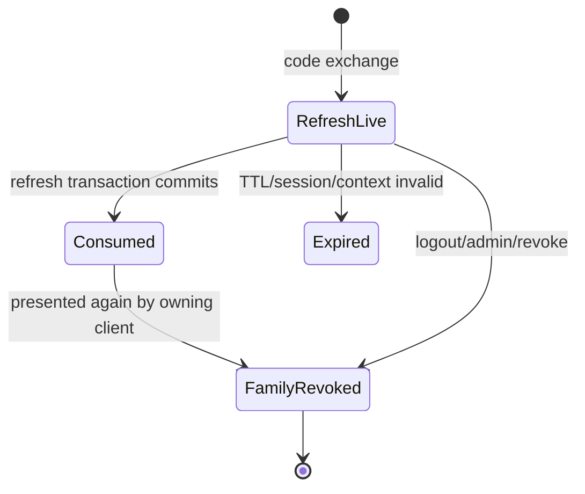

# 08 — Refresh rotation, introspection và thu hồi có hiệu lực

[Trước: OIDC](07-openid-connect.md) · [Mục lục](../../README.md) · [Tiếp: tích hợp SSO](09-sso-integration.md)

Bài này hoàn thành phần quan trọng nhất của opaque access token: **API hỏi trạng thái hiện tại ở mỗi request**, và thu hồi đã commit phải được lần kiểm tra sau quan sát. Điều kiện: schema Identity, `withTransaction`, helpers OAuth chương 06, ID token chương 07. Tạo các module dưới `lab/services/identity/src/oauth/`. API business và Policy vẫn nằm ngoài Identity; token hợp lệ không có nghĩa hành động được phép.

Refresh token không phải password thay thế và không được phát mặc định cho mọi client. Trong profile lab, grant sống tối đa 30 ngày nhưng còn bị chặn bởi session tuyệt đối 12 giờ, membership, organization, app assignment và client hiện hành. Vì thế refresh thường hết khả năng sử dụng trước absolute grant TTL. Đây là policy có chủ đích; `offline_access` không bỏ mọi kiểm soát trạng thái. Khi cần background delegation lâu hơn, thiết kế consent/session policy riêng và test độc lập.

## 1. Trạng thái và transaction boundary



Một family tương ứng `oauth_grants.id`. Token cũ đã consumed vẫn giữ hash tới hết absolute lifetime cộng thời gian cleanup phù hợp. Nếu xóa ngay token consumed, hệ thống chỉ thấy “không biết token này” và mất bằng chứng reuse. `parent_hash UNIQUE` cho refresh successor thêm một lớp invariant ở database; nó không thay transaction lock.

Thứ tự lock thống nhất: tìm artifact để biết `grant_id`, lock grant, lock artifact, kiểm tra lại, mutate, commit. Không giữ transaction khi gọi Policy, gửi email hoặc chờ browser. Thu hồi do reuse phải **return một outcome từ callback**, commit transaction, sau đó mới throw `ProtocolError`. Throw ngay sau `UPDATE revoked_at` bên trong `withTransaction` sẽ rollback chính biện pháp bảo vệ vừa thực hiện.

## 2. Triển khai refresh rotation

Tạo `oauth/refresh.ts`:

```ts
import { withTransaction } from '../db.js';
import { newOpaqueToken, hashToken } from '../security.js';
import { liveUser, required, scopes, ProtocolError, type OAuthClient } from './common.js';

export async function refreshGrant(client: OAuthClient,p: URLSearchParams) {
  const raw = required(p,'refresh_token'); const oldHash = hashToken(raw);
  const result = await withTransaction(async db => {
    const lookup = await db.query(`SELECT grant_id FROM oauth_tokens WHERE token_hash=$1 AND kind='refresh'`,[oldHash]);
    if (!lookup.rows[0]) return { error:'invalid_grant' } as const;
    const gr = await db.query(`SELECT *,absolute_expires_at>clock_timestamp() AS fresh
      FROM oauth_grants WHERE id=$1 FOR UPDATE`,[lookup.rows[0].grant_id]);
    const tr = await db.query(`SELECT *,expires_at>clock_timestamp() AS fresh
      FROM oauth_tokens WHERE token_hash=$1 FOR UPDATE`,[oldHash]);
    const g=gr.rows[0], t=tr.rows[0];
    if (!g || !t || g.client_id!==client.id || t.kind!=='refresh') return { error:'invalid_grant' } as const;
    if (t.consumed_at) {
      await db.query(`UPDATE oauth_grants SET revoked_at=COALESCE(revoked_at,clock_timestamp()) WHERE id=$1`,[g.id]);
      return { error:'invalid_grant' } as const; // caller throw SAU khi withTransaction commit
    }
    if (!g.fresh || !t.fresh || g.revoked_at || t.revoked_at || !g.user_id ||
        !(await liveUser(db,g))) return { error:'invalid_grant' } as const;
    if (!g.scope.every((s:string)=>client.allowed_scopes.includes(s)) ||
        !client.allowed_audiences.includes(g.audience)) return { error:'invalid_grant' } as const;
    if (p.has('org_id') || p.has('resource') || p.has('audience')) return { error:'invalid_request' } as const;
    const nextScopes = p.has('scope') ? scopes(required(p,'scope')) : g.scope as string[];
    if (nextScopes.some(s=>!g.scope.includes(s))) return { error:'invalid_scope' } as const;
    // Profile lưu scope ở grant: narrowing áp dụng cho cả token cùng family.
    await db.query('UPDATE oauth_grants SET scope=$2 WHERE id=$1',[g.id,nextScopes]);
    await db.query('UPDATE oauth_tokens SET consumed_at=clock_timestamp() WHERE token_hash=$1',[oldHash]);
    const access=newOpaqueToken(), refresh=newOpaqueToken();
    const a=await db.query(`INSERT INTO oauth_tokens(token_hash,kind,grant_id,expires_at)
      VALUES($1,'access',$2,LEAST(clock_timestamp()+interval '5 minutes',$3))
      RETURNING EXTRACT(EPOCH FROM expires_at-issued_at)::integer AS ttl`,[hashToken(access),g.id,g.absolute_expires_at]);
    await db.query(`INSERT INTO oauth_tokens(token_hash,kind,grant_id,expires_at,parent_hash)
      VALUES($1,'refresh',$2,$3,$4)`,[hashToken(refresh),g.id,g.absolute_expires_at,oldHash]);
    return { access_token:access,refresh_token:refresh,token_type:'Bearer',
      expires_in:a.rows[0]!.ttl,scope:nextScopes.join(' ') };
  });
  if ('error' in result) throw new ProtocolError(result.error);
  return result;
}
```

Response refresh không phát ID token mới trong baseline; OIDC cho phép response refresh thiếu ID token. BFF giữ authentication assertion ban đầu nhưng không dùng nó để authorize API. Nếu thêm ID token khi refresh, nonce/auth_time phải theo OIDC refresh rules, không giả người dùng vừa MFA lại.

Narrowing ở đây là policy family-wide: request refresh scope nhỏ hơn làm mọi access token trong family introspect với quyền nhỏ hơn. Không cho widen trở lại. Vì `oauth_tokens` chưa có scope riêng, không giả rằng mỗi token mang snapshot scope khác nhau. Nếu sản phẩm cần per-token scopes, migration thêm column và sửa introspection/rotation cùng test. Không nhận đổi organization từ refresh request.

## 3. Query introspection từ current state

Tạo `oauth/introspection.ts`. Hàm này là nền cho endpoint introspection và UserInfo, không gọi Policy. `allowedAudiences` là quyền của caller resource server từ registration, không phải input browser.

```ts
import { pool } from '../db.js';
import { hashToken } from '../security.js';
import { ISSUER } from './common.js';

export interface ActiveToken {
  active:true; sub:string; client_id:string; org_id:string|null; scope:string;
  aud:string; iss:string; token_type:'Bearer'; sid:string|null;
  groups:string[]; amr:string[]; acr:string|null; auth_time:number|null; iat:number; exp:number;
}
export type TokenInspection = ActiveToken | { active:false };

export async function inspectAccessToken(raw:string,allowedAudiences:string[]):Promise<TokenInspection> {
  if (!/^[A-Za-z0-9_-]{43}$/.test(raw)) return {active:false};
  const r=await pool.query(`SELECT
      CASE WHEN g.user_id IS NULL THEN 'client:'||g.client_id ELSE g.user_id::text END AS sub,
      g.client_id,g.org_id,g.scope,g.audience AS aud,g.session_id AS sid,
      COALESCE(s.amr,'{}'::text[]) AS amr,s.acr,
      EXTRACT(EPOCH FROM s.authenticated_at)::bigint AS auth_time,
      EXTRACT(EPOCH FROM t.issued_at)::bigint AS iat,
      EXTRACT(EPOCH FROM LEAST(t.expires_at,g.absolute_expires_at))::bigint AS exp,
      ARRAY(SELECT gm.group_id::text FROM group_members gm
        WHERE gm.user_id=g.user_id AND gm.org_id=g.org_id ORDER BY gm.group_id) AS groups
    FROM oauth_tokens t JOIN oauth_grants g ON g.id=t.grant_id
    JOIN clients c ON c.id=g.client_id
    LEFT JOIN users u ON u.id=g.user_id
    LEFT JOIN sessions s ON s.id=g.session_id AND s.user_id=g.user_id
    LEFT JOIN memberships m ON m.user_id=g.user_id AND m.org_id=g.org_id
    LEFT JOIN organizations o ON o.id=g.org_id
    LEFT JOIN app_assignments aa ON aa.org_id=g.org_id AND aa.client_id=g.client_id
    WHERE t.token_hash=$1 AND t.kind='access' AND t.revoked_at IS NULL
      AND t.expires_at>clock_timestamp() AND g.revoked_at IS NULL
      AND g.absolute_expires_at>clock_timestamp() AND c.status='active'
      AND g.audience=ANY($2::text[]) AND g.audience=ANY(c.allowed_audiences)
      AND g.scope <@ c.allowed_scopes
      AND ((g.user_id IS NOT NULL AND u.status='active'
        AND s.revoked_at IS NULL AND s.expires_at>clock_timestamp()
        AND m.status='active' AND o.status='active' AND aa.status='active')
       OR (g.user_id IS NULL AND g.session_id IS NULL
        AND g.org_id IS NOT DISTINCT FROM c.service_org_id
        AND (g.org_id IS NULL OR (o.status='active' AND aa.status='active'))))` , [hashToken(raw),allowedAudiences]);
  const row=r.rows[0];
  if (!row) return {active:false};
  return {active:true,sub:row.sub,client_id:row.client_id,org_id:row.org_id,
    scope:row.scope.join(' '),aud:row.aud,iss:ISSUER,token_type:'Bearer',
    sid:row.sid,groups:row.groups,amr:row.amr,acr:row.acr,
    auth_time:row.auth_time===null?null:Number(row.auth_time),iat:Number(row.iat),exp:Number(row.exp)};
}
```

Một query primary cho snapshot nhất quán ở thời điểm statement. Không dùng read replica lag để kiểm tra revoke tức thời; không lấy groups từ event projection trễ rồi gọi là current state. Lần kiểm tra bắt đầu sau committed mutation phải thấy trạng thái mới. Một business request đã vượt kiểm tra trước revoke có thể đang chạy; đây không phải distributed transaction bao trùm mọi request. Tài liệu sản phẩm phải diễn đạt ranh giới này chính xác.

Endpoint wiring:

```ts
import { Router,text } from 'express';
import { authenticateClient,fields,required,ProtocolError } from './common.js';
import { inspectAccessToken } from './introspection.js';
export const statusRouter=Router();
statusRouter.post('/oauth2/introspect',text({type:'application/x-www-form-urlencoded',limit:'8kb'}),async(req,res)=>{
  if(typeof req.body!=='string')throw new ProtocolError('invalid_request');
  const p=fields(req.body);const caller=await authenticateClient(req,p);
  if(caller.kind!=='confidential')throw new ProtocolError('invalid_client',401);
  const result=await inspectAccessToken(required(p,'token'),caller.introspection_audiences);
  res.set('Cache-Control','no-store').json(result);
});
```

Unknown/inactive token hoặc ngoài quyền introspect → `200 {"active":false}`. Caller credential sai → `401 invalid_client`. DB lỗi → `503`, **không** `active:false`, vì IAM chưa biết token có valid không. Scope trong token response là chuỗi space-delimited; internal DB là `text[]`. Kết quả active có current groups và session evidence `amr`, `acr`, `auth_time`; machine token dùng `[]`, `null`, `null`. Không nhúng role do Authorization service sở hữu hoặc suy ra MFA từ chữ ký ID token cũ.

## 4. Revocation và client credentials

Tạo `oauth/revoke.ts`:

```ts
import { withTransaction } from '../db.js';
import { hashToken } from '../security.js';
export async function revokeToken(clientId:string,raw:string):Promise<void> {
  await withTransaction(async db=>{
    const lookup=await db.query('SELECT grant_id FROM oauth_tokens WHERE token_hash=$1',[hashToken(raw)]);
    if(!lookup.rows[0])return;
    const gr=await db.query('SELECT * FROM oauth_grants WHERE id=$1 FOR UPDATE',[lookup.rows[0].grant_id]);
    if(gr.rows[0]?.client_id!==clientId)return; // không tiết lộ token thuộc client nào
    // Policy profile: revoke cả family khi revoke bất kỳ token của family.
    await db.query('UPDATE oauth_grants SET revoked_at=COALESCE(revoked_at,clock_timestamp()) WHERE id=$1',[gr.rows[0].id]);
  });
}
```

Mount POST form endpoint, parse bằng `fields`, authenticate confidential client, lấy `token`, gọi hàm trên, trả `200` body rỗng và no-store. `token_type_hint` là hint; không chỉ lookup access khi hint nói access rồi bỏ qua refresh hợp lệ. Unknown token vẫn `200` giúp giảm token-existence oracle. Public-client revocation chưa được baseline cam kết; đừng quảng bá nó nếu chưa có binding/abuse policy.

`client_credentials` không có user/session và không trả refresh/ID token. Tạo `oauth/machine.ts`; helper nhận `OAuthClient` đã authenticate và form đã parse:

```ts
import { withTransaction } from '../db.js';
import { newOpaqueToken,hashToken } from '../security.js';
import { required,scopes,ProtocolError,type OAuthClient } from './common.js';
export async function clientCredentials(client:OAuthClient,p:URLSearchParams) {
  if(client.kind!=='confidential')throw new ProtocolError('unauthorized_client');
  const requested=scopes(required(p,'scope'));const audience=required(p,'audience');
  if(requested.some(s=>!client.allowed_scopes.includes(s)||['openid','offline_access'].includes(s)))throw new ProtocolError('invalid_scope');
  if(!client.allowed_audiences.includes(audience))throw new ProtocolError('invalid_target');
  if(p.has('org_id')||p.has('resource')||p.has('subject_token'))throw new ProtocolError('invalid_request');
  return withTransaction(async db=>{
    const current=await db.query(`SELECT c.id FROM clients c LEFT JOIN organizations o ON o.id=c.service_org_id
      WHERE c.id=$1 AND c.status='active' AND (c.service_org_id IS NULL OR (o.status='active'
       AND EXISTS(SELECT 1 FROM app_assignments a WHERE a.org_id=c.service_org_id
        AND a.client_id=c.id AND a.status='active'))) FOR SHARE OF c`,[client.id]);
    if(!current.rows[0])throw new ProtocolError('invalid_client',401);
    const g=await db.query(`INSERT INTO oauth_grants(client_id,org_id,scope,audience,absolute_expires_at)
      VALUES($1,$2,$3,$4,clock_timestamp()+interval '5 minutes') RETURNING id`,
      [client.id,client.service_org_id,requested,audience]);
    const raw=newOpaqueToken();
    await db.query(`INSERT INTO oauth_tokens(token_hash,kind,grant_id,expires_at)
      VALUES($1,'access',$2,clock_timestamp()+interval '5 minutes')`,[hashToken(raw),g.rows[0]!.id]);
    return {access_token:raw,token_type:'Bearer',expires_in:300,scope:requested.join(' ')};
  });
}
```

Wire grant dispatcher chương 06 bằng switch: `authorization_code → exchangeCode`, `refresh_token → refreshGrant`, `client_credentials → clientCredentials`; trước switch đã kiểm `client.grant_types`. `audience` là extension parameter nội bộ của profile lab, không tự nhận đã hỗ trợ RFC 8707 resource indicators. Machine subject introspection là `client:<id>`; org lấy từ `service_org_id`, tuyệt đối không từ request body. Machine app assignment bị disable cũng làm token inactive. Chương workload identity sau nâng client auth lên private-key JWT/federation; đừng dùng secret hardcode giữa microservices.

Cập nhật discovery khi endpoints đã chạy: `grant_types_supported`, `introspection_endpoint`, `revocation_endpoint`; auth methods vẫn chỉ quảng bá các method hiện thực. Token response và protected response đều no-store. Không cache allow hoặc active introspection giữa requests trong baseline, kể cả khi cache TTL chỉ một giây.

## 5. Tự gọi endpoint bằng PowerShell

Giữ token trong memory, không in ra console:

```powershell
$apiBasic=[Convert]::ToBase64String([Text.Encoding]::UTF8.GetBytes('invoice-api:'+$env:INVOICE_API_CLIENT_SECRET))
$status=Invoke-RestMethod -Method Post -Uri 'https://iam.local.test:8443/oauth2/introspect' -Headers @{Authorization="Basic $apiBasic"} -ContentType 'application/x-www-form-urlencoded' -Body @{token=$tokens.access_token}
$status | Select-Object active,sub,org_id,aud,scope
$rotated=Invoke-RestMethod -Method Post -Uri 'https://iam.local.test:8443/oauth2/token' -Headers @{Authorization="Basic $basic"} -ContentType 'application/x-www-form-urlencoded' -Body @{grant_type='refresh_token';refresh_token=$tokens.refresh_token}
Invoke-WebRequest -Method Post -Uri 'https://iam.local.test:8443/oauth2/revoke' -Headers @{Authorization="Basic $basic"} -ContentType 'application/x-www-form-urlencoded' -Body @{token=$rotated.refresh_token} | Select-Object StatusCode
```

Kỳ vọng minh họa: trước revoke `active=True`, audience invoice-api; revoke `200`; introspect lại token cũ/mới đều `active=False`. Nếu caller `invoice-api` không có introspection_audiences chứa invoice-api thì đúng là inactive cho caller đó; sửa registration bằng migration/admin owner, không bỏ audience enforcement.

## 6. Kiểm tra đồng thời và failure injection

Tạo fixture một refresh family mới. Gửi 20 refresh requests song song, chia đều qua hai Identity replicas chung DB. Thu outcome bằng `Promise.allSettled`, không log response tokens. Assert tối đa một `200`; ít nhất một reuse detection; grant revoked đã commit; mọi access token nhận được không active khi tất cả request kết thúc. Unique successor count theo parent_hash tối đa một. Test này phải chạy với hai pool/process, không chỉ hai promises cùng connection.

Test reuse **tuần tự** riêng để bắt rollback bug: refresh một lần thành công; dùng old refresh lần hai; endpoint `400 invalid_grant`; mở connection mới đọc `oauth_grants.revoked_at IS NOT NULL`; introspect access winner false. Nếu revoke chỉ thấy trong transaction đầu mà connection mới thấy null, test phải fail. Không mock `withTransaction` thành callback trực tiếp: mock đó che lỗi rollback.

Test expiry, grant revoked, session revoked/expired, user suspended, org suspended, membership removed, app disabled, client disabled, allowed scope bị giảm, wrong audience và caller credentials sai. Mỗi case mutation commit trước request kiểm tra. UserInfo phải có cùng kết quả trạng thái; API `401` token invalid, `403` policy deny, `503` dependency lỗi. Test token dạng ID JWT được introspect không active.

Failure lab: kill replica sau consume refresh trước commit → rollback, old refresh có thể dùng lại. Kill sau commit trước HTTP response → client có thể mất successor; retry old token bị strict reuse policy revoke family. Đó là tradeoff có chủ đích của rotation; BFF serialize refresh và khi uncertainty buộc reauthenticate, không tự dựng grace period rồi cấp nhiều nhánh.

Dừng primary trong lúc API nhận request: API timeout → `503`; không fallback local JWT validation, không biến lỗi thành `403`, không dùng last-known active. Sau restore backup, tất cả grant/session/challenge cũ phải invalidate trước mở traffic để không hồi sinh credential đã revoke sau thời điểm backup. Failover durability và disaster recovery được triển khai ở chương vận hành.

Troubleshooting: deadlock thường do khác lock order giữa revoke/refresh; chuẩn hóa grant trước token. `parent_hash` unique violation thường là missing lock hoặc kiểm consumed trên dữ liệu đã đọc trước lock. DB connection pool hết thường do transaction giữ khi gọi network. Cleanup job xóa consumed refresh quá sớm làm mất reuse detection. Ghi metrics theo reason code, không ghi raw token hoặc Basic header.

## Definition of Done

- Refresh mỗi lần tạo successor, giữ consumed hash, client/org/scope binding không mở rộng.
- Reuse revoke commit trước `invalid_grant`; concurrency tests qua hai replica và DB thật đạt.
- Introspection kiểm tra mọi trạng thái hiện hành trên primary, caller audience restriction, không positive cache.
- Revoke idempotent; machine token đúng subject/org; token dispatcher và metadata khớp implementation.
- UserInfo chương 07 đã chạy qua cùng helper; dependency lỗi không bị diễn giải là active/inactive giả.

Chuẩn gốc cho active metadata là [RFC 7662](https://www.rfc-editor.org/rfc/rfc7662.html), revocation là [RFC 7009](https://www.rfc-editor.org/rfc/rfc7009.html), rotation threat model là [RFC 9700](https://www.rfc-editor.org/rfc/rfc9700.html). TTL, family-wide narrowing và zero positive cache là policy cụ thể của giáo trình, không phải mốc thời gian do RFC ấn định.
