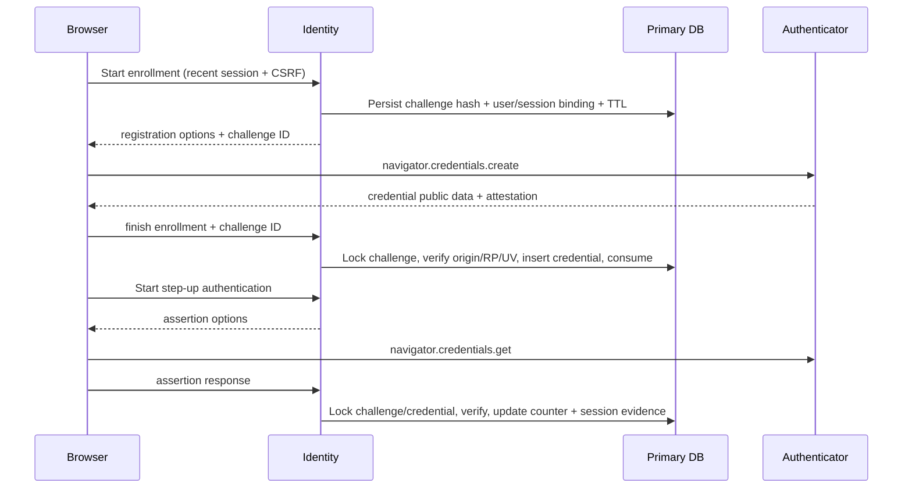

# 10 — Passkeys, MFA, recovery và vòng đời signing key

[Trước: SSO hai ứng dụng](09-sso-integration.md) · [Mục lục](../../README.md) · [Tiếp: Authorization](11-authorization-service.md)

Điều kiện: user/session, CSRF, OIDC claims và token lifecycle đã hoàn tất. Bài này dùng SimpleWebAuthn cho xác minh WebAuthn, `node:crypto` cho primitive mã hóa/HMAC, `jose` cho JOSE. Người học vẫn tự xây challenge lifecycle, account binding, enrollment, recovery, assurance policy và key operations. Files nằm trong `lab/services/identity/src/mfa/`; bảng `authenticators`, `challenges`, `sessions`, `signing_keys` đã có ở [schema chung](../reference/sql/identity.sql).

MFA không chỉ là thêm một input sáu số. Bạn phải bảo vệ enrollment, thay thiết bị, mất thiết bị, rollback trạng thái và reset bởi admin. Một recovery path yếu có thể vô hiệu hóa mọi lợi ích của authenticator mạnh. Default production gate của khóa học yêu cầu admin có passkey và recovery đã test; TOTP là một phương án bổ sung, không được gọi là chống phishing.

## 1. Assurance phải dựa trên bằng chứng

Password session có `amr=['pwd']`, `acr='urn:iam:aal:1'`. Sau password cộng một passkey assertion có user verification đã xác minh, cập nhật session `amr=['pwd','mfa']`, `acr='urn:iam:aal:2'`, `mfa_at=now`. Đây là tên assurance **nội bộ của project**, không phải chứng nhận NIST. Không dùng `hwk` khi chưa có bằng chứng key được bảo vệ phần cứng; passkey sync không tương đương key không export được.

WebAuthn credentials được scope theo RP ID/origin. RP ID local là `iam.local.test`; origin là `https://iam.local.test:8443`. Không dùng app-a/app-b làm RP của IAM login. NIST SP 800-63B-4 phân biệt mức assurance, yêu cầu phishing-resistant option ở AAL2; WebAuthn Level 3 hiện là W3C Recommendation. [NIST authentication guidance](https://pages.nist.gov/800-63-4/sp800-63b.html), [WebAuthn Recommendation](https://www.w3.org/TR/webauthn-3/).



## 2. CSRF và recent authentication dùng chung

Chương 06 yêu cầu CSRF cho interaction; dưới đây là một helper cụ thể có thể dùng cho MFA và consent. Tạo `src/oauth/browser-csrf.ts`. `CSRF_SECRET` tối thiểu 32 byte ngẫu nhiên, secret riêng, cùng giá trị cho các Identity replicas. Không dùng OIDC private key làm CSRF key.

```ts
import { createHmac,timingSafeEqual } from 'node:crypto';
import type { Request } from 'express';
import { ISSUER,ProtocolError } from './common.js';
const secret=process.env.CSRF_SECRET;
if(!secret||Buffer.byteLength(secret)<32)throw new Error('CSRF_SECRET required');
export function csrfFor(sessionId:string):string {
 return createHmac('sha256',secret!).update('iam-browser-csrf:v1:').update(sessionId).digest('base64url');
}
export function assertBrowserCsrf(req:Request,sessionId:string):void {
 const provided=req.get('x-csrf-token')??(typeof req.body?.csrf==='string'?req.body.csrf:'');
 const expected=Buffer.from(csrfFor(sessionId));const actual=Buffer.from(provided);
 if(req.get('origin')!==ISSUER||actual.length!==expected.length||!timingSafeEqual(actual,expected)) {
  throw new ProtocolError('access_denied',403);
 }
}
```

Trang cùng origin lấy CSRF token từ endpoint authenticated trả no-store; cross-origin CORS không được mở để website khác đọc token. Origin check và token cùng tồn tại. Recent authentication kiểm `authenticated_at` trong DB trong vòng 5 phút; enrollment cũng kiểm current user/session active. Reauthentication tạo evidence thực, không chỉ sửa timestamp khi user bấm nút.

Để quản lý authenticator, dùng route riêng user đã login; không truyền `user_id` từ client làm chủ thể. Mọi list/delete/enroll binding lấy từ `browserSession(req)`. Sau khi user vô hiệu hóa authenticator, revoke sessions/grants theo policy và ghi audit; phải giữ ít nhất một recovery path hoặc yêu cầu quy trình recovery rõ ràng.

## 3. Passkey registration: start và finish

```powershell
New-Item -ItemType Directory -Force lab/services/identity/src/mfa | Out-Null
pnpm -C lab --filter @iam/identity add @simplewebauthn/server
```

SimpleWebAuthn v14 yêu cầu Node LTS 22 trở lên; runtime khóa học là Node 24. Tạo `mfa/passkeys.ts`. Các handler nhận JSON nhỏ, authenticated browser, CSRF; mount chúng trước generic error handler. Helper challenge lưu **hash**, không lưu raw challenge vào log.

```ts
import { Router,json } from 'express';
import { randomBytes,timingSafeEqual } from 'node:crypto';
import { generateRegistrationOptions,verifyRegistrationResponse,
 generateAuthenticationOptions,verifyAuthenticationResponse } from '@simplewebauthn/server';
import { pool,withTransaction } from '../db.js';
import { hashToken } from '../security.js';
import { browserSession,ProtocolError,ISSUER } from '../oauth/common.js';
import { assertBrowserCsrf } from '../oauth/browser-csrf.js';

const rpID='iam.local.test';
export const passkeysRouter=Router();passkeysRouter.use(json({limit:'32kb'}));
async function actor(req:import('express').Request,recent=false) {
 const s=await browserSession(req);if(!s)throw new ProtocolError('login_required',401);
 assertBrowserCsrf(req,s.id);
 if(recent&&Date.now()-s.authenticated_at.getTime()>5*60*1000)throw new ProtocolError('reauthentication_required',403);
 return s;
}
function matches(raw:string,stored:Buffer):boolean {
 const h=hashToken(raw);return h.length===stored.length&&timingSafeEqual(h,stored);
}
passkeysRouter.post('/v1/me/passkeys/registration-options',async(req,res)=>{
 const s=await actor(req,true);
 const previous=await pool.query(`SELECT credential_id,transports,metadata FROM authenticators
  WHERE user_id=$1 AND type='webauthn' AND status='active'`,[s.user_id]);
 const userHandle=previous.rows[0]?.metadata.userHandle??randomBytes(32).toString('base64url');
 const options=await generateRegistrationOptions({rpName:'IAM Learning Lab',rpID,
  userID:new Uint8Array(Buffer.from(userHandle,'base64url')),userName:s.user_id,
  attestationType:'none',authenticatorSelection:{residentKey:'preferred',userVerification:'required'},
  excludeCredentials:previous.rows.map(r=>({id:r.credential_id.toString('base64url'),transports:r.transports}))});
 const row=await pool.query<{id:string}>(`INSERT INTO challenges(kind,token_hash,user_id,payload,expires_at)
  VALUES('webauthn_register',$1,$2,$3,clock_timestamp()+interval '5 minutes') RETURNING id`,
  [hashToken(options.challenge),s.user_id,{sessionId:s.id,userHandle}]);
 res.set('Cache-Control','no-store').json({challengeId:row.rows[0]!.id,options});
});
passkeysRouter.post('/v1/me/passkeys/registration-verify',async(req,res)=>{
 const s=await actor(req,true);
 await withTransaction(async db=>{
  const r=await db.query(`SELECT * FROM challenges WHERE id=$1 AND kind='webauthn_register'
   AND user_id=$2 AND consumed_at IS NULL AND expires_at>clock_timestamp() FOR UPDATE`,[req.body.challengeId,s.user_id]);
  const ch=r.rows[0];if(!ch||ch.payload.sessionId!==s.id)throw new ProtocolError('invalid_request');
  const live=await db.query(`SELECT id FROM sessions WHERE id=$1 AND user_id=$2
   AND revoked_at IS NULL AND expires_at>clock_timestamp()
   AND authenticated_at>clock_timestamp()-interval '5 minutes' FOR SHARE`,[s.id,s.user_id]);
  if(!live.rows[0])throw new ProtocolError('reauthentication_required',403);
  const verified=await verifyRegistrationResponse({response:req.body.response,
   expectedChallenge:(value:string)=>matches(value,ch.token_hash),expectedOrigin:ISSUER,
   expectedRPID:rpID,requireUserVerification:true});
  if(!verified.verified||!verified.registrationInfo)throw new ProtocolError('access_denied',403);
  const info=verified.registrationInfo,c=info.credential;
  await db.query(`INSERT INTO authenticators(user_id,type,status,credential_id,public_key,counter,transports,metadata)
   VALUES($1,'webauthn','active',$2,$3,$4,$5,$6)`,[s.user_id,Buffer.from(c.id,'base64url'),
   Buffer.from(c.publicKey),c.counter,c.transports??[],{userHandle:ch.payload.userHandle,
    deviceType:info.credentialDeviceType,backedUp:info.credentialBackedUp}]);
  await db.query('UPDATE challenges SET consumed_at=clock_timestamp() WHERE id=$1',[ch.id]);
 });res.status(201).json({registered:true});
});
```

Nếu payload shape/UUID sai, validator HTTP phải trả `400` trước query; snippet tập trung vào protocol verification. Thêm allowlist JSON schema: `challengeId` UUID, response là object WebAuthn JSON, giới hạn lengths/array count; không ép TypeScript type assertion thành runtime validation. Invalid signatures map `400`/`403` đã định nghĩa, lỗi DB `503`. Không trả library stack trace cho browser.

`attestationType=none` ưu tiên tương thích/privacy, không chứng minh thiết bị thuộc doanh nghiệp. Nếu yêu cầu managed hardware, thêm attestation trust/metadata policy và quy trình update root trust; không chỉ đổi một string `direct` rồi cho mọi authenticator vào. Registration thành công chưa tự nâng session lên MFA: user phải thực hiện assertion ở bước sau.

## 4. Authentication challenge và step-up

Thêm vào cùng router:

```ts
passkeysRouter.post('/v1/me/passkeys/authentication-options',async(req,res)=>{
 const s=await actor(req);
 const existing=await pool.query(`SELECT credential_id,transports FROM authenticators
  WHERE user_id=$1 AND type='webauthn' AND status='active'`,[s.user_id]);
 if(!existing.rows.length)throw new ProtocolError('authenticator_required',403);
 const options=await generateAuthenticationOptions({rpID,userVerification:'required',
  allowCredentials:existing.rows.map(r=>({id:r.credential_id.toString('base64url'),transports:r.transports}))});
 const r=await pool.query<{id:string}>(`INSERT INTO challenges(kind,token_hash,user_id,payload,expires_at)
  VALUES('webauthn_authenticate',$1,$2,$3,clock_timestamp()+interval '2 minutes') RETURNING id`,
  [hashToken(options.challenge),s.user_id,{sessionId:s.id}]);
 res.set('Cache-Control','no-store').json({challengeId:r.rows[0]!.id,options});
});
passkeysRouter.post('/v1/me/passkeys/authentication-verify',async(req,res)=>{
 const s=await actor(req);
 await withTransaction(async db=>{
  const r=await db.query(`SELECT * FROM challenges WHERE id=$1 AND kind='webauthn_authenticate'
   AND user_id=$2 AND consumed_at IS NULL AND expires_at>clock_timestamp() FOR UPDATE`,[req.body.challengeId,s.user_id]);
  const ch=r.rows[0];if(!ch||ch.payload.sessionId!==s.id)throw new ProtocolError('invalid_request');
  const ar=await db.query(`SELECT * FROM authenticators WHERE user_id=$1 AND credential_id=$2
   AND type='webauthn' AND status='active' FOR UPDATE`,[s.user_id,Buffer.from(req.body.response.id,'base64url')]);
  const a=ar.rows[0];if(!a)throw new ProtocolError('access_denied',403);
  const counter=Number(a.counter);if(!Number.isSafeInteger(counter))throw new Error('Counter outside supported range');
  const verification=await verifyAuthenticationResponse({response:req.body.response,
   expectedChallenge:(value:string)=>matches(value,ch.token_hash),expectedOrigin:ISSUER,expectedRPID:rpID,
   requireUserVerification:true,credential:{id:a.credential_id.toString('base64url'),
    publicKey:new Uint8Array(a.public_key),counter,transports:a.transports}});
  if(!verification.verified)throw new ProtocolError('access_denied',403);
  await db.query('UPDATE authenticators SET counter=$2 WHERE id=$1',[a.id,verification.authenticationInfo.newCounter]);
  const upgraded=await db.query(`UPDATE sessions SET mfa_at=clock_timestamp(),acr='urn:iam:aal:2',amr=ARRAY['pwd','mfa']
   WHERE id=$1 AND user_id=$2 AND revoked_at IS NULL AND expires_at>clock_timestamp()
     AND 'pwd'=ANY(amr) RETURNING id`,[s.id,s.user_id]);
  if(!upgraded.rows[0])throw new ProtocolError('login_required',401);
  await db.query('UPDATE challenges SET consumed_at=clock_timestamp() WHERE id=$1',[ch.id]);
 });res.json({verified:true});
});
```

Đây là step-up trên một session **đã có password**. Nếu thêm passwordless login sau này, đừng gắn `pwd` giả vào `amr`; derive array từ bằng chứng thực đã persist. Predicate `AND 'pwd'=ANY(amr)` giữ profile password-first. Counter của synced passkey có thể luôn zero; thư viện xử lý semantics, không tự reject mọi zero. Row locks giúp cập nhật counter không bị lost update.

Frontend IAM cài `@simplewebauthn/browser`, dùng `startRegistration({optionsJSON:options})` / `startAuthentication({optionsJSON:options})`, sau đó POST response và challengeId với CSRF. Các call này chỉ phát sinh sau user gesture; xử lý cancellation như user hủy, không ghi audit thành credential compromise. [SimpleWebAuthn server responsibilities](https://simplewebauthn.dev/docs/packages/server), [browser package](https://simplewebauthn.dev/docs/packages/browser).

## 5. Thực thi organization MFA policy

`organizations.security_policy` có thể chứa `{"require_mfa":true}`; validate kiểu Boolean tại management API. Chèn cùng predicate vào `liveUser` chương 06 và query introspection chương 08:

```sql
AND (NOT (o.security_policy @> '{"require_mfa":true}'::jsonb)
     OR (s.mfa_at IS NOT NULL AND s.acr='urn:iam:aal:2'))
```

Authorize hiển thị step-up khi policy yêu cầu, trước consent/code issuance. Nếu một organization đổi policy sau token issue, protected request tiếp theo bị inactive cho tới khi user có assurance phù hợp. Không gọi Policy service để biết có được authenticate password; đây là login security policy thuộc Identity. Với thao tác nhạy cảm như disable MFA/rotate credential, yêu cầu `mfa_at` trong vòng 5 phút, không chỉ có AAL2 từng đạt lúc sáng.

ID token phát sau step-up phải phản ánh evidence mới; ID token cũ không tự đổi nội dung. API vẫn introspect hiện tại. Test thay require_mfa từ false sang true khi user đã đăng nhập, xác minh user phải step-up; không tiếp tục allow vì ID token cũ có chữ ký hợp lệ.

## 6. TOTP và recovery: triển khai theo state machine

TOTP là phương án tương thích khi passkey chưa sẵn. Sinh seed tối thiểu 20 byte random, mã hóa AES-GCM bằng envelope key riêng, lưu `encrypted_secret`/`secret_ref`; không hash seed vì verifier cần tính mã tương lai. Enrollment tạo authenticator `pending`, trả otpauth URI **một lần**, xác nhận TOTP đúng mới chuyển active. URI và QR chứa seed nên không log, không cache, không gửi analytics. Dùng một thư viện TOTP đã pin hoặc HMAC primitive theo [RFC 6238](https://www.rfc-editor.org/rfc/rfc6238.html); thuật toán/hash/digits/period phải khớp với provisioning URI.

Window mặc định 30 giây, nhận bước hiện tại và tối đa một bước lân cận theo policy clock drift. Chống reuse bằng lưu `metadata.lastStep`; trong transaction lock authenticator, verify code, yêu cầu matched step lớn hơn lastStep rồi cập nhật. Hai request cùng TOTP chỉ một lần được dùng. Rate limit theo account/challenge/IP có budget rõ ràng; không để attacker khóa account vĩnh viễn chỉ bằng gửi mã sai. Test với RFC test vectors và fake clock, không dựa vào việc “mã trên điện thoại vừa khớp”.

Recovery codes là giá trị random dùng một lần, lưu hash SHA-256 giống opaque token, không dùng PIN ngắn. Sinh 8–10 codes khi user đã có recent MFA, render một lần và yêu cầu người dùng xác nhận đã cất giữ. Khi regenerate, revoke toàn bộ bộ cũ trong cùng transaction. Table authenticators dùng type recovery_code, recovery_hash và status; cần unique index trên recovery_hash nếu thêm lookup trực tiếp. Code nhập dùng `SELECT ... FOR UPDATE`, user binding, active check, UPDATE status revoked, rồi commit.

Recovery thành công tạo **restricted recovery session**, không tự cấp đủ quyền admin. Yêu cầu re-enroll authenticator, thông báo qua kênh đã xác minh, revoke các session/grant khác và ghi audit. Không cho support reset MFA chỉ dựa vào email trùng account hoặc câu hỏi bí mật. Mất tất cả factors đi vào workflow proofing/manual approval ở chương governance; đây là requirement sản phẩm cần policy rõ ràng trước production, không một endpoint `DELETE /mfa` công khai.

## 7. Signing key rotation không làm gãy SSO

Các signing key có trạng thái `prepublished → active → retiring → retired`. Tạo cặp khóa mới bằng script chương 07 nhưng insert prepublished. Mọi replica đọc JWKS có key mới trước khi signer dùng nó; chờ ít nhất JWKS cache TTL cộng clock/network margin đã đo. Sau đó transaction đổi old active thành retiring và new prepublished thành active, unique index đảm bảo đúng một active. Key cũ ở JWKS đến khi **mọi assertion nó ký còn có thể được chấp nhận** hết hạn cộng skew/cache. ID token TTL 5 phút chưa đủ nếu logout hint được chấp nhận 12 giờ; retention cần bao phủ cả logout và các loại assertion khác.

SQL activation, chạy bằng operator migration role trong maintenance procedure, sau khi xác minh file/KMS key tồn tại ở mọi signer:

```sql
BEGIN;
SELECT kid FROM signing_keys WHERE status='active' FOR UPDATE;
UPDATE signing_keys SET status='retiring',retire_after=clock_timestamp()+interval '13 hours'
 WHERE status='active';
UPDATE signing_keys SET status='active' WHERE kid=:'new_kid' AND status='prepublished';
-- Operator bắt buộc kiểm rowcount UPDATE thứ hai=1 trước COMMIT; nếu 0 thì ROLLBACK.
COMMIT;
```

Trong application operator tool dùng `withTransaction`, kiểm rowCount rồi throw để rollback nếu new key sai. Không chạy block thủ công và bỏ qua comment rowcount; đó có thể để hệ thống không còn active key. Production signer dùng KMS/HSM interface có algorithm fixed và audit; private_ref là key reference trong secret manager, không plaintext private material trong DB. Không giả rằng generic AWS KMS sign API nhận PKCS8 key file hoặc JOSE formatting tự động: adapter phải chuyển signature/algorithm đúng theo primitive provider.

Lõi operator tool TypeScript thay cho thực thi SQL thiếu kiểm rowcount:

```ts
import { Pool } from 'pg';
export async function activateSigningKey(newKid:string):Promise<void> {
 const url=process.env.KEY_OPERATOR_DATABASE_URL;if(!url)throw new Error('Key operator credential required');
 const operatorPool=new Pool({connectionString:url,max:1});const db=await operatorPool.connect();
 try {
  await db.query('BEGIN');
  await db.query("SELECT pg_advisory_xact_lock(hashtext('iam-signing-key-activation'))");
  const candidate=await db.query("SELECT kid FROM signing_keys WHERE kid=$1 AND status='prepublished' FOR UPDATE",[newKid]);
  if(candidate.rowCount!==1)throw new Error('Expected one prepublished key');
  await db.query("UPDATE signing_keys SET status='retiring',retire_after=clock_timestamp()+interval '13 hours' WHERE status='active'");
  const result=await db.query("UPDATE signing_keys SET status='active' WHERE kid=$1 AND status='prepublished'",[newKid]);
  if(result.rowCount!==1)throw new Error('Activation failed');
  await db.query('COMMIT');
 } catch(error) {await db.query('ROLLBACK');throw error;}
 finally {db.release();await operatorPool.end();}
}
```

Rotation dự kiến khác emergency compromise. Nếu private key lộ, stop signer/key, revoke session/grants theo incident scope, publish replacement, thông báo clients và xem cache eviction/retention. Với opaque access tokens, xóa signing key không phải cơ chế revoke access token; access token vẫn cần current DB state. Backup restore không được hồi sinh old active signing config hoặc grant đã revoke.

## 8. Bài thực hành, kiểm tra và failure lab

```powershell
pnpm -C lab --filter @iam/identity typecheck
pnpm -C lab --filter @iam/identity test -- passkeys
$keys=Invoke-RestMethod 'https://iam.local.test:8443/oauth2/jwks'
$keys.keys | Select-Object kid,kty,alg
```

Tên test là target bạn tạo theo chương này; output **chưa được xác minh ở repository tài liệu**. Với browser automation dùng virtual WebAuthn authenticator, test registration/assertion thật qua browser API, không chỉ mock `verified:true`. Test RP/origin sai, challenge expired/reuse, account khác, session khác, UV false, authenticator revoked, credential ID đã đăng ký, counter semantics và request đồng thời. Unique constraint conflict cần mapping thành lỗi user-safe; không swallow mọi DB error.

Gửi cùng registration verify hai lần song song: một insert, một invalid request, không hai credential. Gửi cùng authentication assertion hai lần: chỉ một challenge consume. Thu hồi session giữa start và finish: finish phải thất bại; predicate session update giữ an toàn dù actor đã load trước transaction. Hai request TOTP cùng step chỉ một success. Hai recovery requests cùng code chỉ một restricted recovery session.

Failure lab: đổi `SIGNING_KEY_DIR` sang đường dẫn không tồn tại trên một replica; readiness phải loại replica lỗi trước khi phát token. Rotate key khi BFF đang cache JWKS cũ; prepublish đúng giúp BFF refresh và login tiếp tục. Cho key mới active trước publish trong môi trường test để quan sát failure, rồi sửa quy trình, không sửa client thành skip signature. Dừng secret manager: không dùng development key fallback; trả 503 và alert.

Troubleshooting: origin mismatch thường do dùng backend HTTP origin thay public HTTPS origin; credential public key từ pg là Buffer cần chuyển Uint8Array; passkey browser cancellation không phải server 500. AAL không nâng thường do session khác giữa challenge/verify; don't copy sid từ request để chữa. TOTP drift kiểm NTP/period/encoding trước tăng window. Logout lỗi sau key retirement thường do retention chỉ tính ID token exp mà quên logout hint policy.

## Definition of Done

- Enrollment và step-up bind user/session, require recent authentication/CSRF, challenge một lần, origin/RP/UV đúng.
- Session assurance dựa evidence thật; org policy được áp dụng ở issue/refresh/introspection, admin mutations cần recent MFA.
- Recovery đã có restricted flow, revoke/audit/notification và concurrency tests; không có bypass admin dựa email.
- Signing key prepublish/activate/retire và compromise runbook được diễn tập; private key không lộ trong JWKS/DB/log/Git.
- Hoàn tất protocol/conformance matrix trước external production, rồi chuyển sang [Authorization](11-authorization-service.md) để xây resource permissions.
