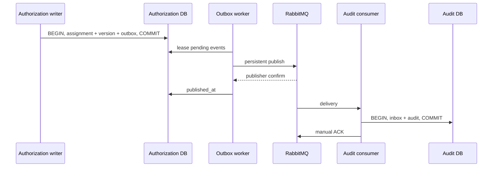

# 12. Transactional outbox, RabbitMQ và Audit service

[Mục lục](../../README.md) · [Trước: Authorization](11-authorization-service.md) · [Tiếp: authorization nâng cao](13-advanced-authorization.md)

**Điều kiện đầu vào:** chương 11 chạy được, bạn hiểu PostgreSQL transaction, Node async và service credentials. Đọc [event contract](../reference/events.md); dùng SQL [Audit](../reference/sql/audit.sql) và outbox trong schema mỗi producer. Bạn sẽ tự tạo lab/services/audit cùng publisher worker của Identity/Authorization. Chương này kết thúc bằng broker bền vững đang được kiểm chứng; không để phần messaging thành một lời hẹn tới Kubernetes.

## 12.1. Bài toán dual write và điều không được hứa

Một HTTP handler revoke quyền rồi publish event có hai thao tác trên hai hệ thống. Nếu PostgreSQL commit nhưng broker chết, thiếu audit; nếu publish trước commit rồi database rollback, audit nói về một việc chưa xảy ra. Retry không tự giải quyết vì client có thể không biết commit đã xảy ra chưa.

Transactional outbox đưa ý định publish vào cùng transaction mutation. Worker đọc outbox và gửi sau. Consumer inbox làm side effect idempotent. Hệ thống vẫn có duplicate; điều ta chứng minh là không mất ý định publish sau commit và audit không tạo hai bản ghi cho cùng event. Đây không phải distributed “exactly once”.

Role/credential/membership hiện hành vẫn đọc trực tiếp từ owner. Event user suspended không phải cơ chế duy nhất chặn request: online introspection đã làm việc đó. Audit dừng không làm user sống lại; broker dừng không ngăn revoke được commit. Tuy nhiên backlog kéo dài làm mất khả năng phát hiện và điều tra kịp thời, nên cần alarm và capacity policy.



## 12.2. Khởi động RabbitMQ và tạo topology

Compose chương 03 đã có service rabbitmq với profile messaging. Chạy từ root giáo trình:

```powershell
docker compose --env-file lab/infra/compose/.env -f lab/infra/compose/compose.yaml --profile messaging up -d rabbitmq
pnpm -C lab --filter @iam/authorization add amqplib@0.10.9
pnpm -C lab --filter @iam/authorization add -D @types/amqplib@0.10.8
pnpm -C lab --filter @iam/audit add amqplib@0.10.9 pg
pnpm -C lab --filter @iam/audit add -D @types/amqplib@0.10.8 @types/pg
```

Nếu audit package chưa tạo, tạo package.json type=module và scripts dev/build/test giống service chương 03 trước khi chạy filter. Version trên là cặp API AMQP 0-9-1 dùng trong ví dụ; ghi lockfile, chạy audit dependencies và cập nhật có kiểm chứng. Không tự thay major library rồi bỏ qua type errors.

Tạo lab/services/audit/src/topology.ts, chạy một lần bằng bootstrap credential có quyền configure. Runtime publisher không cần quyền tạo queue. Mỗi producer có exchange riêng để consumer có thể kiểm tra nguồn mà không tin trường source tự khai.

```ts
import amqp from "amqplib";
const url = process.env.AMQP_BOOTSTRAP_URL;
if (!url) throw new Error("AMQP_BOOTSTRAP_URL missing");
const connection = await amqp.connect(url);
const channel = await connection.createChannel();
for (const source of ["identity","authorization","governance"]) {
  await channel.assertExchange("iam." + source + ".events","topic",{durable:true});
}
await channel.assertExchange("iam.audit.dlx","fanout",{durable:true});
await channel.assertQueue("iam.audit.dead",{durable:true,arguments:{"x-queue-type":"quorum"}});
await channel.bindQueue("iam.audit.dead","iam.audit.dlx","");
await channel.assertQueue("iam.audit.events",{
  durable:true,
  arguments:{
    "x-queue-type":"quorum",
    "x-delivery-limit":10,
    "x-dead-letter-exchange":"iam.audit.dlx"
  }
});
for (const source of ["identity","authorization","governance"]) {
  await channel.bindQueue("iam.audit.events","iam." + source + ".events","#");
}
await channel.close();
await connection.close();
```

Quorum queue một node local vẫn chỉ có một máy lưu dữ liệu. Production dùng cluster phù hợp failure domains, durable storage, xác nhận backup/restore và hỗ trợ phiên bản; không gọi một container là HA. Bật at-least-once dead lettering bằng broker policy, kiểm tra nó thực sự áp vào đúng queue:

```powershell
$mgmtBasic = [Convert]::ToBase64String([Text.Encoding]::UTF8.GetBytes("iam_lab:" + $env:RABBITMQ_PASSWORD))
$policy = @{
  pattern="^iam\.audit\.events$"
  definition=@{"dead-letter-strategy"="at-least-once";overflow="reject-publish"}
  priority=10
  "apply-to"="quorum_queues"
} | ConvertTo-Json -Depth 5
Invoke-RestMethod http://127.0.0.1:15672/api/policies/%2F/iam-audit-safety -Method Put -Headers @{Authorization="Basic $mgmtBasic"} -ContentType application/json -Body $policy
```

Expected 201/204 tuỳ create/update. Management API chỉ bind loopback trong lab, không expose qua public ingress. Provision authz-publisher chỉ write exchange iam.authorization.events; identity-publisher và governance-publisher tương ứng; audit-consumer chỉ read queue iam.audit.events. Không dùng iam_lab bootstrap credential trong worker. Nếu dùng vhost khác "/", đổi cả URL amqp và management API path đã percent-encode.

## 12.3. Outbox mutation và lease không giữ transaction qua broker

Authorization writer đã khoá policy_versions. Trong cùng transaction, tăng version rồi INSERT outbox với type, version schema, aggregate_id, aggregate_version, org_id, actor JSON, correlation_id và data có allowlist. Data chứa action, target, subject, outcome và details tối thiểu; xem contract. Identity sử dụng outbox cùng hình thức. Thêm lease_owner UUID và lease_until TIMESTAMPTZ nếu migration cũ chưa có.

Claim batch bằng một statement, không SELECT rồi publish rồi UPDATE không khoá. Trong worker.ts:

```ts
import {Pool} from "pg";
import {randomUUID} from "node:crypto";
const pool = new Pool({connectionString:process.env.AUTHORIZATION_DATABASE_URL});
const workerId = randomUUID();
export async function claimBatch() {
  return pool.query(
    "WITH picked AS (" +
    " SELECT id FROM outbox WHERE published_at IS NULL AND available_at<=now()" +
    " AND (lease_until IS NULL OR lease_until<now())" +
    " ORDER BY created_at,id FOR UPDATE SKIP LOCKED LIMIT 20" +
    ") UPDATE outbox o SET lease_owner=$1,lease_until=now()+interval '30 seconds'," +
    " attempts=o.attempts+1 FROM picked WHERE o.id=picked.id RETURNING o.*",
    [workerId]
  );
}
```

Lease hết hạn cho worker khác lấy lại sau crash. Publish timeout phải nhỏ hơn lease; batch nhỏ, renew lease nếu xử lý dài. Không mark published sau khi lease đã thuộc worker khác: UPDATE luôn có WHERE lease_owner=$workerId AND published_at IS NULL. Nếu update rowCount=0, ghi metric và chấp nhận khả năng duplicate, không sửa dữ liệu đối thủ.

Map row sang wire envelope bằng function xác định source cố định từ service config, không lấy source từ input người dùng. occurred_at lấy created_at của outbox, không tạo timestamp mới mỗi retry. aggregate_version chuyển string. actor_id lấy actor.id đã xác thực lúc mutation. Đặt toàn bộ wire payload một lần hoặc dùng canonical serialization để cùng event retry không đổi bytes.

## 12.4. Publisher confirms và unroutable messages

Trong publisher.ts dùng ConfirmChannel. Callback publish xác nhận broker, không phải audit đã commit. mandatory=true giúp phát hiện exchange tồn tại nhưng không có queue binding. Ví dụ chỉ một publish in flight trên channel để correlation return đơn giản:

```ts
import amqp from "amqplib";
import type {ConfirmChannel} from "amqplib";
export async function openPublisher(url: string) {
  const connection = await amqp.connect(url);
  const channel = await connection.createConfirmChannel();
  connection.on("error", () => { /* metric; supervisor restart */ });
  channel.on("error", () => { /* metric; không mark published */ });
  return {connection,channel};
}

export async function publishConfirmed(
  channel: ConfirmChannel, exchange: string, id: string, body: Buffer
) {
  let returned = false;
  const onReturn = () => {returned = true;};
  channel.once("return",onReturn);
  try {
    await new Promise<void>((resolve,reject) => {
      const timeout = setTimeout(() => reject(new Error("confirm_timeout")),5000);
      channel.publish(exchange,"audit",body,{
        persistent:true,mandatory:true,messageId:id,
        contentType:"application/json",type:"iam.event.v1"
      }, error => {
        clearTimeout(timeout);
        if (error) reject(error);
        else if (returned) reject(new Error("unroutable"));
        else resolve();
      });
    });
  } finally {channel.off("return",onReturn);}
}
```

Sau confirm timeout, đóng channel/connection và tạo mới trước retry; không tái dùng channel có kết quả publish chưa biết. Nếu mở concurrency lớn, tương quan basic.return bằng messageId và giải quyết backpressure/drain; ví dụ tuần tự này là baseline rõ nghĩa cho người học.

Sau publish thành công, UPDATE published_at WHERE id và lease_owner. Khi thất bại, giải phóng lease và đặt available_at với exponential backoff + jitter tối đa 60 giây. Sau 10 publish failures vẫn giữ outbox và alarm, không delete để “hết lỗi”; operator kiểm tra transport trước controlled retry. Delivery DLQ của consumer là cơ chế khác với failed publisher rows.

## 12.5. Audit consumer: inbox và side effect cùng transaction

Áp dụng audit.sql vào database audit bằng migration role. Tạo event schema trong lab/packages/contracts: các field và enum theo events.md; validator phải từ chối unknown type/version, timestamp sai, UUID sai, payload trên 32 KiB, data ngoài allowlist và source không khớp exchange. Để không giấu helper, bắt đầu với source authorization và hai event created/revoked; mỗi event yêu cầu data.role_id UUID và target.type=role-assignment. Mở rộng schema có test trước khi nhận event mới.

Canonical JSON helper dùng ở producer/consumer, không chấp nhận undefined, BigInt hay số không hữu hạn:

```ts
export function canonicalJson(value: unknown): string {
  if (value === null || typeof value === "boolean" || typeof value === "string")
    return JSON.stringify(value);
  if (typeof value === "number" && Number.isFinite(value)) return JSON.stringify(value);
  if (Array.isArray(value)) return "[" + value.map(canonicalJson).join(",") + "]";
  if (typeof value === "object" && value !== null) {
    const row = value as Record<string,unknown>;
    return "{" + Object.keys(row).sort().map(
      key => JSON.stringify(key) + ":" + canonicalJson(row[key])
    ).join(",") + "}";
  }
  throw new Error("non_json_value");
}
```

Transaction consumer nhận event đã validate. Hash canonical bytes, không dùng JSON object stringify với key order vô tình khác. Dùng c.query("BEGIN") và finally release như chương 11:

```ts
import {createHash,randomUUID} from "node:crypto";
// c là PoolClient của audit DB; event đã được validator kiểm chứng theo events.md.
const hash = createHash("sha256").update(canonicalJson(event)).digest();
const inserted = await c.query(
  "INSERT INTO inbox(source,event_id,payload_hash) VALUES($1,$2,$3)" +
  " ON CONFLICT DO NOTHING RETURNING event_id",
  [event.source,event.id,hash]
);
if (inserted.rowCount === 0) {
  const old = await c.query<{payload_hash:Buffer}>(
    "SELECT payload_hash FROM inbox WHERE source=$1 AND event_id=$2",
    [event.source,event.id]
  );
  if (!old.rows[0]?.payload_hash.equals(hash)) throw new Error("event_integrity_conflict");
} else {
  await c.query(
    "INSERT INTO audit_events(id,source,event_id,event_type,schema_version,occurred_at," +
    "org_id,actor_id,subject_id,action,target_type,target_id,outcome,reason_code," +
    "correlation_id,causation_id,aggregate_id,aggregate_version,details)" +
    " VALUES($1,$2,$3,$4,$5,$6,$7,$8,$9,$10,$11,$12,$13,$14,$15,$16,$17,$18,$19)",
    [randomUUID(),event.source,event.id,event.type,event.schema_version,event.occurred_at,
     event.org_id,event.actor_id,event.subject_id,event.action,event.target.type,
     event.target.id,event.outcome,event.reason_code,event.correlation_id,
     event.causation_id,event.aggregate.id,event.aggregate.version,event.data]
  );
}
```

Commit rồi ACK. Nếu crash sau commit trước ACK, redelivery thấy inbox hash bằng nhau và ACK; không tạo record thứ hai. Với concurrent duplicate, INSERT ON CONFLICT chờ transaction đối thủ; nếu đối thủ rollback, insertion có thể thành công. Không INSERT inbox ngoài transaction audit.

Consumer prefetch=8 và noAck=false. Trong callback, malformed/integrity/source-conflict là permanent: nack false false để DLQ. Database unavailable là transient: đợi backoff ngắn có jitter rồi nack false true. Quorum queue giữ delivery count và delivery-limit đưa poison message sang DLQ. Không dùng while retry vô hạn trong callback. Consume callback async phải bắt toàn bộ rejection; thư viện không tự await Promise của callback.

## 12.6. Những kiểm thử làm rõ bảo đảm

Viết integration tests với PostgreSQL và RabbitMQ thật của lab:

- Publish cùng event hai lần: inbox=1, audit_events=1; received_at không bị sửa.
- Cùng event ID nhưng đổi role_id: bản thứ hai vào DLQ, không overwrite lịch sử.
- Crash publisher sau confirm trước mark: sau lease expiry được gửi lại, Audit vẫn một record.
- Crash consumer sau COMMIT trước ACK: broker redeliver, không audit duplicate.
- Source authorization publish lên exchange identity bằng credential authz: broker từ chối; sửa source JSON không đổi quyền broker.
- Reorder hai policy events: audit lưu cả hai với occurred_at/aggregate version, không dùng event cũ để thay policy hiện hành.
- Schema version lạ, payload lớn hoặc data có access_token: validator chặn và DLQ có reason đã redact.

Đếm bằng psql audit_reader, không expose query admin không guard:

```powershell
psql -h localhost -U audit_reader -d audit -c "SELECT source,event_id,count(*) FROM audit_events GROUP BY source,event_id HAVING count(*)>1"
docker compose --env-file lab/infra/compose/.env -f lab/infra/compose/compose.yaml exec rabbitmq rabbitmqctl list_queues name messages_ready messages_unacknowledged
```

Expected query duplicate trả zero rows sau test; queue ready/unacked về 0 khi đã tiêu thụ, trừ DLQ cố ý tạo. Không hứa mọi lần query ngay sau HTTP mutation đã thấy event: delivery là async.

## 12.7. Failure lab và vận hành audit

Dừng rabbitmq bằng compose stop rabbitmq, revoke một assignment, xác minh API deny ngay và outbox pending tăng. Start rabbitmq, worker reconnect, pending giảm và audit xuất hiện. Dừng Audit DB: messages unacked/retry tăng trong giới hạn; không ACK khi chưa commit. Thử xoá binding trên broker lab: mandatory return làm outbox giữ nguyên pending. Khôi phục topology, retry và kiểm tra ID không đổi.

Theo dõi outbox_oldest_age, pending_count, publish_failure, confirm_latency, consumer_processing, redelivery_count, DLQ_depth và audit_ingest_lag. Alert backlog theo thời gian chứ không chỉ queue length. Nếu queue không giảm, kiểm tra worker credential/ACL, topology, channel errors và DB pool; không purge queue để làm dashboard xanh.

### Troubleshooting

| Triệu chứng | Chẩn đoán | Sửa và xác minh |
|---|---|---|
| Outbox pending tăng, queue rỗng | Worker/ACL, exchange/binding, mandatory returns | Sửa transport; replay cùng event ID |
| Queue unacked tăng | Audit DB/pool hoặc consumer stuck | Phục hồi DB, rollback lỗi rồi redelivery |
| Cùng event ID có hash khác | Producer thay wire payload giữa retry hoặc tampering | Cách ly DLQ, so canonical bytes; không overwrite inbox |
| Mất event sau ACK | ACK trước audit transaction commit | Chuyển ACK sau COMMIT và chạy crash test |
| Queue redeclare 406 | Arguments queue khác topology cũ | Migration topology có kiểm soát; không xoá queue có dữ liệu |

Audit SQL role append-only chưa chống DBA. Khi cần bằng chứng chống sửa, export batch có manifest/hash, ký bằng key tách quyền, lưu WORM/object-lock và audit quyền operator ở hệ thống riêng. Retention lab 30 ngày; production cần quyết định theo nghiệp vụ/privacy. Public audit query/export phải online introspect và policy check theo org như Invoice API; không lấy org từ querystring làm scope.

**Definition of Done:** mutation+outbox atomic; publisher confirm/mandatory, durable exchanges/quorum queue, explicit ACL, manual ACK sau inbox+audit commit; duplicate/integrity/DLQ tests; broker/DB outage drill; không secret trong envelope/log; revoke không phụ thuộc event; metrics/runbook và evidence được lưu. RabbitMQ là một dependency vận hành thật, không chỉ một package trong package.json.

Nguồn: [RabbitMQ confirms và acknowledgements](https://www.rabbitmq.com/docs/confirms), [quorum queues](https://www.rabbitmq.com/docs/quorum-queues), [dead lettering](https://www.rabbitmq.com/docs/dlx), [PostgreSQL row locking](https://www.postgresql.org/docs/current/explicit-locking.html), [amqplib API](https://amqp-node.github.io/amqplib/channel_api.html), [OWASP logging](https://cheatsheetseries.owasp.org/cheatsheets/Logging_Cheat_Sheet.html).
