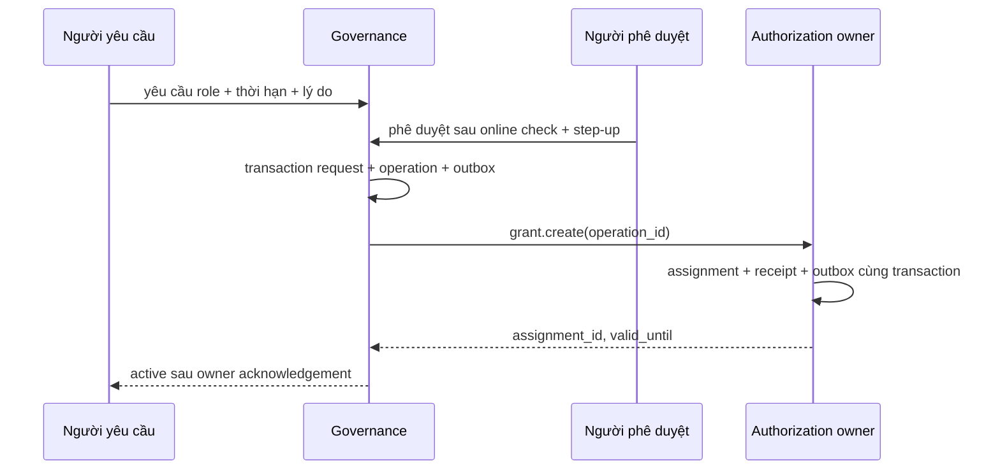

# 16. Governance, SCIM và quyền quản trị có thời hạn

[Mục lục](../../README.md) · [Tiếp: workload và delegation](17-workload-delegation.md)

## Đích của chương và điều kiện bắt đầu

Bạn cần hoàn thành Identity, Authorization, audit/outbox và federation ở các chương trước. Hai ứng dụng đã dùng chung account, token gắn một organization, mọi API kiểm tra online. Đọc lại [hợp đồng triển khai](../reference/implementation-map.md), đặc biệt ba owner API nội bộ. Chương này tạo service `@iam/governance` ở cổng 3500; người học tự viết ứng dụng dưới `lab/`, sách không cung cấp một server đã chạy.

Mục tiêu là thay quy trình “admin cấp quyền rồi quên” bằng yêu cầu, phê duyệt, hiệu lực có hạn và rà soát. Quyền đặc biệt là một role assignment có điều kiện, không phải cờ `is_super_admin` trên account global. Alice có thể là quản trị Acme và người dùng thường tại Beta. Một nhân viên rời Acme không bị xóa account đang dùng ở Beta.



Một operation đang retry chưa phải quyền active. UI hiển thị `activating`, người học quan sát cả hai trạng thái thay vì đánh dấu thành công khi mới gửi message.

## Bước 1 — Tạo dữ liệu và quyền database

Tạo database riêng theo chương dữ liệu; đặt DSN migration vào biến môi trường từ secret local, không ghi password trong Git. Cần CLI `psql` PostgreSQL 18 trên PATH. Lệnh sau chạy ở root `IAM`:

```powershell
if (-not $env:GOVERNANCE_MIGRATION_URL) { throw 'Thiếu GOVERNANCE_MIGRATION_URL' }
psql $env:GOVERNANCE_MIGRATION_URL -v ON_ERROR_STOP=1 -f docs/reference/sql/governance.sql
if ($LASTEXITCODE -ne 0) { throw 'Governance migration thất bại' }
New-Item -ItemType Directory -Force lab/services/governance/src,lab/evidence/ch16 | Out-Null
```

[governance.sql](../reference/sql/governance.sql) chứa bảng thực thi. Đọc từng constraint trước khi chạy: request có organization, vote không được do requester tự bỏ, queue có operation ID bền vững, SCIM journal gắn integration. Các UUID trỏ đến owner khác là opaque references; Governance không có mật khẩu DB Identity/Authorization. SCIM resource/version hiện hành nằm ở `Identity.provisioned_resources` của [chương 15](15-scim-provisioning.md), không tạo một nguồn active state thứ hai ở Governance.

Tạo app role khác migration owner. Cấp SELECT/INSERT/UPDATE cần thiết, không cấp DELETE hàng loạt, SUPERUSER hay BYPASSRLS. Với API transaction, đặt organization từ principal đã online-check bằng `SELECT set_config('app.org_id',$1,true)`. Tham số `true` giới hạn trong transaction; `SET` ngoài transaction dễ làm tenant context rò qua pooled connection. Worker đọc queue bằng role riêng; chỉ đọc các bảng tenant sau khi đặt tenant từ operation đã claim.

## Bước 2 — Yêu cầu và phê duyệt không tự nâng quyền

Triển khai `POST /v1/access-requests`, `POST /v1/access-requests/:id/approvals`, `POST /v1/access-requests/:id/activate` và `GET /v1/operations/:id`. Các management endpoints dùng middleware online đã học, audience riêng `governance-api` được đăng ký bằng management API. Không lấy `requester_id` hoặc `org_id` từ body làm principal. Body yêu cầu gồm `subject_id`, `role_id`, `reason`, `requested_until`; giới hạn đặc quyền tối đa một giờ trong lab. Đây là chính sách bài học, không phải giới hạn của giao thức.

Approval đòi quyền `governance.approve`, membership còn active và step-up MFA trong năm phút; activation kiểm tra lại người nhận còn đủ điều kiện. Cần hai người cho role nhạy cảm: requester khác approver; approver không phải subject nhận quyền. SQL đã chặn requester tự vote, ứng dụng thêm điều kiện subject. Trong transaction khóa `access_requests FOR UPDATE`, kiểm tra state/revision rồi ghi vote, state, operation và outbox. Hai approver bấm đồng thời không được tạo hai assignment.

Khóa định nghĩa role, phạm vi org và version chính sách vào request để người duyệt biết chính xác đang cấp gì. Nếu role thay đổi trước activation, trả `409 REVIEW_REQUIRED`, tạo vòng duyệt mới. Không tái sử dụng approval cũ cho quyền mở rộng. Bảo vệ last-owner ở owner service bằng lock phù hợp; một kiểm tra COUNT rồi UPDATE tách transaction không đủ chống hai admin cùng tự gỡ quyền.

## Bước 3 — Gọi owner qua API với retry an toàn

Tạo `lab/services/governance/src/owner-client.ts`. Hàm này hoàn chỉnh ở lớp transport; bearer `ownerAccessToken` do client-credentials module của chương 17 cung cấp. Token phải mang audience owner và scope quản trị đúng org. Trước chương 17, dùng machine client đã đăng ký ở chương token, không dùng token Alice cho daemon.

```typescript
export async function createAssignment(input: {
  operationId: string; orgId: string; subjectId: string;
  roleId: string; resourceType: string; validUntil: string; ownerAccessToken: string;
}): Promise<{ id: string; revision: string }> {
  const base = process.env.AUTHORIZATION_URL;
  if (!base) throw new Error('AUTHORIZATION_URL missing');
  const response = await fetch(new URL('/internal/v1/grants', base), {
    method: 'POST', signal: AbortSignal.timeout(800),
    headers: { authorization: `Bearer ${input.ownerAccessToken}`,
      'content-type': 'application/json' },
    body: JSON.stringify({ operation_id: input.operationId,
      org_id: input.orgId, subject_type: 'user', subject_id: input.subjectId,
      role_id: input.roleId, scope: { type: 'organization', resource_type: input.resourceType },
      valid_until: input.validUntil }),
  });
  if (!response.ok) throw new Error(`OWNER_HTTP_${response.status}`);
  const body: unknown = await response.json();
  if (typeof body !== 'object' || body === null ||
      !('id' in body) || typeof body.id !== 'string' ||
      !('revision' in body) || typeof body.revision !== 'string') {
    throw new Error('OWNER_RESPONSE_INVALID');
  }
  return { id: body.id, revision: body.revision };
}
```

Worker claim operation trong transaction ngắn bằng `FOR UPDATE SKIP LOCKED`, tăng attempts và lease 30 giây, commit rồi mới gọi HTTP. Không giữ database transaction trong suốt network request. Gọi lại dùng đúng operation ID và payload; owner trả cùng assignment, payload khác cùng ID trả `409`. Timeout có nghĩa **không biết kết quả**, không có nghĩa owner chưa commit. Retry backoff có jitter, tối đa mười lần rồi chuyển failed có thao tác vận hành; không nuốt lỗi.

Outbox Governance dùng đúng schema storage chung: type/version/aggregate_id/aggregate_version/org_id/actor/correlation_id/data/created_at và lease fields. Publisher tái dùng mapper chương 12: `version→schema_version`, `created_at→occurred_at`, actor/data thành wire envelope theo [events](../reference/events.md), source cố định `governance`. `iam.provisioning.operation-completed` chỉ phát sau receipt owner được xác nhận; không publish raw row hay tạo envelope riêng tên payload.

Owner tạo assignment và receipt trong cùng transaction. `revision` là chuỗi bigint như policy_version. Role expiry được PDP kiểm tra bằng `valid_until > statement_timestamp()` mỗi decision; quyền hết hạn kể cả khi scheduler chết. Scheduler chỉ cập nhật UI và audit. Với access review, Governance gọi DELETE owner có body `{operation_id,expected_revision}`; không tự sửa bảng role assignment qua một kết nối DB bí mật.

## Bước 4 — SCIM là adapter quản trị danh tính

[SCIM protocol](https://www.rfc-editor.org/rfc/rfc7644.html) định nghĩa các thao tác HTTP để provisioning. Ta triển khai một profile rõ ràng, công bố capability thực có: Users, Groups, pagination, `userName eq`, PATCH active và ETag. Chưa hỗ trợ Bulk thì `/scim/v2/ServiceProviderConfig` trả `bulk.supported=false`; không quảng cáo toàn bộ SCIM sau vài endpoints.

Đăng ký machine client cho mỗi integration, bind một org, scope `scim:provision` như chương federation. Mọi SCIM request vẫn introspect online; client bị disable chặn lần tiếp theo. `externalId` không phải bằng chứng sở hữu account global. Không tự link account Alice chỉ vì upstream gửi cùng email; kết nối account đã tồn tại cần quy trình claim/link đã xác minh. `active:false` chỉ suspend membership của org integration, không global-disable Alice tại Beta; DELETE remove membership theo lifecycle policy.

Các resource ID SCIM là UUID được owner lưu, không phơi password hoặc bearer secret. GET/list/filter/version luôn đọc owner API sống; operation journal chỉ giúp retry/reconciliation, không trả active hiện hành. Schema User trả `schemas`, `id`, `userName`, `active`, `meta.resourceType`, `meta.location`, `meta.version`. Sử dụng `application/scim+json`; lỗi chuẩn SCIM có `schemas:["urn:ietf:params:scim:api:messages:2.0:Error"]`, `status` dạng chuỗi và `scimType` khi phù hợp. ListResponse dùng `totalResults`, `startIndex`, `itemsPerPage`, `Resources`; `startIndex` bắt đầu từ 1. Giới hạn count 100, parser filter có allowlist và parameterized SQL, không ghép filter vào SQL.

Với PATCH active, parse `schemas` và chỉ chấp nhận operation được công bố. Gọi Identity owner theo hợp đồng chương 15; acknowledge SCIM 200 sau owner commit document/version/membership trong cùng transaction, không trả active=false khi mới enqueue. Nếu timeout trả 503 để bên provisioning retry; giữ operation ID bền vững để retry không tạo side effect lặp.

```powershell
# Token của integration được lấy ở chương 17; không dán vào lịch sử lệnh.
if (-not $env:SCIM_ACCESS_TOKEN) { throw 'Thiếu SCIM_ACCESS_TOKEN' }
$scimId = Read-Host 'ID SCIM User từ response POST trước đó'
$patch = @{
  schemas = @('urn:ietf:params:scim:api:messages:2.0:PatchOp')
  Operations = @(@{ op='replace'; path='active'; value=$false })
} | ConvertTo-Json -Depth 8
Invoke-RestMethod "http://127.0.0.1:3500/scim/v2/Users/$scimId" -Method Patch `
  -Headers @{ Authorization="Bearer $env:SCIM_ACCESS_TOKEN"; 'If-Match'='W/"1"' } `
  -ContentType 'application/scim+json' -Body $patch
```

HTTP loopback chỉ phục vụ debug lab; qua cluster dùng TLS nội bộ hoặc gateway TLS đúng cấu hình. SCIM gọi `PUT /internal/v1/orgs/:orgId/scim/:connectorId/Users/:id` với normalized document, expected_version và operation_id theo chương 15; owner đồng thời đặt membership suspended. Lệnh membership/status riêng dành workflow quản trị ngoài SCIM, không dùng để bỏ qua version của SCIM document. Membership enum là invited/active/suspended/removed. Owner nhận ETag/version cũ thì trả 412. `scim_mutations` giữ operation ID theo integration/resource/version; retry sau commit dùng cùng receipt, payload khác cùng key bị từ chối. Group provisioning cũng qua owner Groups API, không đọc group state từ journal.

## Bước 5 — Access review và quyền khẩn cấp

Mỗi campaign lấy danh sách assignment qua Authorization management API có pagination; snapshot chỉ phục vụ review, không là nguồn enforcement. Item ghi assignment ID và revision quan sát. Người duyệt chọn retain hoặc revoke, thêm lý do. Khi apply, owner kiểm tra revision hoặc trạng thái hiện tại; nếu assignment được thay thế thì không revoke nhầm quyền mới. Mặc định hết hạn review mà chưa quyết định thì đưa escalation queue; không âm thầm thu hồi quyền critical trong lab đầu tiên.

Break-glass không phải endpoint bỏ authentication khi Identity chết. Chuẩn bị hai operator identities ở hệ quản trị hạ tầng độc lập, hardware MFA, dual approval, quyền phục hồi giới hạn, audit ngoài IAM. Credential không nằm trong repository. Diễn tập tại lab bằng quyền sửa deployment/restore theo runbook, sau đó rotate credential sử dụng và review toàn bộ thao tác. Không cấp org admin global vì Kubernetes operator có quyền vận hành pod.

## Kiểm thử, failure lab và kết quả kỳ vọng

Tạo integration tests trong `lab/services/governance/test/` với database thật cô lập. Chạy `pnpm -C lab --filter @iam/governance test`; script test được người học nối vào test runner ở chương 03. Dùng fixtures thay vì secret mẫu.

| Kịch bản | Kết quả phải quan sát |
|---|---|
| Alice request, Alice approve | 403; không vote, không operation grant |
| Approver thuộc Beta duyệt request Acme | 403/404 theo contract; không lộ request |
| Hai activation đồng thời | đúng một owner operation/assignment |
| Owner đã commit nhưng response mất | retry trả cùng assignment ID |
| Role hết hạn, worker tắt | decision mới deny qua kiểm tra live validity |
| SCIM active=false tại Acme | token Acme inactive; token Beta không bị global-disable |
| PATCH If-Match cũ | 412, version không đổi |
| Queue replay message cũ | không cấp lại role đã revoke |

Failure lab: dừng worker ngay sau owner commit trước cập nhật Governance. Khởi động lại sau lease expiry. Quan sát một assignment, request chuyển active, audit có operation ID tương ứng. Sau đó chặn owner bằng network fault, request phải giữ activating/retry và API không khẳng định active. Lưu timestamp, operation ID, status codes và SQL COUNT đã redact vào `lab/evidence/ch16/`; đây là kết quả bạn đo, các trạng thái trong bảng trên là kỳ vọng.

Troubleshooting: request đứng activating thường do lease chưa hết hoặc owner credential sai audience; kiểm tra attempts/error code, không xóa queue. SCIM trả 409 với userName trùng thì kiểm tra mapping integration và quy trình linking, không INSERT trực tiếp Identity DB. RLS trả danh sách rỗng thường do thiếu `set_config` trong đúng transaction. Quyền chưa hết khi worker chết là lỗi PDP bỏ qua `valid_until`, không phải lý do tăng tần suất cron.

## Definition of Done và nguồn đọc

- Yêu cầu, phê duyệt, activation, expiry và review chạy trọn luồng bằng API owner; không có cross-database credentials.
- Test tenant, self-approval, race, replay và timeout có assertions; audit giữ actor, subject, org, operation và lý do, không chứa token.
- SCIM capability phản ánh implementation thật; Users active=false không xóa account global; ETag/pagination/filter có negative tests.
- Checkpoint Git và evidence đủ để một người khác tái hiện failure lab.

Đọc thêm [SCIM core schema](https://www.rfc-editor.org/rfc/rfc7643.html), [Microsoft Entra PIM overview](https://learn.microsoft.com/en-us/entra/id-governance/privileged-identity-management/pim-configure) để đối chiếu capability, và [runbooks](../reference/runbooks.md) trước diễn tập quyền khẩn cấp. Mô hình approval và giới hạn một giờ ở đây là thiết kế của lab; không phải bản sao đầy đủ PIM hay cam kết tương thích mọi SCIM connector.
