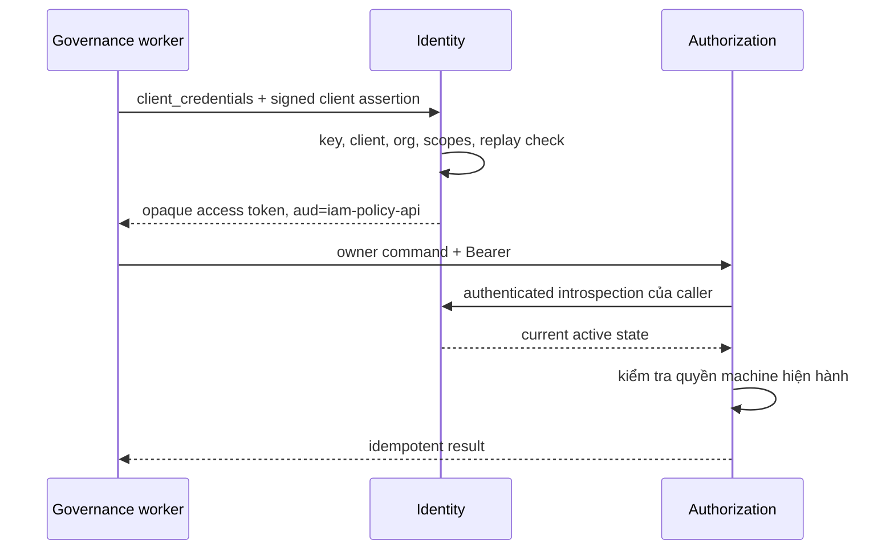

# 17. Workload identity, machine credentials và delegation

[Mục lục](../../README.md) · [Trước: governance](16-governance-privileged-access.md) · [Tiếp: Kubernetes](18-kubernetes.md)

## Đầu vào và lý do tách danh tính người/máy

Hoàn thành token endpoint, introspection, PDP và outbox trước chương này. Bạn cần Node 24, PostgreSQL 18, TLS local và client registration quản trị. Các route, audience và tên package tuân [implementation map](../reference/implementation-map.md). Machine identity không phải tài khoản nhân viên dùng chung password: nó không có mailbox, không làm interactive MFA và không được gắn group người dùng chỉ để vượt một policy.

Chúng ta triển khai client credentials cho daemon, thêm `private_key_jwt`, rồi một profile token exchange giới hạn. API nghiệp vụ vẫn kiểm tra token và trạng thái online mỗi request. Có thể giữ access token machine trong bộ nhớ đến gần expiry để gửi request; **giữ credential để trình bày khác với cache kết quả active**. Token bị revoke vẫn bị Identity trả inactive ở request tiếp theo.



## Bước 1 — Service principal có giới hạn

Đăng ký client `governance-worker`, confidential, bind organization Acme trong `clients.service_org_id`. Cho phép đúng grant và audience cần dùng; production không dùng một global credential cho mọi tenant. Với job nhiều org, cấp identity riêng theo integration hoặc triển khai broker được audit, không nhận `org_id` bất kỳ từ queue rồi phát token cho org đó.

Trong Identity token handler, nhánh `client_credentials` xác thực client trước, kiểm tra status, org status và app assignment. Scope request phải là tập con allowlist; audience được phép phải là một giá trị rõ ràng. Tạo grant có `user_id=NULL`, `session_id=NULL`, access token opaque ngẫu nhiên 32 byte, TTL năm phút; không trả ID token hay refresh token cho grant này. Introspection trả `sub=client:governance-worker`; không giả lập UUID Alice. PDP nhận diện `subject_type=client` và tra assignment tương ứng.

Hai danh tính cùng tồn tại khi một service làm thay người dùng: caller machine và subject người dùng. Audit phải giữ cả hai; nếu chỉ lưu Alice, bạn không biết service nào thực hiện. Nếu chỉ lưu worker, bạn không biết người nào đã ủy quyền. API không được tin header `X-User-ID` từ caller để dựng subject.

## Bước 2 — Tạo cặp khóa và đăng ký public key

Thêm thư viện JOSE vào đúng packages. Đây là thư viện ký/kiểm tra, không phải authorization server runtime:

```powershell
pnpm -C lab --filter @iam/identity add jose
pnpm -C lab --filter @iam/governance add jose
New-Item -ItemType Directory -Force lab/.secrets,lab/evidence/ch17 | Out-Null
@'
import { generateKeyPairSync, randomUUID } from 'node:crypto';
import { writeFileSync } from 'node:fs';
const pair = generateKeyPairSync('rsa', { modulusLength: 3072 });
const jwk = pair.publicKey.export({ format: 'jwk' });
Object.assign(jwk, { kid: randomUUID(), alg: 'RS256', use: 'sig' });
writeFileSync('lab/.secrets/governance-private.pem', pair.privateKey.export({
  format: 'pem', type: 'pkcs8' }), { mode: 0o600 });
writeFileSync('lab/.secrets/governance-public.jwk.json', JSON.stringify(jwk));
'@ | node --input-type=module
if ($LASTEXITCODE -ne 0) { throw 'Không tạo được key' }
$env:CLIENT_PRIVATE_KEY_FILE = (Resolve-Path lab/.secrets/governance-private.pem).Path
```

Đưa `lab/.secrets/` vào `.gitignore`; `mode` không thay Windows ACL, hãy kiểm tra Properties → Security và giới hạn quyền người dùng hiện tại. Chỉ public JWK được upload qua client-management API có step-up; lưu vào `clients.jwks.keys`. Không lấy JWKS URL từ JWT header `jku`, không download key theo `iss` không tin cậy. Đổi client auth method sang `private_key_jwt` bằng thao tác quản trị đã audit. Key dùng xác thực client độc lập key ký ID token của Identity.

## Bước 3 — Client assertion tự chứa

Tạo `lab/services/governance/src/client-assertion.ts`:

```typescript
import { readFile } from 'node:fs/promises';
import { randomUUID } from 'node:crypto';
import { importPKCS8, SignJWT } from 'jose';

export async function clientAssertion(input: {
  clientId: string; endpoint: string; kid: string;
}): Promise<string> {
  const path = process.env.CLIENT_PRIVATE_KEY_FILE;
  if (!path) throw new Error('CLIENT_PRIVATE_KEY_FILE missing');
  const key = await importPKCS8(await readFile(path, 'utf8'), 'RS256');
  return new SignJWT({})
    .setProtectedHeader({ alg: 'RS256', kid: input.kid, typ: 'JWT' })
    .setIssuer(input.clientId).setSubject(input.clientId)
    .setAudience(input.endpoint).setJti(randomUUID())
    .setIssuedAt().setExpirationTime('60s').sign(key);
}
```

Tạo token request bằng `URLSearchParams`, không JSON. `aud` trong assertion là URL endpoint **đang gọi**, còn `audience` trong grant là API cần token: hai trường này khác ý nghĩa. Dùng một assertion mới cho mỗi request, kể cả retry. Header Basic cùng assertion phải bị từ chối như nhiều cơ chế auth đồng thời.

```typescript
import { clientAssertion } from './client-assertion.js';

export async function policyMachineToken(kid: string): Promise<string> {
  const issuer = process.env.ISSUER;
  if (!issuer) throw new Error('ISSUER missing');
  const endpoint = new URL('/oauth2/token', issuer).href;
  const assertion = await clientAssertion({ clientId: 'governance-worker', endpoint, kid });
  const response = await fetch(endpoint, {
    method: 'POST', signal: AbortSignal.timeout(1000),
    headers: { 'content-type': 'application/x-www-form-urlencoded' },
    body: new URLSearchParams({ grant_type: 'client_credentials',
      client_id: 'governance-worker', scope: 'authz:grant',
      audience: 'iam-policy-api',
      client_assertion_type: 'urn:ietf:params:oauth:client-assertion-type:jwt-bearer',
      client_assertion: assertion }),
  });
  if (!response.ok) throw new Error(`TOKEN_HTTP_${response.status}`);
  const value: unknown = await response.json();
  if (typeof value !== 'object' || value === null || !('access_token' in value) ||
      typeof value.access_token !== 'string') throw new Error('TOKEN_RESPONSE_INVALID');
  return value.access_token;
}
```

`authz:grant` là scope lab cho owner mutation. Scope không tự cấp quyền tạo mọi role; Authorization vẫn áp policy giới hạn role và org cho caller. Với nhiều org, chọn credential từ registry bằng org đã được kiểm chứng; `invoice-api-beta`/`iam-policy-api-beta` không dùng credential Acme. PDP còn so caller org với resource org và resource_owners allowlist; cùng audience không tự cho phép cross-tenant.

## Bước 4 — Verify assertion và chống replay bền vững

Identity thêm migration sau. Không sửa schema bằng code startup của mọi replica:

```sql
CREATE TABLE IF NOT EXISTS client_assertion_replays (
  client_id text NOT NULL REFERENCES clients(id),
  jti text NOT NULL CHECK (length(jti) BETWEEN 1 AND 128),
  expires_at timestamptz NOT NULL,
  PRIMARY KEY (client_id, jti)
);
CREATE INDEX IF NOT EXISTS client_assertion_expiry ON client_assertion_replays(expires_at);
```

Nếu đã áp dụng toàn bộ schema Identity đích có bảng này, không tạo migration trùng; IF NOT EXISTS phục vụ checkpoint học, production vẫn kiểm tra schema checksum/version. Dưới đây là verifier trong `lab/services/identity/src/machine-auth.ts`. `pool` được định nghĩa ở chương dữ liệu; input endpoint lấy từ config issuer cố định, không từ Host header. Caller chỉ được truyền endpoint thực tế mà router đang xử lý.

```typescript
import { createLocalJWKSet, jwtVerify, type JSONWebKeySet } from 'jose';
import { pool } from './db.js';

export async function verifyMachineAssertion(
  clientId: string, assertion: string, endpoint: string,
): Promise<void> {
  if (assertion.length > 8192) throw new Error('INVALID_CLIENT_ASSERTION');
  const result = await pool.query<{
    status: string; token_endpoint_auth_method: string; jwks: JSONWebKeySet;
  }>('SELECT status,token_endpoint_auth_method,jwks FROM clients WHERE id=$1', [clientId]);
  const client = result.rows[0];
  if (!client || client.status !== 'active' ||
      client.token_endpoint_auth_method !== 'private_key_jwt') {
    throw new Error('INVALID_CLIENT');
  }
  const { payload } = await jwtVerify(assertion, createLocalJWKSet(client.jwks), {
    algorithms: ['RS256'], issuer: clientId, subject: clientId,
    audience: endpoint, clockTolerance: 5, maxTokenAge: '65s',
    requiredClaims: ['iss', 'sub', 'aud', 'iat', 'exp', 'jti'],
  });
  if (typeof payload.iat !== 'number' || typeof payload.exp !== 'number' ||
      payload.exp <= payload.iat || payload.exp - payload.iat > 60 ||
      typeof payload.jti !== 'string' || payload.jti.length > 128) {
    throw new Error('INVALID_CLIENT_ASSERTION');
  }
  await pool.query(`INSERT INTO client_assertion_replays(client_id,jti,expires_at)
    VALUES ($1,$2,to_timestamp($3)+interval '5 seconds')`,
    [clientId, payload.jti, payload.exp]);
}
```

Tích hợp verifier với protocol error handler: credential/JWT invalid hoặc unique violation `23505` trả `invalid_client`; lỗi kết nối DB, timeout, JWKS cấu hình hỏng trả 503 và báo vận hành. Không dùng `catch { return invalid_client }` bao cả truy vấn DB. Snippet cố ý để exceptions đi ra; người học viết mapping cụ thể và tests trước khi nối vào router. Background cleanup chỉ xóa replay row đã qua expiry cộng clock tolerance, không xóa sớm để giảm bảng.

Đăng ký thuật toán một cách cố định, reject HS256/none và khóa private upload nhầm. JWKS current lấy từ primary mỗi auth request để key/client disable có hiệu lực; cache parsed public key chỉ là tối ưu tính toán nếu đã xác nhận registration hiện hành và version, không được thay current-state check. Version đầu có thể không cache gì. Khi `private_key_jwt` dùng cho introspection, tạo assertion với audience `/oauth2/introspect`, không `/oauth2/token`.

## Bước 5 — Rotation không làm mất danh tính

Thêm public key K2 vào registration trước; triển khai caller ký K2; quan sát K1 không còn dùng, chờ hết 60 giây cộng lệch đồng hồ và network budget rồi gỡ K1. Giữ operator ability disable toàn client khi compromise. Không log PEM, assertion hoặc bearer token. Audit ghi `client_id`, `kid`, outcome, request ID; metric không dùng `jti` làm label vì cardinality vô hạn.

Client-secret-basic ban đầu vẫn hợp lệ cho lab nếu secret ngẫu nhiên mạnh, lưu hash và qua TLS. Không chạy Argon2 password verification cho hàng trăm introspections mỗi giây với machine secret entropy cao; benchmark crypto và DB riêng. Khi sang Kubernetes, projected service-account token dùng để đăng nhập Vault; nó không tự trở thành access token IAM. Hai hệ issuer/audience có trust contract riêng.

## Bước 6 — Delegation giới hạn thay vì chuyển tiếp token tùy nơi

[RFC 8693](https://www.rfc-editor.org/rfc/rfc8693.html) mô tả token exchange và actor. Profile lab chỉ hỗ trợ delegation một hop, opaque access token, không refresh, không impersonation bỏ actor. Ví dụ Governance nhận token Alice audience `governance-api` để chạy export; nó exchange sang audience `invoice-api` với scope `invoice.read`. Browser không được yêu cầu token mọi audience.

Nhánh token endpoint nhận `grant_type=urn:ietf:params:oauth:grant-type:token-exchange`, `subject_token`, `subject_token_type=urn:ietf:params:oauth:token-type:access_token`, `requested_token_type` cùng giá trị, `audience`, `scope`, cùng client auth. Identity kiểm tra subject token trực tiếp trong core, client audience policy và allowed delegation edge. Không gọi PDP từ Identity; resource owner quyết định quyền invoice bằng live policy sau đó.

Thêm `parent_grant_id` và `actor_client_id` vào grant bằng migration có foreign keys; depth tối đa 1. Downstream scope là giao của subject scope, client allowlist, requested scope; profile không cấp scope chưa có trong subject. TTL không vượt subject expiry. Introspection child kiểm tra cả grant cha, user/session/membership và trạng thái client nguồn/actor hiện hành, trả `act:{sub:"client:governance-worker"}`. Nếu chỉ kiểm tra child revoked_at, revoke parent sẽ bị vô hiệu hóa bởi token exchange.

Token exchange response gồm `access_token`, `issued_token_type`, `token_type:"Bearer"`, `expires_in`, `scope`. Audience không được phép trả lỗi `invalid_target`. Cấm subject là ID token hoặc refresh token trong profile này, cấm actor tùy ý do browser khai. Tests ghi rõ profile chưa hỗ trợ mọi biến thể RFC; capability metadata phải phản ánh đúng. Delegation một hop được thực hiện sau khi client credentials và replay tests ổn định, không thay cho bước nền.

## Kiểm thử và failure lab

Viết tests tự dựng key bằng `generateKeyPairSync`, không phụ thuộc PEM máy người học. Chạy `pnpm -C lab --filter @iam/identity test` rồi `pnpm -C lab --filter @iam/governance test`. Bắt buộc có wrong aud/iss/sub/kid, expired, future iat, oversized assertion, signature sai, algorithm sai, replay đồng thời và DB outage. Một trăm requests cùng jti phải chỉ có một lần auth thành công; các request còn lại không phát thêm grant.

Failure lab: dùng K1 lấy token machine, disable client trong transaction đã commit, giữ bearer cũ trong worker. Request owner mới phải bị chặn; đây là bằng chứng online checking hoạt động dù credential vẫn nằm trong RAM. Sau đó kill DB khi verify assertion: protected business request trả 503, không coi token active từ lần trước. Với delegated token, revoke parent rồi gọi invoice: check mới inactive; lưu hai thời điểm commit/check, không khẳng định hủy được request đã qua check trước đó.

Troubleshooting: assertion đúng chữ ký nhưng invalid_client thường do aud sai endpoint hoặc client key chưa đăng ký; kiểm tra metadata đã redact. Replay lỗi khi retry thường do caller tái dùng assertion; tạo jti mới. TLS unknown CA cần cấp đúng CA cho Node, không đặt `NODE_TLS_REJECT_UNAUTHORIZED=0`. Machine token active nhưng 403 là kiểm tra assignment/scope/org tại Policy, không phải lý do cấp `*`.

## Definition of Done và nguồn

- Machine principal tách user, bind org, có allowlists; token machine không có refresh/ID token.
- Verify claims, replay insert bền vững, error mapping và key rotation có tests, gồm lỗi dependency.
- Delegation giữ actor, giới hạn một hop, downscope và parent revocation; chưa hỗ trợ thì metadata không quảng cáo.
- Evidence nằm `lab/evidence/ch17/`; kết quả minh họa trong sách không được ghi là benchmark đã chạy.

Đọc [JWT client authentication](https://www.rfc-editor.org/rfc/rfc7523.html), [OAuth mTLS](https://www.rfc-editor.org/rfc/rfc8705.html) để phân biệt client authentication với certificate-bound token, và [Vault Kubernetes auth](https://developer.hashicorp.com/vault/docs/auth/kubernetes) cho chương tiếp. mTLS chỉ trở thành sender constraint khi resource server thực sự so certificate binding; thêm TLS vào network không tự biến bearer token thành token chống phát lại.
