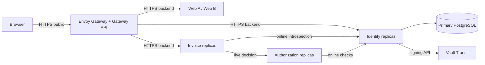

# 18. Từ Compose đến Kubernetes: TLS, isolation, Helm và Vault Transit

[Mục lục](../../README.md) · [Trước: workload](17-workload-delegation.md) · [Tiếp: CI/CD](19-cicd.md)

## Điều kiện và topology cần đạt

Hoàn thành các luồng ứng dụng trong Compose trước khi chuyển platform. Chương này không sửa lỗi OAuth bằng Kubernetes. Bạn cần Docker Desktop Linux containers/WSL2, khoảng 16 GB RAM dành cho Docker khi chạy đầy đủ, và CLI `kind`, `kubectl`, `helm`, `mkcert`. Đọc [versions](../reference/versions.md) trước cài đặt. Baseline ngày 28/10/2026: kind 0.33.0, kubectl 1.35.10, Helm 3.22.1, Kubernetes 1.35.8 theo image kind có digest; Envoy Gateway 1.9.3, cert-manager 1.21.3, Calico 3.33.0, Vault chart 0.34.1/runtime 2.2.1. Đây là pins để học; compatibility đọc từ upstream chưa thay cho integration test của bạn.



Namespace `iam` chứa ứng dụng; `security` chứa Vault lab; `envoy-gateway-system`, `cert-manager`, `tigera-operator` dành controllers. Database/Redis/RabbitMQ ở namespace `data` hoặc dịch vụ ngoài cluster có TLS. Mỗi DB owner vẫn độc lập. Cluster kind nhiều node container cùng nằm một máy: nó không chứng minh HA khi máy đó mất điện.

## Bước 1 — Cluster có CNI thực sự enforce NetworkPolicy

Tạo `lab/infra/kind/cluster.yaml`:

```yaml
kind: Cluster
apiVersion: kind.x-k8s.io/v1alpha4
networking:
  disableDefaultCNI: true
  podSubnet: 192.168.0.0/16
nodes:
  - role: control-plane
  - role: worker
  - role: worker
```

Nếu subnet trùng LAN/VPN, đổi cả kind và Calico IP pool trong cùng commit; không chạy hai CIDR khác nhau. Lệnh PowerShell ở root:

```powershell
kind create cluster --name iam --config lab/infra/kind/cluster.yaml `
  --image 'kindest/node:v1.35.8@sha256:07b2536e30b803ed61d1677a79df6115f798ce64c80f9e22f6ed45afd09323c0'
if ($LASTEXITCODE -ne 0) { throw 'kind create thất bại' }
kubectl config use-context kind-iam
helm repo add projectcalico https://docs.tigera.io/calico/charts
helm repo add hashicorp https://helm.releases.hashicorp.com
helm repo update
helm upgrade --install calico projectcalico/tigera-operator --version v3.33.0 `
  --namespace tigera-operator --create-namespace --wait --timeout 10m
kubectl wait --for=condition=Ready nodes --all --timeout=300s
helm upgrade --install eg oci://docker.io/envoyproxy/gateway-helm --version v1.9.3 `
  --namespace envoy-gateway-system --create-namespace --wait --timeout 10m
helm upgrade --install cert-manager oci://quay.io/jetstack/charts/cert-manager `
  --version v1.21.3 --namespace cert-manager --create-namespace `
  --set crds.enabled=true --set config.enableGatewayAPI=true --wait --timeout 10m
kubectl create namespace iam
kubectl create namespace security
kubectl create namespace data
```

Nodes NotReady trước khi CNI chạy là kỳ vọng; NotReady sau timeout là lỗi cần điều tra. [Calico requirements](https://docs.tigera.io/calico/latest/getting-started/kubernetes/requirements) liệt kê baseline Kubernetes được test. Không suy ra NetworkPolicy hoạt động chỉ vì `kubectl apply` trả created; bài kiểm chứng packet ở cuối chương mới là bằng chứng.

## Bước 2 — Certificate và đường dẫn public cố định

Tạo CA lab bằng cert-manager: một `ClusterIssuer` SelfSigned tên `lab-bootstrap`, một `Certificate` CA trong namespace `cert-manager` tên `lab-root`, secret `lab-root-ca`, `isCA:true`, rồi `ClusterIssuer` CA tên `lab-ca` trỏ secret đó. Ba resources có dạng:

```yaml
apiVersion: cert-manager.io/v1
kind: ClusterIssuer
metadata: {name: lab-bootstrap}
spec: {selfSigned: {}}
---
apiVersion: cert-manager.io/v1
kind: Certificate
metadata: {name: lab-root, namespace: cert-manager}
spec:
  isCA: true
  commonName: IAM Lab Root
  secretName: lab-root-ca
  issuerRef: {name: lab-bootstrap, kind: ClusterIssuer}
---
apiVersion: cert-manager.io/v1
kind: ClusterIssuer
metadata: {name: lab-ca}
spec: {ca: {secretName: lab-root-ca}}
```

Lưu thành `lab/infra/kind/ca.yaml`, apply rồi wait certificate Ready. Root CA private key trong cluster chỉ dành lab. Production dùng CA/ACME của tổ chức, ownership/DNS challenge và key custody được quản lý; không copy private CA key từ máy phát triển.

Tạo certificate `iam-gateway` namespace iam, secret `iam-gateway-tls`, issuer `lab-ca`, DNS names `iam.local.test`, `app-a.local.test`, `app-b.local.test`, `api.local.test`. Tạo một Certificate nữa cho mỗi backend, secret `<service>-backend-tls`, DNS `<service>.iam.svc.cluster.local`; Vault dùng `vault.security.svc`, `vault.security.svc.cluster.local`, `vault-0.vault-internal.security.svc.cluster.local` và IP `127.0.0.1` cho CLI lab. Không dùng wildcard certificate chung làm workload identity.

Export **public CA** để trust, không export `tls.key`:

```powershell
kubectl apply -f lab/infra/kind/ca.yaml
kubectl -n cert-manager wait certificate/lab-root --for=condition=Ready --timeout=120s
$caData = kubectl -n cert-manager get secret lab-root-ca -o 'jsonpath={.data.tls\.crt}'
[IO.File]::WriteAllBytes((Join-Path (Get-Location) 'lab/.secrets/kind-ca.crt'),
  [Convert]::FromBase64String($caData))
Import-Certificate -FilePath lab/.secrets/kind-ca.crt -CertStoreLocation Cert:\CurrentUser\Root | Out-Null
kubectl -n iam create configmap iam-internal-ca --from-file=ca.crt=lab/.secrets/kind-ca.crt
```

Trust CA này chỉ trên máy lab; ghi fingerprint vào evidence. Node dùng `NODE_EXTRA_CA_CERTS=/run/ca/ca.crt`; browser trust không tự cấu hình Node. Khi certificate rotate, recreate workload nếu Node chỉ đọc CA lúc startup. Không vô hiệu hóa certificate verification.

## Bước 3 — Service HTTPS và Helm chart tối thiểu

Ở bootstrap từng Express service, dùng `node:https` khi `TLS_CERT_FILE`/`TLS_KEY_FILE` được cấu hình. Đặt helper vào `src/https-server.ts`, gọi `startHttps(app, config.port)` thay `app.listen` trong bootstrap đã có; không tạo server thứ hai:

```typescript
import { readFileSync } from 'node:fs';
import { createServer } from 'node:https';
import type { Express } from 'express';
export function startHttps(app: Express, port: number) {
  const certPath = process.env.TLS_CERT_FILE;
  const keyPath = process.env.TLS_KEY_FILE;
  if (!certPath || !keyPath) throw new Error('Kubernetes requires backend TLS');
  const server = createServer({ cert: readFileSync(certPath), key: readFileSync(keyPath) }, app);
  server.listen(port, '0.0.0.0');
  process.on('SIGTERM', () => {
    server.close(() => process.exit(0));
    setTimeout(() => process.exit(1), 25_000).unref();
  });
  return server;
}
```

Kết hợp shutdown với drain pool/worker ở chương async. Base URL nội bộ là HTTPS service DNS, còn issuer/aud của protocol lấy config public cố định; client assertion cho introspection vẫn dùng canonical public endpoint mà verifier cấu hình. Không thay issuer thành `https://identity.iam.svc...` chỉ vì transport đi nội bộ.

Tạo `lab/infra/helm/iam/Chart.yaml` (`apiVersion:v2`, `name:iam`, `version:0.1.0`), `values.yaml` và `templates/identity.yaml`. Values cho lần đầu:

```yaml
identity:
  image: iam/identity:lab
  replicas: 2
  issuer: https://iam.local.test:8443
```

Template sau là deployment/service tối thiểu; người học lặp cùng mẫu cho authorization:3300, audit:3400, governance:3500, invoice-api:3200, web-a:3101, web-b:3102, giữ label app và secret riêng từng service:

```yaml
apiVersion: apps/v1
kind: Deployment
metadata: {name: identity}
spec:
  replicas: {{ .Values.identity.replicas }}
  selector: {matchLabels: {app: identity}}
  strategy: {rollingUpdate: {maxUnavailable: 0, maxSurge: 1}}
  template:
    metadata: {labels: {app: identity}}
    spec:
      serviceAccountName: identity
      automountServiceAccountToken: false
      terminationGracePeriodSeconds: 30
      securityContext: {runAsNonRoot: true, runAsUser: 1000, fsGroup: 1000}
      containers:
        - name: identity
          image: {{ .Values.identity.image | quote }}
          imagePullPolicy: IfNotPresent
          ports: [{name: https, containerPort: 3000}]
          envFrom: [{secretRef: {name: identity-runtime}}]
          env:
            - {name: ISSUER, value: {{ .Values.identity.issuer | quote }}}
            - {name: PORT, value: "3000"}
            - {name: TLS_CERT_FILE, value: /run/tls/tls.crt}
            - {name: TLS_KEY_FILE, value: /run/tls/tls.key}
            - {name: NODE_EXTRA_CA_CERTS, value: /run/ca/ca.crt}
          securityContext:
            allowPrivilegeEscalation: false
            readOnlyRootFilesystem: true
            capabilities: {drop: [ALL]}
          resources:
            requests: {cpu: 100m, memory: 128Mi}
            limits: {cpu: "1", memory: 512Mi}
          startupProbe:
            httpGet: {path: /health/live, port: https, scheme: HTTPS}
            failureThreshold: 30
            periodSeconds: 2
          readinessProbe:
            httpGet: {path: /health/ready, port: https, scheme: HTTPS}
          livenessProbe:
            httpGet: {path: /health/live, port: https, scheme: HTTPS}
          volumeMounts:
            - {name: tls, mountPath: /run/tls, readOnly: true}
            - {name: ca, mountPath: /run/ca, readOnly: true}
            - {name: tmp, mountPath: /tmp}
      volumes:
        - {name: tls, secret: {secretName: identity-backend-tls}}
        - {name: ca, configMap: {name: iam-internal-ca}}
        - {name: tmp, emptyDir: {sizeLimit: 32Mi}}
---
apiVersion: v1
kind: Service
metadata: {name: identity}
spec:
  selector: {app: identity}
  ports: [{name: https, port: 3000, targetPort: https}]
```

Tạo `ServiceAccount identity`; runtime secret chỉ có DSN/credential thực cần. Dùng `kubectl create secret generic identity-runtime --from-env-file=lab/.secrets/identity.k8s.env`; không commit env file. Database URL phải tới primary từ trong cluster, không `127.0.0.1` của host. Dockerfile của service phải tồn tại từ chương container trước; build và load image vào đúng cluster:

```powershell
docker build -f lab/infra/Dockerfile --build-arg 'PACKAGE=@iam/identity' -t iam/identity:lab lab
if ($LASTEXITCODE -ne 0) { throw 'Image build failed' }
kind load docker-image iam/identity:lab --name iam
helm lint lab/infra/helm/iam
helm template iam lab/infra/helm/iam --namespace iam | kubectl apply --dry-run=server -f -
helm upgrade --install iam lab/infra/helm/iam --namespace iam --wait --timeout 5m
kubectl -n iam rollout status deployment/identity --timeout=180s
```

Liveness không ping DB/Policy/Vault: dependency lỗi không được làm restart storm. Readiness kiểm tra DB primary và khả năng serve core checks. Vault signing outage có thể làm token mint trả 503 trong khi introspection opaque vẫn hoạt động; xuất health theo capability, đừng loại hết replicas còn phục vụ được introspection chỉ vì signer tạm lỗi.

## Bước 4 — Gateway API thay reverse proxy local

Dockerfile dùng mẫu đầy đủ tại [chương 19](19-cicd.md#bước-3--image-nhỏ-immutable-và-build-một-lần); tạo file đó trước lần build đầu. Liveness không thay security checks.

Tạo `lab/infra/kind/gateway.yaml`:

```yaml
apiVersion: gateway.networking.k8s.io/v1
kind: GatewayClass
metadata: {name: eg}
spec: {controllerName: gateway.envoyproxy.io/gatewayclass-controller}
---
apiVersion: gateway.networking.k8s.io/v1
kind: Gateway
metadata: {name: iam-gateway, namespace: iam}
spec:
  gatewayClassName: eg
  listeners:
    - name: https
      port: 443
      protocol: HTTPS
      tls: {mode: Terminate, certificateRefs: [{name: iam-gateway-tls}]}
      allowedRoutes: {namespaces: {from: Same}}
---
apiVersion: gateway.networking.k8s.io/v1
kind: HTTPRoute
metadata: {name: identity-public, namespace: iam}
spec:
  parentRefs: [{name: iam-gateway, sectionName: https}]
  hostnames: [iam.local.test]
  rules:
    - matches:
        - {path: {type: PathPrefix, value: /oauth2}}
        - {path: {type: PathPrefix, value: /.well-known}}
        - {path: {type: PathPrefix, value: /login}}
        - {path: {type: PathPrefix, value: /interactions}}
      backendRefs: [{name: identity, port: 3000}]
```

Apply file rồi thêm route từng host web-a/web-b và API `/v1/invoices` trỏ đúng Service. Auth UI/account routes ngoài allowlist phải thêm explicit sau review; `/internal`, management và health debug không public theo wildcard. Cấu hình callback đăng ký vẫn giữ URL public cũ.

Với Gateway API 1.6.1, thêm BackendTLSPolicy cho từng Service:

```yaml
apiVersion: gateway.networking.k8s.io/v1
kind: BackendTLSPolicy
metadata: {name: identity-tls, namespace: iam}
spec:
  targetRefs: [{group: "", kind: Service, name: identity, sectionName: https}]
  validation:
    caCertificateRefs: [{group: "", kind: ConfigMap, name: iam-internal-ca}]
    hostname: identity.iam.svc.cluster.local
```

Kiểm tra Gateway Accepted, HTTPRoute Accepted/ResolvedRefs và controller logs; kind không có cloud LoadBalancer nên external IP có thể Pending. Dùng port-forward tới data-plane Service, giữ nguyên bốn URL local; dừng Caddy Compose trước để tránh port conflict:

```powershell
$proxy = kubectl -n envoy-gateway-system get service `
  -l 'gateway.envoyproxy.io/owning-gateway-name=iam-gateway,gateway.envoyproxy.io/owning-gateway-namespace=iam' `
  -o 'jsonpath={.items[0].metadata.name}'
if (-not $proxy) { throw 'Gateway data-plane Service chưa được tạo' }
kubectl -n envoy-gateway-system port-forward "service/$proxy" 8443:443 8444:443 8445:443 8446:443
```

Giữ terminal này; terminal khác gọi discovery qua HTTPS. Public DNS/hosts vẫn như chương TLS local. Gateway chỉ routing/transport/rate controls; resource middleware vẫn introspect. Không cài Envoy JWT policy để thay opaque-token check.

## Bước 5 — NetworkPolicy deny mặc định

[Kubernetes NetworkPolicy](https://kubernetes.io/docs/concepts/services-networking/network-policies/) kiểm soát traffic theo pod/namespace/port khi CNI hỗ trợ. Tạo default deny ingress+egress namespace iam. Sau đó cho DNS UDP/TCP 53 đến CoreDNS; cho Envoy ingress vào BFF/Identity/Invoice; cho đúng callers đến Identity:3000 và Authorization:3300; Identity chỉ đến DB/Redis/Vault; workers tới RabbitMQ/owner APIs. Data namespace cũng cần ingress policy, nếu không deny ở iam chưa bảo vệ khỏi pod namespace khác.

Ví dụ allow Invoice đến Identity gồm cả egress ở nguồn và ingress ở đích, tạo dưới templates:

```yaml
apiVersion: networking.k8s.io/v1
kind: NetworkPolicy
metadata: {name: invoice-to-identity, namespace: iam}
spec:
  podSelector: {matchLabels: {app: invoice-api}}
  policyTypes: [Egress]
  egress:
    - to: [{podSelector: {matchLabels: {app: identity}}}]
      ports: [{protocol: TCP, port: 3000}]
---
apiVersion: networking.k8s.io/v1
kind: NetworkPolicy
metadata: {name: identity-from-invoice, namespace: iam}
spec:
  podSelector: {matchLabels: {app: identity}}
  policyTypes: [Ingress]
  ingress:
    - from: [{podSelector: {matchLabels: {app: invoice-api}}}]
      ports: [{protocol: TCP, port: 3000}]
```

Đây chỉ hai cạnh của graph; lập bảng tất cả cạnh và tạo policy tương ứng trước bật deny. Không thêm `0.0.0.0/0` để làm xanh probes. Node/kubelet traffic và semantics của CNI cần kiểm chứng riêng; health endpoint không trả secret và không thay service authentication.

## Bước 6 — Vault Transit giữ private signing key

Tạo Vault TLS certificate như bước 2. Lưu `lab/infra/kind/vault-values.yaml`:

```yaml
injector: {enabled: false}
server:
  image: {repository: hashicorp/vault, tag: 2.2.1}
  dev: {enabled: false}
  standalone: {enabled: false}
  dataStorage: {enabled: true, size: 2Gi}
  extraEnvironmentVars:
    VAULT_CACERT: /vault/userconfig/vault-tls/ca.crt
  volumes:
    - {name: vault-tls, secret: {secretName: vault-tls}}
  volumeMounts:
    - {name: vault-tls, mountPath: /vault/userconfig/vault-tls, readOnly: true}
  ha:
    enabled: true
    replicas: 1
    raft:
      enabled: true
      config: |
        ui = true
        listener "tcp" {
          address = "[::]:8200"
          cluster_address = "[::]:8201"
          tls_cert_file = "/vault/userconfig/vault-tls/tls.crt"
          tls_key_file = "/vault/userconfig/vault-tls/tls.key"
        }
        storage "raft" { path = "/vault/data" }
        api_addr = "https://vault.security.svc:8200"
        cluster_addr = "https://vault-0.vault-internal.security.svc:8201"
```

```powershell
helm upgrade --install vault hashicorp/vault --version 0.34.1 --namespace security `
  -f lab/infra/kind/vault-values.yaml
kubectl -n security get pod,pvc
```

Không `--wait` trước initialize/unseal vì readiness sealed sẽ chưa pass. Không dùng tls_disable/root token hardcode. Production cần ba Raft members khác failure domain và custody theo runbook; chart/version override vẫn phải được bạn integration-test.

Khởi tạo bằng `kubectl -n security exec -it vault-0 -- vault operator init -key-shares=3 -key-threshold=2`; lưu kết quả vào secret custody riêng, không evidence/log/Git. Unseal hai lần qua prompt `vault operator unseal`, không đưa key vào command arguments. Root token chỉ bootstrap; runtime dùng Kubernetes auth. Mở shell `kubectl -n security exec -it vault-0 -- /bin/sh`, `vault login` qua prompt kín. Lệnh sau là **Linux shell bên trong Vault pod**:

```bash
vault secrets enable transit
vault write transit/keys/iam-id type=rsa-3072 exportable=false
vault auth enable kubernetes
vault write auth/kubernetes/config kubernetes_host=https://kubernetes.default.svc:443
vault write auth/kubernetes/role/identity \
  bound_service_account_names=identity bound_service_account_namespaces=iam \
  audience=vault token_policies=iam-signer token_ttl=10m token_max_ttl=30m
```

Vault trong pod dùng local mounted service-account reviewer theo [Vault Kubernetes auth](https://developer.hashicorp.com/vault/docs/auth/kubernetes); cấp `system:auth-delegator` cho service account vault/security. Ghi policy file HCL `path "transit/sign/iam-id" { capabilities=["update"] }`, chạy `vault policy write iam-signer <file>` trong operator session; không rotate/delete/export. Trước thu hồi root bootstrap token, thiết lập operator recovery identity/custody độc lập.

Identity thêm projected service-account volume audience vault, expirationSeconds 600, path `vault.jwt`; Agent sidecar `hashicorp/vault:2.2.1` mount JWT và CA read-only, shared memory emptyDir `/vault/agent` writable. Đặt config Agent vào ConfigMap, mount `/vault/config`, command `vault agent -config=/vault/config/agent.hcl`:

```hcl
vault {
  address = "https://vault.security.svc:8200"
  ca_cert = "/run/ca/ca.crt"
}
auto_auth {
  method "kubernetes" {
    mount_path = "auth/kubernetes"
    config {
      role = "identity"
      token_path = "/var/run/secrets/tokens/vault.jwt"
    }
  }
  sink "file" { config = { path = "/vault/agent/token" } }
}
```

App chỉ đọc sink token, không dùng Kubernetes JWT làm Vault bearer. Test Agent renew/re-auth qua nhiều TTL và app trả 503 khi token file chưa tồn tại; không dùng root token tạm cho signer.

Đối với RS256, gửi Transit `input=base64(UTF8(headerBase64url+'.'+payloadBase64url))`, `hash_algorithm=sha2-256`, `signature_algorithm=pkcs1v15`, `prehashed=false`; lấy phần base64 signature từ `vault:vN:...` rồi encode base64url. Đây là adapter KMS cho JOSE signing input, không thay đổi claims validation. Export **public** RSA key thành JWK bằng `node:crypto.createPublicKey(...).export({format:'jwk'})`, map mỗi Transit key version tới kid trong `signing_keys`. Pin key_version khi ký để rotation không làm header kid lệch actual key. Không bật exportable private key cho tiện debug.

## Kiểm thử, failure lab và DoD

Tạo PodDisruptionBudget `minAvailable:1` cho Identity hai replicas và topology spread qua hostname. Thêm requests/limits từng service trước HPA; autoscale không được làm tổng DB pools vượt connection budget. Test delete một pod khi traffic chạy, token vẫn phải check online. Cố gọi Identity từ pod label không được phép: timeout; từ Invoice: TLS thành công. Disable client rồi gọi qua Gateway, gọi trực tiếp Service và conditional GET: cả ba đều không bypass.

Failure lab: chặn Invoice→Identity bằng policy; request trả 503 trong deadline, không dùng allow cũ. Phục hồi policy rồi kill một Identity pod. Sau đó seal Vault: token mint thất bại có kiểm soát, introspection vẫn phản ánh revocation khi DB còn hoạt động. Lưu manifests, versions, events và status codes; không ghi “HA đạt” chỉ từ rollout succeeded.

Troubleshooting: ImagePullBackOff kiểm tra kind image load/pull secret và architecture; x509 lỗi kiểm tra SAN/CA/hostname, không skip verification; Gateway 503 kiểm tra EndpointSlice, BackendTLSPolicy và readiness; mọi Pod NotReady kiểm tra Calico/subnet trước ứng dụng. Vault 403 kiểm tra policy, role audience và service account, không thay runtime credential bằng root.

- Hai apps, Identity và Invoice truy cập được qua URL cũ; nội bộ dùng TLS đúng CA.
- Chart render/server dry-run thành công; secrets không nằm Git; workloads non-root, read-only filesystem và service accounts tách biệt.
- NetworkPolicy được chứng minh bằng positive/negative probes; online checking giữ nguyên khi đi thẳng Service.
- Vault private key không export; rotation/version/kid và agent renewal đã test; backup/unseal được diễn tập trước production.

Nguồn: [kind release 0.33.0](https://github.com/kubernetes-sigs/kind/releases/tag/v0.33.0), [Envoy compatibility](https://gateway.envoyproxy.io/news/releases/matrix/), [cert-manager Helm](https://cert-manager.io/docs/installation/helm/), [Vault Transit API](https://developer.hashicorp.com/vault/api-docs/secret/transit), [Gateway TLS](https://gateway-api.sigs.k8s.io/guides/tls/). Những lệnh và trạng thái trên là hướng dẫn/kỳ vọng; sách chưa chạy cluster của bạn.
