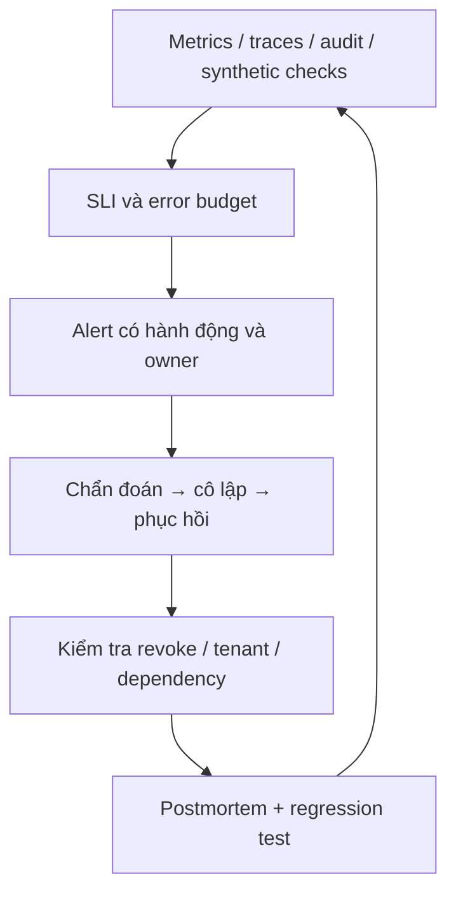

# 20. SRE, kiểm thử tải, phục hồi và cổng production

[Mục lục](../../README.md) · [Trước: CI/CD](19-cicd.md) · [Runbooks](../reference/runbooks.md) · [Checklist](../reference/production-checklist.md)

## Điều kiện và ý nghĩa “hoàn thành”

Ứng dụng, CI, staging và Kubernetes của bạn đã hoạt động theo các chương trước. Đến đây có hai loại bằng chứng khác nhau: correctness/security tests xác nhận hệ thống xử lý đúng, operational tests xác nhận nó tiếp tục xử lý đúng khi tải tăng hoặc một thành phần lỗi. Một dashboard xanh không chứng minh tenant isolation; một conformance report cũng không chứng minh backup restore được.

Chương này đặt mục tiêu lab cụ thể để bạn thực hành; sách **không có kết quả benchmark đã đo** cho ứng dụng bạn chưa viết. Mục tiêu ban đầu: 10.000 users, 100 organizations, 20.000 memberships, 50.000 active tokens; protected API 100 requests/giây trong 15 phút; p95 introspection ≤50 ms, p95 API ≤150 ms. Chỉ kết luận đạt sau khi lưu phiên bản, cấu hình, dữ liệu, lệnh và raw results. Nếu không đạt, giữ kết quả thật rồi tìm bottleneck; không sửa threshold để báo xanh.



## Bước 1 — Đo những điểm quyết định đúng

Trong từng service, instrument HTTP ingress, outbound introspection, PDP call và SQL latency. Dùng route template, outcome, service và status class làm labels. Không dùng user ID, org ID, token hash, URL có resource ID hoặc error message làm metric labels: cardinality và dữ liệu nhạy cảm sẽ tăng không kiểm soát. Log giữ correlation/request/decision ID; audit giữ sự kiện quản trị bền vững; trace chỉ metadata đã redact, không body/token/authorization header.

Ví dụ `prom-client@15.1.3` trong Invoice API, file `src/metrics.ts`:

```typescript
import { Counter, Histogram, Registry } from 'prom-client';
export const registry = new Registry();
export const checks = new Counter({
  name: 'iam_online_checks_total', help: 'Online dependency check outcomes',
  labelNames: ['dependency', 'outcome'] as const, registers: [registry],
});
export const latency = new Histogram({
  name: 'iam_online_check_seconds', help: 'Online check duration',
  labelNames: ['dependency'] as const,
  buckets: [0.005, 0.01, 0.025, 0.05, 0.1, 0.2, 0.5, 1], registers: [registry],
});
```

Thêm dependency bằng `pnpm -C lab --filter @iam/invoice-api add prom-client@15.1.3`. Ở middleware, timer bắt đầu trước network call và kết thúc trong finally; `outcome` là `active`, `inactive`, `allow`, `deny`, `error`, không `true/false` gộp outage vào denied. Expose `/metrics` chỉ tới collector identity/network được phép; endpoint này không dùng human login redirect. Collector vẫn cần authentication/mTLS riêng, không public internet. Identity introspection không ghi `last_seen` vào primary mỗi request chỉ để dashboard; audit security mutations đi outbox, usage metrics đi telemetry.

Trace một protected request phải thấy đủ đường: Invoice introspect user → PDP → PDP introspect caller và subject → SQL live policy. Vì contract xác minh lại trong PDP, 100 external RPS có thể tạo khoảng 300 introspections/giây, cộng refresh và các request quản trị. Đây là suy luận từ topology, không benchmark. Tính capacity từ tổng hops/fan-out, không từ số browser requests.

## Bước 2 — SLO và deadline có ngân sách

Chọn SLO end-to-end ban đầu 99,9% trong 30 ngày cho protected requests hợp lệ. Đây là request-based SLI: error budget là 0,1% số request trong phạm vi. Nếu đo time-based availability riêng thì 99,9% của 30 ngày tương đương 43 phút 12 giây downtime; không dùng phép đổi phút đó thay error budget request-based. Đây là target, không chứng nhận availability. SLI cần phân biệt 401/403 đúng hợp đồng với 5xx/timeout sai trải nghiệm; synthetic flow với credential biết chắc hợp lệ phát hiện lỗi “mọi request đều 401” mà server-error ratio bỏ sót. Track rate limiting của traffic hợp lệ riêng để không giấu overload dưới nhãn client error.

Đặt outbound introspection/PDP deadlines theo tổng đường gọi: ví dụ 300 ms mỗi hop quan trọng, budget kiểm tra toàn request tối đa 900 ms, trả 503 trong khoảng một giây khi dependency không phản hồi. Các hop lồng nhau không được mỗi nơi tự chờ một giây rồi làm tổng thành nhiều giây. Truyền deadline còn lại, không retry mặc định trong synchronous auth path; caller có thể retry request idempotent theo nghiệp vụ. Mutation như approve invoice cần idempotency/version, không tự retry sau timeout không biết kết quả.

Một circuit breaker bảo vệ tài nguyên có thể fail fast 503 khi mở; nó không được trả active/allow cũ. Giới hạn concurrency, queue và DB pool; HPA tăng replicas phải giữ tổng connection dưới budget. Alert theo burn rate nhiều cửa sổ và synthetic auth failure, kèm runbook. Đừng page một người chỉ vì có một 401 từ token sai. Tách cảnh báo outbox lag, backup age, certificate expiry, replication health và credential/key rotation.

## Bước 3 — Chuẩn bị dữ liệu tải mà không thêm password grant

Tạo benchmark database/tenant độc lập với staging người dùng. Seed 10.000 accounts, 100 orgs, 20.000 memberships qua fixture/migration test đã guard môi trường; tạo invoices và roles reader đúng org. Dùng CSPRNG cho token rows và SHA-256 như production; không chèn raw token vào DB. Chỉ benchmark fixture được phép seed grant trực tiếp, không tạo endpoint HTTP `mint-as-user` hoặc bật password grant để dễ chạy tải.

Fixture phải tạo các grant/session hợp lệ, code/refresh semantics đúng schema và xuất file `lab/.secrets/load-tokens.json` có dạng:

```json
[{"access_token":"generated-at-runtime","refresh_token":"generated-at-runtime","expires_at":1793149500,"invoice_id":"40000000-0000-4000-8000-000000000001"}]
```

Mẫu chỉ mô tả shape; các chuỗi không phải credential dùng được. Cần ít nhất 200 rows độc lập, tốt hơn 50.000 để đo lookup trên tập dữ liệu lớn. Mỗi row phải có token thuộc client `web-a`, audience invoice-api, scopes phù hợp và resource cùng tenant. Tạo bằng script seed của bạn dùng schema owner trong môi trường benchmark; bảo vệ script bằng explicit `BENCHMARK_MODE=true`, kiểm tra tên database và không đóng gói vào image production. File chứa refresh token nên chỉ current user đọc, không commit/upload CI artifact.

## Bước 4 — k6 theo arrival rate, có refresh thật

Cài k6 2.3.0 từ [release chính thức](https://github.com/grafana/k6/releases/tag/v2.3.0). Tạo `lab/load/online-checks.k6.js`; protected invoice route chuẩn hóa tại đây là `GET /v1/invoices/:id`. Nếu trước đó bạn chọn tên khác, đổi route cùng tests và contract, không benchmark health endpoint rồi gọi là auth throughput.

```javascript
import http from 'k6/http';
import encoding from 'k6/encoding';
import { check, fail } from 'k6';
import { SharedArray } from 'k6/data';
import { Rate } from 'k6/metrics';

const principals = new SharedArray('principals', () =>
  JSON.parse(open('../.secrets/load-tokens.json')));
const mode = __ENV.MODE || 'api';
const kind = mode === 'introspection' ? 'introspection' : 'api';
const maxVUs = 200;
const bad = new Rate('unexpected_result');
const localState = new Map();
const tokenBasic = `Basic ${encoding.b64encode(`web-a:${__ENV.WEB_A_CLIENT_SECRET}`)}`;
const introspectBasic = `Basic ${encoding.b64encode(`invoice-api:${__ENV.INVOICE_CLIENT_SECRET}`)}`;
export const options = {
  scenarios: { steady: { executor: 'constant-arrival-rate', rate: 100,
    timeUnit: '1s', duration: '15m', preAllocatedVUs: 50, maxVUs } },
  thresholds: {
    unexpected_result: ['rate<0.001'], dropped_iterations: ['count==0'],
    [`http_req_duration{kind:${kind}}`]: kind === 'api'
      ? ['p(95)<150', 'p(99)<300'] : ['p(95)<50', 'p(99)<100'],
  },
};
export default function () {
  if (principals.length < maxVUs) fail('Need >=200 independent principals');
  const slots = Math.floor(principals.length / maxVUs);
  const index = (__VU - 1) + (__ITER % slots) * maxVUs;
  let state = localState.get(index);
  if (!state) { state = { ...principals[index] }; localState.set(index, state); }
  if (state.expires_at <= Date.now() / 1000 + 30) {
    const r = http.post(`${__ENV.ISSUER}/oauth2/token`, {
      grant_type: 'refresh_token', refresh_token: state.refresh_token,
    }, { headers: { Authorization: tokenBasic }, tags: { kind: 'refresh' }, timeout: '2s' });
    if (r.status !== 200) { bad.add(true); fail('Refresh failed; redact response'); }
    const next = r.json();
    if (!next.access_token || !next.refresh_token || !(next.expires_in > 0)) {
      bad.add(true); fail('Invalid refresh response');
    }
    Object.assign(state, { access_token: next.access_token,
      refresh_token: next.refresh_token, expires_at: Date.now() / 1000 + next.expires_in });
  }
  let response;
  if (kind === 'introspection') {
    response = http.post(`${__ENV.ISSUER}/oauth2/introspect`, { token: state.access_token }, {
      headers: { Authorization: introspectBasic }, tags: { kind }, timeout: '2s',
    });
    const ok = response.status === 200 && response.json('active') === true;
    bad.add(!ok); check(response, { 'current active state': () => ok });
  } else {
    response = http.get(`${__ENV.API_URL}/v1/invoices/${state.invoice_id}`, {
      headers: { Authorization: `Bearer ${state.access_token}` },
      tags: { kind }, timeout: '2s',
    });
    bad.add(response.status !== 200);
    check(response, { 'authorized invoice read': r => r.status === 200 });
  }
}
export function handleSummary(data) {
  return { [`lab/evidence/ch20/k6-${kind}.json`]: JSON.stringify(data, null, 2) };
}
```

VU index partition bảo đảm hai VU không consume cùng refresh token; mỗi VU giữ successor trong bộ nhớ của nó. File input không được sửa trong khi chạy. Refresh cần thiết vì token mặc định năm phút ngắn hơn test 15 phút; tăng TTL riêng để test xanh sẽ bỏ qua thực tế rotation. k6 processes song song phải dùng tập principal khác nhau. `response.json` malformed phải làm test fail; không coi HTTP 200 tự động là active.

```powershell
New-Item -ItemType Directory -Force lab/evidence/ch20 | Out-Null
$env:ISSUER = 'https://iam.local.test:8443'
$env:API_URL = 'https://api.local.test:8446'
if (-not $env:WEB_A_CLIENT_SECRET -or -not $env:INVOICE_CLIENT_SECRET) { throw 'Thiếu client secrets' }
$env:MODE = 'introspection'
k6 run lab/load/online-checks.k6.js
if ($LASTEXITCODE -ne 0) { throw 'Introspection thresholds failed' }
# Seed lại refresh fixture trước lượt mới: lượt trước đã consume tokens.
$env:MODE = 'api'
k6 run lab/load/online-checks.k6.js
if ($LASTEXITCODE -ne 0) { throw 'API thresholds failed' }
```

Không bật insecureSkipTLSVerify. Ghi CPU/RAM, Docker allocation, pod count, pool sizes, DB indexes, rows và certificate path. Theo [k6 thresholds](https://grafana.com/docs/k6/latest/using-k6/thresholds/), threshold fail tạo exit nonzero; output ví dụ trong tài liệu không thay số đo của bạn. Tăng tải đến saturation ở lượt khác, quan sát bounded 503 thay memory/connection collapse; đừng trộn intentional outage vào latency baseline rồi giải thích tùy tiện.

## Bước 5 — HA không được hồi sinh quyền bị thu hồi

Online check chỉ mạnh nếu DB phản ánh state đã commit. [PostgreSQL standby](https://www.postgresql.org/docs/18/warm-standby.html) có nhiều chế độ durability; async replication có thể mất acknowledged transaction. Production security gate cần synchronous durability cho acknowledged revoke, leader fencing tránh hai primary, và promote đúng standby đã nhận dữ liệu. `synchronous_commit=remote_apply` là một lựa chọn mạnh hơn về apply visibility; nó không thay fencing và chính sách chọn candidate.

Nếu synchronous standby không còn, mutation có thể chờ/fail; không âm thầm đổi asynchronous để báo thành công revoke. Nếu không chứng minh được revoke đã bảo toàn sau failover, chặn protected traffic bằng recovery gate. Một outage có thể được phục hồi; một quyền đã thu hồi sống lại âm thầm phá security contract.

Diễn tập: tạo token, revoke và lưu operation acknowledgement bên ngoài primary; failover theo DB operator runbook, kiểm tra token inactive trên primary mới trước mở traffic. Lặp với session, membership, client và policy assignment. Check bắt đầu sau commit phải thấy state mới; request đã qua check không bị undo. Redis và RabbitMQ không làm nguồn authority cho allow; mất broker làm audit lag có alert, không làm permission revoke chậm theo consumer.

## Bước 6 — Backup restore là một security event

Backup encrypted, retention, PITR/WAL archive, restore permissions và recovery keys đều cần owner. Backup job success chưa đủ: định kỳ restore vào DB cô lập, so row counts/checksums, kiểm tra schema/app tương thích và đo RTO. Mục tiêu lab RTO 30 phút là bài tập đo, không cam kết production. Backup RPO cho business data và RPO=0 cho acknowledged security revocation là hai yêu cầu khác nhau; restore backup cũ không thể tự bảo đảm revoke mới.

[Runbook restore](../reference/runbooks.md#rb-03--restore-vao-moi-truong-co-lap-va-security-reset) buộc invalidate grants, sessions, challenges, recovery credentials; xử lý password/MFA/client key thay sau backup và thu hồi assignment khôi phục từ snapshot. Không gửi reset tới email từ backup như bằng chứng ownership duy nhất nếu chưa reconciliation. Tách operator recovery identity khỏi IAM đang hỏng. Sau restore, dùng credential mới được xác minh ngoài snapshot, kiểm thử lại và mở traffic theo từng tenant; không phục hồi login bằng cách tắt introspection.

## Failure lab tổng hợp và điều tra

Chạy tuần tự, ghi expected/observed tách biệt: kill một Identity pod, chặn DB, seal Vault, dừng RabbitMQ, revoke trong lúc tải, failover primary, restore snapshot trước revoke. Với mỗi lượt ghi detection latency, status code, dữ liệu có mất không và hành động phục hồi. Broker outage: business auth vẫn đúng, outbox tăng; DB outage: protected APIs 503 bounded; Vault outage: minting 503, valid opaque-token checks còn phục vụ nếu DB khỏe. Restore trước revoke: traffic bị recovery gate chặn cho tới security reset.

Troubleshooting p95 cao: xem trace để phân biệt queue wait/network/crypto/SQL; chạy EXPLAIN ANALYZE trên replica benchmark hoặc query an toàn, không chạy tùy ý trên production nóng. Check repeated lookup missing indexes, N+1 groups, pool wait và synchronous replay writes. Node event loop lag tăng khi dùng password hashing đồng bộ; không chữa bằng cache allow. Sau incident, viết timeline, impact, contributing factors và một regression test cụ thể; tránh đổ hết cho “human error”.

## Cổng hoàn tất

Hoàn thành [production checklist](../reference/production-checklist.md) bằng evidence links và reviewer. Cần protocol conformance/security review độc lập, threat model cập nhật, review crypto/key custody, tenant tests, restore/failover drills và integration SDK guide cho các hệ thống khác. Chưa có một bằng chứng thì đánh dấu pending, không diễn giải “đã đọc chương” là passed. Kết quả mong đợi cuối khóa là bạn tự giải thích được tradeoff, tái tạo hệ thống, chẩn đoán lỗi và chứng minh các ranh giới bảo mật; production thật chỉ mở khi các gate tương ứng đã đạt.
