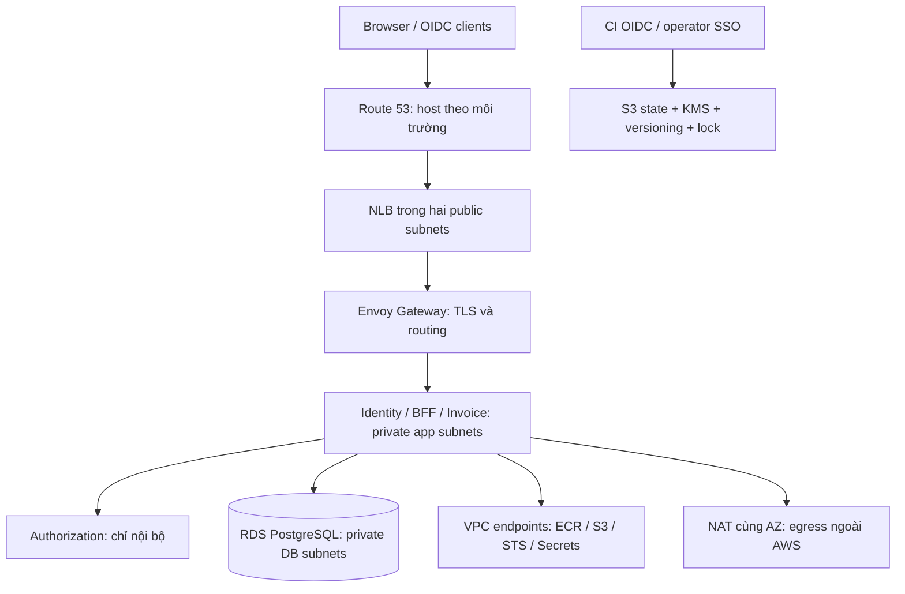

# P03. Viết hạ tầng thành code: từ máy local đến một nền tảng AWS có thể tái tạo

[Mục lục](../../README.md) · [Môi trường và promotion](04-environments-promotion.md) · [Kubernetes ứng dụng](../chapters/18-kubernetes.md)

## Mục tiêu, điều kiện đầu vào và chi phí

Bài này bổ sung phần tạo hạ tầng còn nằm trước bước `kubectl apply`: ai tạo mạng, database, cluster, nơi chứa image, state và quyền triển khai? Sau bài, bạn phải giải thích được một thay đổi Terraform sẽ tạo gì, ai có thể áp dụng, dữ liệu nào còn lại khi hủy lab, và vì sao một pod tới được database còn laptop thì không.

IAM ứng dụng vẫn độc lập nhà cung cấp. **AWS là ví dụ thực hành hạ tầng**; Compose và kind trong [chương 03](../chapters/03-workspace-bootstrap.md), [chương 18](../chapters/18-kubernetes.md) là đường học local không cần trả phí cloud. Không thay IAM tự xây bằng Amazon Cognito. AWS IAM trong bài bảo vệ tài nguyên hạ tầng; Identity Core của bạn xác thực người dùng các ứng dụng.

Đầu vào: checkpoint Kubernetes local đã chạy, AWS CLI v2, Terraform CLI 1.13.5, Git, kubectl/Helm theo bảng phiên bản, một tài khoản AWS sandbox tách khỏi dữ liệu thật, quyền quản trị ban đầu qua IAM Identity Center/SSO và MFA. Cần quyền tạo VPC/EKS/RDS/IAM/KMS/ECR/Budgets; kiểm tra Service Quotas trước. Tài khoản phải có ít nhất hai AZ sử dụng được. Chuẩn bị domain nếu thực hành TLS public; không dùng `local.test` trên internet.

EKS control plane, EC2, NAT Gateway, IPv4 public, RDS Multi-AZ, endpoints, load balancer, log, snapshot và DNS đều có thể tính tiền khi không có traffic. Trước apply, lập bảng ước tính theo region từ [AWS Pricing Calculator](https://calculator.aws/), ghi giới hạn chi tiêu được chấp nhận và giờ dọn lab. AWS Budgets là cảnh báo có độ trễ, không phải trần cứng chặn hóa đơn. [AWS Budgets](https://docs.aws.amazon.com/cost-management/latest/userguide/budgets-managing-costs.html).

Mọi đường dẫn `lab/...` dưới đây là file **người học tạo trong repository ứng dụng**. Các lệnh AWS được đưa để bạn thực hành; giáo trình chưa tạo tài nguyên trong tài khoản của bạn. Lưu bằng chứng đã loại secret tại `lab/evidence/p03/`; state, saved plan và JSON plan có thể chứa dữ liệu nhạy cảm nên giữ ngoài Git và ngoài artifact công khai.

## Bước 1 — Chốt topology trước khi viết Terraform



Chọn `ap-southeast-1`, VPC `10.40.0.0/16`; kiểm tra không trùng VPN/VPC đã có. Hai public subnets chỉ chứa load balancer và NAT; hai private app subnets chứa nodes/pods; hai private DB subnets không có default route tới NAT/Internet Gateway. Không có SSH ingress. EKS API endpoint private cho node, public chỉ allowlist IP egress của người vận hành lúc bootstrap. Sau khi có runner/VPN trong VPC, tắt public endpoint trong một PR riêng và kiểm chứng từ runner trước.

Hai NAT, mỗi AZ một chiếc, tránh phụ thuộc egress xuyên AZ. Một NAT giảm phí lab nhưng mất AZ chứa NAT có thể làm cả hai AZ mất egress và phát sinh phí xuyên AZ. Hai NAT vẫn chưa là kiểm soát nội dung egress: NetworkPolicy, proxy và allowlist đích cần được triển khai thêm. Interface endpoints cũng tính phí mỗi AZ; chọn theo traffic, đừng tạo mọi endpoint vì nghĩ chúng miễn phí. ECR private cần cả `ecr.api`, `ecr.dkr` và S3; workload IRSA cần regional STS. [Hướng dẫn private EKS](https://docs.aws.amazon.com/eks/latest/userguide/private-clusters.html).

Nền tảng này tạo network, EKS, RDS, ECR; chart của chương 18 tạo ứng dụng. Redis/RabbitMQ/Vault cần triển khai theo chương tương ứng và kiểm chứng HA/restore trước production; một StatefulSet replica trong cluster chưa đạt tiêu chí đó. Có thể dùng dịch vụ managed tương đương sau khi kiểm tra semantics, TLS, backup và failure modes. Không mặc nhiên coi EKS/RDS provisioning thành công là nghiệm thu toàn bộ IAM.

## Bước 2 — Bootstrap state và ngân sách trước tài nguyên đắt tiền

Tạo `lab/infra/terraform/bootstrap/`. Root bootstrap ban đầu dùng **local state**, chỉ chứa bucket state/KMS/budget; không phụ thuộc bucket chưa tồn tại. Giữ local state trong ổ được mã hóa, backup bảo vệ quyền truy cập cho tới khi migrate xong. Thêm `.terraform/`, `*.tfstate*`, `*.tfplan`, `*plan.json`, `*.auto.tfvars.json` và `.secrets/` vào `.gitignore`; commit `.terraform.lock.hcl`.

Tạo `bootstrap/main.tf` với nội dung đầy đủ sau. AWS account ID nằm trong cấu hình là guard chống chạy nhầm tài khoản, không phải secret. Thay ba giá trị đầu vào qua `terraform.tfvars` đã review; email là hộp thư bạn quản lý.

```hcl
terraform {
  required_version = "= 1.13.5"
  required_providers {
    aws = { source = "hashicorp/aws", version = "= 6.59.0" }
  }
}
variable "account_id" { type = string }
variable "region" {
  type    = string
  default = "ap-southeast-1"
}
variable "environment" { type = string }
variable "budget_email" { type = string }
provider "aws" {
  region              = var.region
  allowed_account_ids = [var.account_id]
  default_tags {
    tags = {
      Project = "iam-learning"
      Environment = var.environment
      Owner = "platform-team"
      ManagedBy = "terraform"
      CostCenter = "learning"
    }
  }
}
resource "aws_kms_key" "state" {
  description             = "IAM Terraform state ${var.environment}"
  enable_key_rotation     = true
  deletion_window_in_days = 30
  lifecycle { prevent_destroy = true }
}
resource "aws_kms_key" "data" {
  description             = "Retained IAM RDS and ECR ${var.environment}"
  enable_key_rotation     = true
  deletion_window_in_days = 30
  lifecycle { prevent_destroy = true }
}
resource "aws_s3_bucket" "state" {
  bucket        = "iam-tfstate-${var.account_id}-${var.region}-${var.environment}"
  force_destroy = false
  lifecycle { prevent_destroy = true }
}
resource "aws_s3_bucket_versioning" "state" {
  bucket = aws_s3_bucket.state.id
  versioning_configuration { status = "Enabled" }
}
resource "aws_s3_bucket_public_access_block" "state" {
  bucket                  = aws_s3_bucket.state.id
  block_public_acls       = true
  block_public_policy     = true
  ignore_public_acls      = true
  restrict_public_buckets = true
}
resource "aws_s3_bucket_server_side_encryption_configuration" "state" {
  bucket = aws_s3_bucket.state.id
  rule {
    apply_server_side_encryption_by_default {
      sse_algorithm     = "aws:kms"
      kms_master_key_id = aws_kms_key.state.arn
    }
    bucket_key_enabled = true
  }
}
resource "aws_s3_bucket_policy" "tls" {
  bucket = aws_s3_bucket.state.id
  policy = jsonencode({
    Version = "2012-10-17"
    Statement = [{
      Sid = "DenyInsecureTransport", Effect = "Deny", Principal = "*"
      Action = "s3:*"
      Resource = [aws_s3_bucket.state.arn, "${aws_s3_bucket.state.arn}/*"]
      Condition = { Bool = { "aws:SecureTransport" = "false" } }
    }]
  })
}
resource "aws_budgets_budget" "account" {
  name         = "iam-${var.environment}-monthly"
  budget_type  = "COST"
  time_unit    = "MONTHLY"
  limit_amount = "100"
  limit_unit   = "USD"
  notification {
    comparison_operator        = "GREATER_THAN"
    threshold                  = 80
    threshold_type             = "PERCENTAGE"
    notification_type          = "ACTUAL"
    subscriber_email_addresses = [var.budget_email]
  }
  notification {
    comparison_operator        = "GREATER_THAN"
    threshold                  = 100
    threshold_type             = "PERCENTAGE"
    notification_type          = "FORECASTED"
    subscriber_email_addresses = [var.budget_email]
  }
}
output "state_bucket" { value = aws_s3_bucket.state.id }
output "state_key_arn" { value = aws_kms_key.state.arn }
output "data_key_arn" { value = aws_kms_key.data.arn }
```

`100 USD` là ngưỡng học minh họa, **không phải dự toán đủ cho một tháng topology này**. Sửa theo ngân sách trước apply. Budget account-level phù hợp sandbox riêng, không bỏ sót dịch vụ chưa gắn tag. Chính sách KMS mặc định bootstrap cho phép account quản lý key; sau bootstrap giới hạn key policy/grants theo role state và operator được chỉ định. Trước khi thắt quyền, kiểm chứng một phiên operator dự phòng còn đọc state được.

Lệnh PowerShell chạy từ repository ứng dụng, ví dụ ở đây dùng `lab` như tên workspace theo giáo trình. `Set-Location` chỉ khi bạn đã xác định đúng workspace:

```powershell
$ErrorActionPreference = 'Stop'
$env:AWS_PROFILE = 'iam-dev-admin'
aws sso login --profile $env:AWS_PROFILE
if ($LASTEXITCODE -ne 0) { throw 'SSO login failed' }
aws sts get-caller-identity
terraform -chdir=lab/infra/terraform/bootstrap init
if ($LASTEXITCODE -ne 0) { throw 'Terraform init failed' }
terraform -chdir=lab/infra/terraform/bootstrap plan -out=bootstrap.tfplan
if ($LASTEXITCODE -ne 0) { throw 'Bootstrap plan failed' }
# Đọc plan, account, budget và region rồi mới chạy dòng tiếp theo.
terraform -chdir=lab/infra/terraform/bootstrap apply bootstrap.tfplan
if ($LASTEXITCODE -ne 0) { throw 'Bootstrap apply failed' }
```

Sau khi bucket tồn tại, thêm `backend "s3" {}` bên trong `terraform {}` của bootstrap. Tạo `bootstrap/backend.hcl` chứa các trường sau, thay giá trị angle brackets bằng output thật; file này không chứa credentials:

```hcl
bucket       = "<state-bucket>"
key          = "bootstrap/terraform.tfstate"
region       = "ap-southeast-1"
encrypt      = true
kms_key_id   = "<state-key-arn>"
use_lockfile = true
```

Chạy `terraform -chdir=lab/infra/terraform/bootstrap init -migrate-state -backend-config=backend.hcl`. Xác nhận migration khi CLI hỏi, kiểm tra object `bootstrap/terraform.tfstate` có version trong S3 và plan tiếp theo không có thay đổi. Không commit local state cũ. Bootstrap được giữ riêng và không destroy khi dọn stack ứng dụng.

S3 native locking dùng `use_lockfile=true`; không tạo DynamoDB lock table mặc định. Role backend cần `s3:ListBucket` giới hạn prefix, `GetObject`/`PutObject` trên state, `GetObject`/`PutObject`/`DeleteObject` trên file `.tflock`, cùng quyền KMS encrypt/decrypt/data key phù hợp. Không cần quyền DeleteObject trên state để chạy Terraform thông thường. [S3 backend](https://developer.hashicorp.com/terraform/language/backend/s3), [AWS backend guidance](https://docs.aws.amazon.com/prescriptive-guidance/latest/terraform-aws-provider-best-practices/backend.html).

## Bước 3 — Pin provider/module và tạo root cho một môi trường

Tạo `lab/infra/terraform/environments/dev/versions.tf`; mỗi môi trường có backend state riêng theo P04. Không dùng workspace name để giả lập cách ly tài khoản. Các pins sau đã được đối chiếu upstream ngày 29/10/2026: [Terraform 1.13.5](https://releases.hashicorp.com/terraform/1.13.5/), [AWS provider 6.59.0](https://github.com/hashicorp/terraform-provider-aws/releases/tag/v6.59.0), [VPC 6.7.3](https://github.com/terraform-aws-modules/terraform-aws-vpc/releases/tag/v6.7.3), [EKS 21.26.0](https://github.com/terraform-aws-modules/terraform-aws-eks/releases/tag/v21.26.0). EKS module này yêu cầu AWS provider từ 6.59; không ghép với pin 5.x trong tutorial cũ.

```hcl
terraform {
  required_version = "= 1.13.5"
  backend "s3" {}
  required_providers {
    aws  = { source = "hashicorp/aws", version = "= 6.59.0" }
    tls  = { source = "hashicorp/tls", version = "= 4.1.0" }
    time = { source = "hashicorp/time", version = "= 0.13.1" }
  }
}
```

TLS/time là providers phụ thuộc EKS module; pins có binary chính thức tại [TLS](https://releases.hashicorp.com/terraform-provider-tls/4.1.0/) và [time](https://releases.hashicorp.com/terraform-provider-time/0.13.1/). Tạo `backend.hcl` cùng shape bootstrap, nhưng `key="infrastructure/dev/terraform.tfstate"`. Lockfile khóa version/checksum **provider**, không khóa nội dung remote module; module dùng version exact, review upstream tag/diff và có thể mirror source nội bộ nếu cần kiểm soát chặt hơn. [Dependency lock file](https://developer.hashicorp.com/terraform/language/files/dependency-lock).

Tạo `main.tf` cho root dev. Các blocks trong bước 3–5 cùng thuộc file này; HCL hỗ trợ tách thành nhiều `.tf` trong cùng folder nếu muốn. Chưa chạy apply khi mới chép một phần.

```hcl
variable "account_id" { type = string }
variable "admin_principal_arn" { type = string }
variable "operator_cidrs" { type = list(string) }
variable "postgres_version" { type = string }
variable "data_key_arn" { type = string }
variable "environment" {
  type    = string
  default = "dev"
  validation {
    condition     = contains(["dev", "staging", "prod"], var.environment)
    error_message = "Environment must be dev, staging or prod."
  }
}
variable "region" {
  type    = string
  default = "ap-southeast-1"
}
locals {
  name = "iam-${var.environment}"
  tags = {
    Project = "iam-learning", Environment = var.environment
    Owner = "platform-team", CostCenter = "learning", ManagedBy = "terraform"
  }
}
provider "aws" {
  region              = var.region
  allowed_account_ids = [var.account_id]
  default_tags { tags = local.tags }
}
data "aws_availability_zones" "available" {
  state = "available"
  filter {
    name   = "opt-in-status"
    values = ["opt-in-not-required"]
  }
}
module "vpc" {
  source  = "terraform-aws-modules/vpc/aws"
  version = "6.7.3"
  name    = local.name
  cidr    = "10.40.0.0/16"
  azs     = slice(data.aws_availability_zones.available.names, 0, 2)
  public_subnets   = ["10.40.0.0/24", "10.40.1.0/24"]
  private_subnets  = ["10.40.16.0/20", "10.40.32.0/20"]
  database_subnets = ["10.40.64.0/24", "10.40.65.0/24"]
  enable_dns_hostnames = true
  enable_dns_support   = true
  enable_nat_gateway   = true
  single_nat_gateway   = false
  one_nat_gateway_per_az = true
  create_database_subnet_route_table = true
  create_database_nat_gateway_route  = false
  create_database_internet_gateway_route = false
  public_subnet_tags  = { "kubernetes.io/role/elb" = "1" }
  private_subnet_tags = { "kubernetes.io/role/internal-elb" = "1" }
  enable_flow_log                      = true
  create_flow_log_cloudwatch_log_group = true
  create_flow_log_cloudwatch_iam_role  = true
  flow_log_cloudwatch_log_group_retention_in_days = 30
  tags = local.tags
}
module "eks" {
  source  = "terraform-aws-modules/eks/aws"
  version = "21.26.0"
  name               = local.name
  kubernetes_version = "1.35"
  authentication_mode = "API"
  endpoint_private_access = true
  endpoint_public_access  = true
  endpoint_public_access_cidrs = var.operator_cidrs
  enable_cluster_creator_admin_permissions = false
  enable_irsa = true
  deletion_protection = var.environment == "prod"
  enabled_log_types = ["api", "audit", "authenticator", "controllerManager", "scheduler"]
  cloudwatch_log_group_retention_in_days = 30
  vpc_id     = module.vpc.vpc_id
  subnet_ids = module.vpc.private_subnets
  addons = {
    coredns = {}
    kube-proxy = {}
    vpc-cni = {
      before_compute = true
      configuration_values = jsonencode({ enableNetworkPolicy = "true" })
    }
  }
  access_entries = {
    operator = {
      principal_arn = var.admin_principal_arn
      policy_associations = {
        bootstrap = {
          policy_arn = "arn:aws:eks::aws:cluster-access-policy/AmazonEKSClusterAdminPolicy"
          access_scope = { type = "cluster" }
        }
      }
    }
  }
  eks_managed_node_groups = {
    az_a = {
      subnet_ids = [module.vpc.private_subnets[0]]
      instance_types = ["t3.large"]
      ami_type = "AL2023_x86_64_STANDARD"
      min_size = 1, max_size = 3, desired_size = 1
      autoscaling_group_tags = {
        "k8s.io/cluster-autoscaler/enabled" = "true"
        "k8s.io/cluster-autoscaler/${local.name}" = "owned"
      }
      metadata_options = {
        http_endpoint = "enabled", http_tokens = "required"
        http_put_response_hop_limit = 1
      }
    }
    az_b = {
      subnet_ids = [module.vpc.private_subnets[1]]
      instance_types = ["t3.large"]
      ami_type = "AL2023_x86_64_STANDARD"
      min_size = 1, max_size = 3, desired_size = 1
      autoscaling_group_tags = {
        "k8s.io/cluster-autoscaler/enabled" = "true"
        "k8s.io/cluster-autoscaler/${local.name}" = "owned"
      }
      metadata_options = {
        http_endpoint = "enabled", http_tokens = "required"
        http_put_response_hop_limit = 1
      }
    }
  }
  tags = local.tags
}
```

Hai node group một AZ mỗi nhóm giúp chứng minh còn tối thiểu một node mỗi AZ. `max_size=3` mới là giới hạn, **chưa tự tăng nodes**: cài Cluster Autoscaler tương ứng Kubernetes 1.35 với IRSA, auto-discovery tags, giới hạn quyền `SetDesiredCapacity`/`TerminateInstanceInAutoScalingGroup` theo tags cluster; không trao quyền điều khiển mọi ASG trong tài khoản. HPA tăng pod, autoscaler tăng node khi không đủ chỗ; PDB/topology spread trong chương 18 bảo vệ phân bố workload. Thực hiện bài tăng tải và quan sát ASG trước khi kết luận autoscaling đã hoạt động. [EKS Cluster Autoscaler](https://docs.aws.amazon.com/eks/latest/best-practices/cas.html).

EKS add-ons ở bước bootstrap được resolver của EKS chọn phiên bản tương thích; trước apply production, dùng `aws eks describe-addon-versions --kubernetes-version 1.35`, ghi exact `addon_version` cho ba entries và commit cùng BOM. Tương tự khóa AMI `release_version` từ managed node group sau khi thử ở dev; không tuyên bố các giá trị rỗng là pin release. EKS 1.35 được chọn để khớp lab, vẫn phải theo dõi ngày hết standard support. [Vòng đời EKS](https://docs.aws.amazon.com/eks/latest/userguide/kubernetes-versions.html).

## Bước 4 — Database private, encryption và registry

Tiếp tục `main.tf`. SG của RDS chỉ nhận TCP 5432 từ node SG. Đây là ranh giới network sơ bộ: khi pod dùng VPC CNI thông thường, nhiều pods trên node có thể dùng cùng SG, do đó vẫn cần NetworkPolicy và credential DB riêng theo service. Production có thể dùng Security Groups for Pods sau khi kiểm tra tương thích CNI/NetworkPolicy. Không dùng CIDR `0.0.0.0/0` cho DB dù DB đã đặt private.

```hcl
resource "aws_security_group" "database" {
  name        = "${local.name}-database"
  description = "PostgreSQL only from application nodes"
  vpc_id      = module.vpc.vpc_id
}
resource "aws_vpc_security_group_ingress_rule" "database" {
  security_group_id            = aws_security_group.database.id
  referenced_security_group_id = module.eks.node_security_group_id
  from_port = 5432
  to_port   = 5432
  ip_protocol = "tcp"
}
resource "aws_db_parameter_group" "postgres" {
  name   = "${local.name}-pg18"
  family = "postgres18"
  parameter {
    name  = "rds.force_ssl"
    value = "1"
  }
}
resource "aws_db_instance" "iam" {
  identifier = "${local.name}-postgres"
  engine = "postgres"
  engine_version = var.postgres_version
  instance_class = "db.t4g.medium"
  allocated_storage     = 30
  max_allocated_storage = 100
  storage_type          = "gp3"
  storage_encrypted     = true
  kms_key_id            = var.data_key_arn
  db_name               = "identity"
  username              = "platform_owner"
  manage_master_user_password = true
  multi_az               = true
  publicly_accessible    = false
  db_subnet_group_name   = module.vpc.database_subnet_group_name
  vpc_security_group_ids = [aws_security_group.database.id]
  parameter_group_name   = aws_db_parameter_group.postgres.name
  backup_retention_period = 7
  backup_window           = "18:00-19:00"
  maintenance_window      = "sun:20:00-sun:21:00"
  enabled_cloudwatch_logs_exports = ["postgresql", "upgrade"]
  deletion_protection     = true
  skip_final_snapshot     = false
  final_snapshot_identifier = "${local.name}-retained-final"
  copy_tags_to_snapshot    = true
  auto_minor_version_upgrade = false
  apply_immediately          = false
}
resource "aws_ecr_repository" "services" {
  for_each = toset(["identity", "authorization", "audit", "governance", "invoice-api", "web-a", "web-b"])
  name = "${local.name}/${each.key}"
  image_tag_mutability = "IMMUTABLE"
  force_delete = false
  encryption_configuration {
    encryption_type = "KMS"
    kms_key         = var.data_key_arn
  }
  image_scanning_configuration { scan_on_push = true }
}
output "cluster_name" { value = module.eks.cluster_name }
output "vpc_id" { value = module.vpc.vpc_id }
output "oidc_provider_arn" { value = module.eks.oidc_provider_arn }
output "oidc_issuer" { value = module.eks.cluster_oidc_issuer_url }
output "node_security_group_id" { value = module.eks.node_security_group_id }
output "database_endpoint" { value = aws_db_instance.iam.address }
output "database_master_secret_arn" { value = aws_db_instance.iam.master_user_secret[0].secret_arn }
```

Không truyền master password vào Terraform: RDS quản lý nó trong Secrets Manager; output chỉ ARN. Tạo riêng `identity`, `authorization`, `audit`, `governance` database và các migration/application roles theo [chương 04](../chapters/04-data-tenancy.md). RDS cùng instance trong lab vẫn không cho các services truy vấn DB của nhau. Chỉ job bootstrap/migration được quyền đọc master secret; ứng dụng chỉ có credential database của nó. [RDS resource](https://registry.terraform.io/providers/hashicorp/aws/6.59.0/docs/resources/db_instance).

Lấy CA bundle RDS theo region, mount vào pod và dùng hostname endpoint RDS với xác minh CA/hostname. Trong `pg`, dùng `ssl:{ca:readFileSync(...),rejectUnauthorized:true}`; tránh ghép DSN có SSL flags ghi đè cấu hình driver. Password master và plaintext DSN không nằm trong Helm values/plan artifacts. PITR có 7 ngày retention chưa chứng minh RPO/RTO; bài restore ở chương 20 mới đo khả năng phục hồi. [TLS cho RDS](https://docs.aws.amazon.com/AmazonRDS/latest/UserGuide/UsingWithRDS.SSL.html).

## Bước 5 — Plan là tài liệu cần review, không phải nút bấm

Tạo `terraform.tfvars` với account ID thật, ARN role operator bền vững (không phải ARN STS session), `operator_cidrs=["<your-egress-ip>/32"]`, environment, `data_key_arn` lấy từ bootstrap output và **exact patch** PostgreSQL 18 có trong region. Khóa dữ liệu được bootstrap sở hữu để snapshot còn giải mã được sau khi hủy app stack. Xác nhận bằng hai lệnh đọc sau; nếu region/class chưa hỗ trợ PG18, dừng ở local PG18 hoặc chọn region khác sau review, không âm thầm hạ major version:

```powershell
aws rds describe-db-engine-versions --engine postgres --region ap-southeast-1 `
  --query "DBEngineVersions[?starts_with(EngineVersion, '18.')].[EngineVersion,DBParameterGroupFamily]" --output table
aws rds describe-orderable-db-instance-options --engine postgres --db-instance-class db.t4g.medium `
  --region ap-southeast-1 --query 'OrderableDBInstanceOptions[].[EngineVersion,MultiAZCapable]' --output table
terraform -chdir=lab/infra/terraform/environments/dev init -backend-config=backend.hcl
if ($LASTEXITCODE -ne 0) { throw 'Init failed' }
terraform -chdir=lab/infra/terraform/environments/dev providers lock -platform=windows_amd64 -platform=linux_amd64
if ($LASTEXITCODE -ne 0) { throw 'Provider lock failed' }
terraform -chdir=lab/infra/terraform/environments/dev fmt -check
if ($LASTEXITCODE -ne 0) { throw 'Format check failed' }
terraform -chdir=lab/infra/terraform/environments/dev validate
if ($LASTEXITCODE -ne 0) { throw 'Validation failed' }
terraform -chdir=lab/infra/terraform/environments/dev plan -lock-timeout=60s -out=review.tfplan
if ($LASTEXITCODE -ne 0) { throw 'Plan failed' }
terraform -chdir=lab/infra/terraform/environments/dev show -no-color review.tfplan
```

Lưu JSON plan bằng PowerShell 7 `terraform ... show -json review.tfplan | Set-Content -Encoding utf8 lab/.secrets/dev-plan.json`; kiểm tra `$LASTEXITCODE`. Cài Checkov trong venv riêng với `python -m pip install checkov==3.2.471` theo [release](https://github.com/bridgecrewio/checkov/releases/tag/3.2.471); quét source và plan:

```powershell
checkov -d lab/infra/terraform/environments/dev --download-external-modules true --framework terraform
if ($LASTEXITCODE -ne 0) { throw 'Source IaC review failed' }
checkov -f lab/.secrets/dev-plan.json --framework terraform_plan
if ($LASTEXITCODE -ne 0) { throw 'Plan policy review failed' }
```

Xử lý findings theo threat model; một số control production như log archival độc lập chưa có ở bootstrap tối thiểu. Mỗi exception phải có rule ID, resource, lý do, owner, ngày hết hạn và môi trường được phép. Không dùng global soft-fail hoặc bỏ mọi rule để có check xanh. CI cần quét nội dung modules đã resolve hoặc JSON plan, không chỉ file root gọi module. [Checkov CLI](https://www.checkov.io/2.Basics/CLI%20Command%20Reference.html).

Reviewer xác nhận account/region, thay đổi public exposure, quyền IAM mới, thay đổi KMS, replacement database, deletion, chi phí và backward compatibility. Saved plan dùng đúng commit, provider lock, backend và credentials đã review. Khi state/config thay đổi hoặc hết thời hạn review, tạo plan mới; không sửa source rồi apply plan cũ. Chạy `terraform ... apply review.tfplan` chỉ sau khi review. Lưu hash plan và summary đã redact; dùng protected environment trong P04 trước production.

## Bước 6 — Workload identity, egress, load balancer và TLS

Node role dùng cho bootstrap node/ECR pull/CNI cần thiết; role của pod tách theo Kubernetes ServiceAccount. IRSA trust phải bind issuer OIDC của **cluster này**, `aud=sts.amazonaws.com` và `sub=system:serviceaccount:<namespace>:<serviceaccount>`. Đừng dùng issuer OIDC của ứng dụng IAM làm issuer IRSA. Hạn chế IMDS, không hostNetwork tùy tiện và không gắn `AdministratorAccess` lên node để mọi pod cùng dùng. [IRSA](https://docs.aws.amazon.com/eks/latest/userguide/iam-roles-for-service-accounts.html).

Ví dụ root Terraform sau tạo role cho worker cần đọc một secret cụ thể. Khai báo variable `worker_secret_arn`, `oidc_provider_arn`/issuer lấy từ outputs hiện có; trong cùng root dùng trực tiếp module output như dưới đây. Áp dụng tương tự cho cert-manager DNS01, load balancer controller và autoscaler bằng **policy riêng** theo trách nhiệm.

```hcl
variable "worker_secret_arn" { type = string }
locals { oidc_host = replace(module.eks.cluster_oidc_issuer_url, "https://", "") }
resource "aws_iam_role" "worker" {
  name = "${local.name}-secret-worker"
  assume_role_policy = jsonencode({
    Version = "2012-10-17"
    Statement = [{
      Effect = "Allow", Action = "sts:AssumeRoleWithWebIdentity"
      Principal = { Federated = module.eks.oidc_provider_arn }
      Condition = { StringEquals = {
        "${local.oidc_host}:aud" = "sts.amazonaws.com"
        "${local.oidc_host}:sub" = "system:serviceaccount:iam:secret-worker"
      } }
    }]
  })
}
resource "aws_iam_role_policy" "worker" {
  role = aws_iam_role.worker.id
  policy = jsonencode({
    Version = "2012-10-17"
    Statement = [{
      Effect = "Allow", Action = ["secretsmanager:GetSecretValue"]
      Resource = var.worker_secret_arn
    }]
  })
}
```

Khi secret dùng customer managed KMS key, thêm `kms:Decrypt` đúng key và key policy cho role với điều kiện service phù hợp. Secret này do secret provisioning tạo trước; không cần thêm ví dụ worker vào plan đầu khi chưa có ARN. ServiceAccount `secret-worker` annotate `eks.amazonaws.com/role-arn` bằng ARN role; bật projected token cho pod này theo IRSA, kiểm tra SDK default credential chain. ServiceAccount ứng dụng không cần AWS API giữ `automountServiceAccountToken:false` như chương 18.

Ở giai đoạn NAT hoạt động, nodes pull ECR qua NAT được. Nếu bổ sung endpoints, tạo S3 gateway endpoint gắn private app route tables; tạo interface endpoints `ecr.api`, `ecr.dkr`, `sts`, `logs`, `secretsmanager` trong hai app subnets, private DNS bật, SG chỉ 443 từ node SG. Dùng `aws_vpc_endpoint` với `vpc_endpoint_type="Interface"`/`"Gateway"` và service name theo region; thêm endpoint policy giới hạn repository/bucket/secret. Mỗi bước có plan chi phí riêng. Nếu tắt NAT, bổ sung toàn bộ dependencies còn thiếu như EC2/ELB APIs cho controllers, DNS, ACME, IdP ngoài và package/image source; endpoints AWS không cung cấp đường ra mọi website.

Kết nối tới cluster, rồi làm lại cài Envoy Gateway/cert-manager, chart TLS backend và NetworkPolicy theo chương 18 với context EKS. EKS trong bài dùng **VPC CNI native NetworkPolicy** đã bật qua add-on; không cài chồng Calico CNI theo lệnh dành cho kind. VPC CNI standard enforcement cho phép traffic trong khoảng pod khởi tạo trước khi policy sẵn sàng. Trước production, chuẩn bị allow policies cho DNS/CoreDNS, controllers và mọi dependency, rồi chuyển `NETWORK_POLICY_ENFORCING_MODE=strict` qua `env` trong add-on configuration, rollout nodes/pods có kiểm soát và thử lại cả boot lẫn steady traffic. Strict mặc định deny có thể làm CoreDNS/controllers mất kết nối nếu bỏ bước chuẩn bị. [Cấu hình VPC CNI policy](https://docs.aws.amazon.com/eks/latest/userguide/cni-network-policy-configure.html).

```powershell
aws eks update-kubeconfig --region ap-southeast-1 --name iam-dev --alias iam-dev
if ($LASTEXITCODE -ne 0) { throw 'Kubeconfig failed' }
kubectl --context iam-dev get nodes -L topology.kubernetes.io/zone
kubectl --context iam-dev auth can-i '*' '*' --all-namespaces
```

Lệnh cuối chỉ xác nhận quyền **operator bootstrap**; application service account không được có kết quả tương tự. Thay bootstrap cluster-admin bằng các role platform/release/read-only có scope sau khi vận hành ổn định.

Với managed nodes trong ví dụ, EKS Auto Mode không được bật. Vì vậy phải cài AWS Load Balancer Controller riêng, không dùng class `eks.amazonaws.com/nlb` của Auto Mode. Chọn controller [v3.6.2](https://github.com/kubernetes-sigs/aws-load-balancer-controller/releases/tag/v3.6.2), chart `3.6.2` từ [EKS charts](https://github.com/aws/eks-charts/tree/master/stable/aws-load-balancer-controller). Tải `docs/install/iam_policy.json` từ tag controller v3.6.2, review rồi dùng `aws_iam_policy` và IRSA role bind `system:serviceaccount:kube-system:aws-load-balancer-controller`. Cài chart bằng Helm với `clusterName=iam-dev`, `region`, `vpcId`, `serviceAccount.create=false` và SA đã annotate. CRDs lấy cùng release chart; pin checksum/chart artifact trong BOM. Đây là controller tạo AWS NLB cho Service; Terraform không đồng thời quản lý cùng NLB. [Cài LBC](https://kubernetes-sigs.github.io/aws-load-balancer-controller/latest/deploy/installation/).

Để thực hiện cụ thể, tải policy theo tag, không theo `main`. Folder `policies` nằm trong root environment của Terraform; đọc JSON và review IAM actions/resources trước khi apply:

```powershell
New-Item -ItemType Directory -Force lab/infra/terraform/environments/dev/policies | Out-Null
Invoke-WebRequest 'https://raw.githubusercontent.com/kubernetes-sigs/aws-load-balancer-controller/v3.6.2/docs/install/iam_policy.json' `
  -OutFile lab/infra/terraform/environments/dev/policies/lbc.json
Get-FileHash -Algorithm SHA256 lab/infra/terraform/environments/dev/policies/lbc.json
```

Thêm HCL sau vào root dev, rồi chạy lại plan/review/apply cho quyền controllers. `local.oidc_host` được khai báo ở ví dụ IRSA trên; nếu bỏ bài secret-worker, vẫn tạo local đó. Controller policy do upstream công bố có một số API discovery cần Resource `*`; review điều kiện tags/VPC cho phần mutation thay vì cấp toàn quyền trên account. Autoscaler chỉ sửa ASGs có cả hai tags như cấu hình node groups ở bước 3.

```hcl
locals {
  controller_subjects = {
    lbc = "system:serviceaccount:kube-system:aws-load-balancer-controller"
    autoscaler = "system:serviceaccount:kube-system:cluster-autoscaler"
  }
}
resource "aws_iam_role" "controller" {
  for_each = local.controller_subjects
  name = "${local.name}-${each.key}"
  assume_role_policy = jsonencode({
    Version = "2012-10-17"
    Statement = [{
      Effect = "Allow", Action = "sts:AssumeRoleWithWebIdentity"
      Principal = { Federated = module.eks.oidc_provider_arn }
      Condition = { StringEquals = {
        "${local.oidc_host}:aud" = "sts.amazonaws.com"
        "${local.oidc_host}:sub" = each.value
      } }
    }]
  })
}
resource "aws_iam_role_policy" "lbc" {
  role   = aws_iam_role.controller["lbc"].id
  policy = file("${path.module}/policies/lbc.json")
}
resource "aws_iam_role_policy" "autoscaler" {
  role = aws_iam_role.controller["autoscaler"].id
  policy = jsonencode({
    Version = "2012-10-17"
    Statement = [
      {
        Effect = "Allow"
        Action = ["autoscaling:SetDesiredCapacity", "autoscaling:TerminateInstanceInAutoScalingGroup"]
        Resource = "*"
        Condition = { StringEquals = {
          "aws:ResourceTag/k8s.io/cluster-autoscaler/enabled" = "true"
          "aws:ResourceTag/k8s.io/cluster-autoscaler/${local.name}" = "owned"
        } }
      },
      {
        Effect = "Allow"
        Action = [
          "autoscaling:DescribeAutoScalingGroups", "autoscaling:DescribeAutoScalingInstances",
          "autoscaling:DescribeLaunchConfigurations", "autoscaling:DescribeScalingActivities",
          "autoscaling:DescribeTags", "ec2:DescribeInstanceTypes", "ec2:DescribeLaunchTemplateVersions",
          "ec2:DescribeImages", "ec2:GetInstanceTypesFromInstanceRequirements", "eks:DescribeNodegroup"
        ]
        Resource = "*"
      }
    ]
  })
}
output "lbc_role_arn" { value = aws_iam_role.controller["lbc"].arn }
output "autoscaler_role_arn" { value = aws_iam_role.controller["autoscaler"].arn }
```

Sau apply quyền, cài LBC; các biến chỉ chứa ARN/ID công khai, không chứa credential:

```powershell
$infraRoot = 'lab/infra/terraform/environments/dev'
$lbcRole = terraform "-chdir=$infraRoot" output -raw lbc_role_arn
$vpcId = terraform "-chdir=$infraRoot" output -raw vpc_id
kubectl --context iam-dev -n kube-system create serviceaccount aws-load-balancer-controller --dry-run=client -o yaml | `
  kubectl --context iam-dev apply -f -
kubectl --context iam-dev -n kube-system annotate serviceaccount aws-load-balancer-controller `
  "eks.amazonaws.com/role-arn=$lbcRole" --overwrite
helm repo add eks https://aws.github.io/eks-charts
helm repo update
helm upgrade --install aws-load-balancer-controller eks/aws-load-balancer-controller `
  --kube-context iam-dev --namespace kube-system --version 3.6.2 `
  --set clusterName=iam-dev --set region=ap-southeast-1 --set "vpcId=$vpcId" `
  --set serviceAccount.create=false --set serviceAccount.name=aws-load-balancer-controller `
  --wait --timeout 5m
if ($LASTEXITCODE -ne 0) { throw 'LBC rollout failed' }
```

Với autoscaler, lấy manifest/RBAC từ upstream tag `cluster-autoscaler-1.35.0`, lưu vào `lab/infra/kind/cluster-autoscaler-aws.yaml` và review trước apply. Manifest upstream có thể giữ image ví dụ cũ, do đó thay `registry.k8s.io/autoscaling/cluster-autoscaler:v1.32.1` bằng `...:v1.35.0`, thay `<YOUR CLUSTER NAME>` bằng `iam-dev`, và bỏ hostPath CA mount nếu image đã có CA bundle; không mount file Ubuntu lên AL2023 rồi bỏ qua lỗi TLS. [Manifest upstream theo tag](https://github.com/kubernetes/autoscaler/blob/cluster-autoscaler-1.35.0/cluster-autoscaler/cloudprovider/aws/examples/cluster-autoscaler-autodiscover.yaml). Resolve image digest, cập nhật manifest trước production.

```powershell
Invoke-WebRequest 'https://raw.githubusercontent.com/kubernetes/autoscaler/cluster-autoscaler-1.35.0/cluster-autoscaler/cloudprovider/aws/examples/cluster-autoscaler-autodiscover.yaml' `
  -OutFile lab/infra/kind/cluster-autoscaler-aws.yaml
# Sửa image/cluster/CA mount như mô tả, rồi đọc diff trước apply.
kubectl --context iam-dev apply -f lab/infra/kind/cluster-autoscaler-aws.yaml
if ($LASTEXITCODE -ne 0) { throw 'Autoscaler manifest failed' }
$autoscalerRole = terraform "-chdir=$infraRoot" output -raw autoscaler_role_arn
kubectl --context iam-dev -n kube-system annotate serviceaccount cluster-autoscaler `
  "eks.amazonaws.com/role-arn=$autoscalerRole" --overwrite
kubectl --context iam-dev -n kube-system rollout restart deployment/cluster-autoscaler
kubectl --context iam-dev -n kube-system rollout status deployment/cluster-autoscaler --timeout=180s
kubectl --context iam-dev -n kube-system logs deployment/cluster-autoscaler --tail=50
```

Annotation SA được thêm sau Deployment thì phải restart để pod được inject IRSA. Review log discovery nhóm `az_a`/`az_b`, kiểm tra role identity và thử pending pods theo bước 7. Sau bootstrap, đưa SA/controller manifests cùng pins vào platform GitOps để lệnh annotate thủ công không thành cấu hình chỉ còn trong trí nhớ.

EnvoyProxy customization của Envoy Gateway đặt `service.beta.kubernetes.io/aws-load-balancer-scheme=internet-facing`, `service.beta.kubernetes.io/aws-load-balancer-nlb-target-type=ip` và `loadBalancerClass=service.k8s.aws/nlb` trên **data-plane Service**, không phải Service của control plane. Chỉ expose 443, NLB TCP passthrough tới Envoy; TLS terminate tại Envoy, rồi HTTPS tới backend theo BackendTLSPolicy của chương 18. Không kết hợp ACM termination tại NLB với listener Envoy chờ TLS nếu chưa thiết kế lại transport.

Sau khi Service có hostname NLB, tạo CNAME ở Route 53 cho `iam.dev.<your-domain>`, `app-a.dev...`, `app-b.dev...`, `api.dev...` trỏ cùng NLB; apex dùng alias phù hợp. Tạo ACME DNS01 ClusterIssuer qua cert-manager, IRSA chỉ quyền sửa hosted zone cần dùng. Thử ACME staging trước rồi production, tạo Certificate chứa các DNS names và đợi Ready trước kiểm tra OIDC. `ISSUER=https://iam.dev.<your-domain>` là cấu hình cố định; đăng ký lại redirect URIs chính xác cho `web-a`/`web-b`. Backend ports vẫn Identity 3000, BFF 3101/3102, Invoice 3200, Authorization 3300. Audience vẫn `invoice-api` và `iam-policy-api`.

## Bước 7 — Kiểm chứng, sự cố có chủ đích và dọn lab

Kiểm chứng network bằng đường đi thật: từ laptop thử TCP5432 tới RDS phải không tới được; từ migration Job allowlisted kết nối TLS thành công; pod không được phép không tới DB; application DB user không đọc DB service khác. Kiểm tra RDS `PubliclyAccessible=false`, `StorageEncrypted=true`, `MultiAZ=true`, retention 7 ngày bằng `aws rds describe-db-instances`. Xem route tables DB không có route internet, nodes trải hai AZ, public ingress chỉ đến Envoy, và `/internal` không truy cập được từ internet. SG, Kubernetes NetworkPolicy và quyền SQL phải được kiểm tra riêng.

Failure lab chỉ trên sandbox: đổi account guard sang ID khác rồi plan, phải fail trước mutation; giữ một plan/apply đang chạy và mở terminal khác thử lock, terminal thứ hai phải chờ/fail theo timeout. Không xóa `.tflock` thủ công khi process đầu còn sống. Thu hồi quyền đọc state của role test, xác nhận deployment dừng thay vì tạo state local mới. Với drift, chỉnh một tag tài nguyên lab bằng console rồi `plan -refresh-only`; đọc chênh lệch, quyết định sửa source hay khôi phục cấu hình, không dùng refresh-only để âm thầm chấp nhận drift bảo mật.

Thử drain node ở một AZ trong maintenance lab; protected requests phải giữ online checks. PDB có thể chặn drain nếu không còn replica đủ điều kiện; đó là tín hiệu cần capacity, không phải lý do xóa PDB. Làm bài pending pods→autoscaler scale-out, ghi node/ASG trước và sau; DB failover/restore nằm trong [chương 20](../chapters/20-sre-production.md).

| Triệu chứng | Chẩn đoán và cách sửa |
|---|---|
| `AccessDenied` khi init | Kiểm tra SSO profile/account, prefix state, `.tflock`, KMS key policy; không đổi sang state local để vượt lỗi |
| EKS API timeout | IP egress thay đổi hoặc runner không có đường vào private API; kiểm tra endpoint/allowlist/VPN trước |
| Nodes NotReady/ImagePullBackOff | Route/NAT, DNS, ECR node role, ECR+S3 endpoints, architecture/digest; không cấp AdministratorAccess |
| NLB Service Pending | LBC logs/IRSA, subnet tags, quotas và class đúng controller; Auto Mode annotation không thay việc cài LBC |
| DB TLS lỗi | Endpoint hostname/CA bundle, CA expiry, `pg` SSL options; không tắt certificate verification |
| Plan muốn replace RDS | Engine/name/subnet/key khác cấu hình; dừng, tìm thuộc tính ForceNew và lập migration dữ liệu trước |

Dọn **sandbox** theo thứ tự: thu hồi sessions/clients demo, lưu evidence không chứa token; gỡ GitOps application và Services LoadBalancer để controller xóa NLB, target groups và SG do nó tạo; chờ AWS xác nhận; xóa DNS records không còn dùng. Quyết định giữ snapshot nào, thử restore trước khi hủy bản dữ liệu cuối. Đổi `deletion_protection=false` cho EKS/RDS lab qua PR và apply riêng; chọn tên final snapshot mới nếu tên cũ đã tồn tại. Xóa images trong ECR lab sau khi lưu digest cần giữ; không bật force_delete production để tiện destroy.

Chạy `terraform ... plan -destroy -out=destroy.tfplan`, review account và các tài nguyên, rồi `terraform ... apply destroy.tfplan`. Nếu báo dependency NLB/ENI còn, xác định controller chủ sở hữu và hoàn tất cleanup thay vì xóa network mù quáng. `terraform state rm` chỉ làm Terraform quên tài nguyên, không dừng hóa đơn. Kiểm tra AWS còn NAT/EIP/LB, endpoints, EC2/EBS, RDS snapshots, ECR, logs, DNS và KMS scheduled deletion. Bucket state và hai KMS keys trong bootstrap được giữ có chủ ý. **Giữ CMK dữ liệu và recovery grants chừng nào retained snapshots/backups còn cần khôi phục**; xóa key sẽ làm snapshot không sử dụng được dù snapshot vẫn hiện trong AWS. Nếu hủy hoàn toàn sandbox, xuất state được bảo vệ, xác nhận không còn dữ liệu cần giữ/stack dùng key/bucket rồi lập thay đổi riêng có review để gỡ prevent_destroy/xóa object versions.

Lệnh cụ thể sau chỉ nhắm root `environments/dev`, sau khi hoàn thành các bước dependency/deletion-protection/ECR ở trên; nhập account từ inventory, không lấy account hiện tại làm giá trị mong đợi:

```powershell
$expectedDevAccount = 'REPLACE_WITH_DISPOSABLE_DEV_ACCOUNT_ID'
$actualDevAccount = aws sts get-caller-identity --query Account --output text
if ($LASTEXITCODE -ne 0 -or $actualDevAccount.Trim() -ne $expectedDevAccount) {
  throw 'Không ở đúng tài khoản dev dùng cho cleanup'
}
terraform -chdir=lab/infra/terraform/environments/dev plan -destroy -lock-timeout=60s -out=destroy.tfplan
if ($LASTEXITCODE -ne 0) { throw 'Destroy plan failed' }
terraform -chdir=lab/infra/terraform/environments/dev show -no-color destroy.tfplan
# Dừng đọc/review plan ở đây; apply đúng saved plan sau review.
terraform -chdir=lab/infra/terraform/environments/dev apply destroy.tfplan
if ($LASTEXITCODE -ne 0) { throw 'Cleanup incomplete; kiểm tra tài nguyên còn tính phí' }
```

**Definition of Done:** commit HCL và provider lock; state encrypted/versioned/locked; plan/policy review có người chịu trách nhiệm; network/TLS/DB negative tests có evidence; topology hai AZ được xác nhận; chi phí ước tính và thực tế được so sánh; cleanup có inventory còn lại và owner. Giáo trình không khẳng định các bước cloud này đã chạy thay bạn. Giữ checkpoint `p03-infrastructure` cùng kết quả thật, kể cả control chưa đạt để đưa vào backlog trước production.
