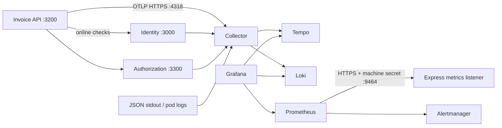

# P06 — Nối telemetry thật, sao lưu và phục hồi dữ liệu

[Trang đầu](../../README.md) · [Nền tảng SRE](../chapters/20-sre-production.md) · [Runbooks](../reference/runbooks.md) · [Tiếp: vận hành và chi phí](07-operations-cost.md)

## 1. Đầu vào, sản phẩm bàn giao và hai cấu hình học

Đây là bài bổ sung sau chương 18–20, áp dụng cho ứng dụng bạn tự tạo trong `lab/`. Đọc [implementation map](../reference/implementation-map.md) để giữ đúng port, issuer và database owner. Mọi lệnh PowerShell chạy tại thư mục giáo trình; khối Bash chỉ chạy trong máy Linux lab được chỉ định. Không có kết quả benchmark, restore hay cluster đang chạy sẵn trong tài liệu này.

Bạn bàn giao dashboard dùng số liệu từ Express, alert có người nhận trách nhiệm, một trace nối Invoice → Identity → Authorization, log tìm theo trace ID và biên bản khôi phục database **đã chạy**. Backup có file và backup khôi phục được là hai checkpoint riêng.

| Profile | Thành phần | Khi sử dụng |
|---|---|---|
| Tiết kiệm | Prometheus, Alertmanager, Grafana; JSON logs đọc bằng kubectl; không Collector/Loki/Tempo | Máy ít RAM; thực hiện metrics, alert, backup trước |
| Đầy đủ trong lab | Thêm Collector DaemonSet, Loki monolithic, Tempo single binary | Điều tra phân tán; dự trù thêm RAM/PVC rồi đo thực tế |

Các profile một replica giúp học đường đi dữ liệu; không phải topology HA. Production cần storage, quyền truy cập, TLS nội bộ, retention và failure domains được thiết kế lại. Việc giảm telemetry không được thay đổi online introspection hoặc fail-closed.



## 2. Instrument Express trước khi cài dashboard

Thêm dependency vào Invoice API; lặp lại cho Identity, Authorization và BFF khi nối các hop. Nhóm OTel dưới đây tương thích với nhau theo [manifest SDK 0.207.0](https://github.com/open-telemetry/opentelemetry-js/blob/v2.2.0/experimental/packages/opentelemetry-sdk-node/package.json); giữ nguyên nhóm version, commit lockfile và kiểm tra advisories khi cập nhật.

```powershell
pnpm -C lab --filter @iam/invoice-api add --save-exact prom-client@15.1.3 `
  @opentelemetry/api@1.9.0 @opentelemetry/sdk-node@0.207.0 `
  @opentelemetry/sdk-trace-base@2.2.0 @opentelemetry/resources@2.2.0 `
  @opentelemetry/core@2.2.0 @opentelemetry/exporter-trace-otlp-http@0.207.0
New-Item -ItemType Directory -Force lab/infra/observability,lab/evidence/p06,lab/.secrets | Out-Null
```

Tạo `src/telemetry.ts`. Chọn span thủ công để không tự thu URL chứa authorization code, header, SQL parameter hoặc body. Import module này đầu tiên trong entrypoint, trước module ứng dụng. OTel exporter gửi bất đồng bộ; hàng đợi đầy có thể mất trace, không được làm request nghiệp vụ chờ collector. [OTLP exporter JavaScript](https://opentelemetry.io/docs/languages/js/exporters/).

```typescript
import { readFileSync } from 'node:fs';
import { context, propagation, trace } from '@opentelemetry/api';
import { NodeSDK } from '@opentelemetry/sdk-node';
import { resourceFromAttributes } from '@opentelemetry/resources';
import { W3CTraceContextPropagator } from '@opentelemetry/core';
import { BatchSpanProcessor, TraceIdRatioBasedSampler } from '@opentelemetry/sdk-trace-base';
import { OTLPTraceExporter } from '@opentelemetry/exporter-trace-otlp-http';

export const telemetry = process.env.OTEL_EXPORTER_OTLP_TRACES_ENDPOINT
  ? new NodeSDK({
      resource: resourceFromAttributes({
        'service.name': process.env.OTEL_SERVICE_NAME ?? 'invoice-api',
        'deployment.environment.name': 'lab',
      }),
      textMapPropagator: new W3CTraceContextPropagator(),
      sampler: new TraceIdRatioBasedSampler(1), // Lab 100%; production đo rồi giảm.
      spanProcessors: [new BatchSpanProcessor(new OTLPTraceExporter({
        url: process.env.OTEL_EXPORTER_OTLP_TRACES_ENDPOINT,
        headers: { Authorization: `Bearer ${readFileSync(
          process.env.OTEL_TOKEN_FILE!, 'utf8').trim()}` },
        timeoutMillis: 3000,
      }), { maxQueueSize: 512, maxExportBatchSize: 128 })],
    }) : undefined;
telemetry?.start();
export const tracer = trace.getTracer('iam-learning');

// Chỉ truyền URL nội bộ do server cấu hình; không nhận URL từ người dùng.
export async function dependencyFetch(
  dependency: 'identity' | 'authorization', url: string, init: RequestInit,
) {
  return tracer.startActiveSpan(`dependency.${dependency}`, async span => {
    try {
      const carrier: Record<string, string> = {};
      propagation.inject(context.active(), carrier);
      const headers = new Headers(init.headers);
      for (const [name, value] of Object.entries(carrier)) headers.set(name, value);
      return await fetch(url, { ...init, headers });
    } finally { span.end(); }
  });
}
```

Trong middleware gọi introspection/PDP đã có, thay `fetch` bằng `dependencyFetch`, giữ nguyên timeout, schema validation và cách xử lý 401/403/503. Chỉ propagate `traceparent`; không nhận `baggage` của browser. Khi shutdown, await `telemetry?.shutdown()` cùng drain server/pool, trước hard deadline của chương 18. Chưa bật endpoint OTLP thì module không cần secret và profile tiết kiệm vẫn chạy.

Thêm `src/observe.ts`; registry này thay registry của ví dụ chương 20 nếu đã tạo, tránh đăng ký trùng metric. Tham số `route` là tên route cố định do code khai báo. Không lấy từ `originalUrl`, user ID hay org ID.

```typescript
import type { RequestHandler } from 'express';
import { context, propagation, trace, SpanKind } from '@opentelemetry/api';
import { Counter, Histogram, Registry } from 'prom-client';
import { tracer } from './telemetry.js';
export const registry = new Registry();
registry.setDefaultLabels({ service: process.env.SERVICE_NAME ?? 'invoice-api', environment: 'lab',
  track: process.env.RELEASE_TRACK ?? 'stable' });
const requests = new Counter({ name: 'iam_http_requests_total', help: 'Protected HTTP outcomes',
  labelNames: ['route', 'status'] as const, registers: [registry] });
const duration = new Histogram({ name: 'iam_http_request_duration_seconds', help: 'Protected HTTP latency',
  labelNames: ['route', 'status'] as const, buckets: [.005, .01, .025, .05, .1, .15, .3, 1], registers: [registry] });
export function observe(route: string): RequestHandler {
  for (const status of ['200', '401', '403', '429', '500', '503']) requests.inc({ route, status }, 0);
  return (req, res, next) => {
    const parent = propagation.extract(context.active(), {
      traceparent: req.get('traceparent') ?? '',
    });
    const span = tracer.startSpan(route, { kind: SpanKind.SERVER }, parent);
    const finish = duration.startTimer({ route });
    res.once('finish', () => {
      requests.inc({ route, status: String(res.statusCode) });
      span.setAttribute('http.response.status_code', res.statusCode);
      span.end(); finish({ status: String(res.statusCode) });
    });
    context.with(trace.setSpan(parent, span), next);
  };
}
```

Gắn `observe('/v1/invoices/:id')` **trước** authenticate/authorize trên route Invoice. Route bị từ chối hoặc dependency lỗi vẫn được đếm. Nếu đã có middleware metrics P05, dùng cùng registry/counter/histogram đó rồi chỉ thêm spans; không đếm request hai lần. Đặt `SERVICE_NAME` và `OTEL_SERVICE_NAME` cùng tên, `RELEASE_TRACK=stable|canary`. Thêm xử lý `close` chưa `finish` để đếm disconnect một lần khi hoàn thiện instrumentation; test phải chứng minh không double count. Register metrics online checks của chương 20 vào cùng `registry` này. SLI trên chỉ phản ánh server error/overload; synthetic có credential biết hợp lệ phải phát hiện lỗi khiến mọi người nhận401. Không có series/scrape hoặc không đủ requests thì canary gate P05 phải fail, không tự hiểu là0 lỗi. Không đưa traffic tấn công vào mẫu số để làm đẹp SLO người dùng.

Metrics dùng listener riêng HTTPS `9464`, không đi human login, introspection hoặc PDP. Tạo `src/metrics-server.ts`, gọi sau khi khởi tạo app:

```typescript
import { createServer } from 'node:https';
import { readFileSync } from 'node:fs';
import { timingSafeEqual } from 'node:crypto';
import { registry } from './observe.js';
export function startMetrics() {
  const expected = Buffer.from(`Bearer ${readFileSync(process.env.METRICS_TOKEN_FILE!, 'utf8').trim()}`);
  return createServer({ cert: readFileSync(process.env.TLS_CERT_FILE!),
    key: readFileSync(process.env.TLS_KEY_FILE!) }, async (req, res) => {
    const actual = Buffer.from(req.headers.authorization ?? '');
    if (req.url !== '/metrics' || actual.length !== expected.length || !timingSafeEqual(actual, expected)) {
      res.writeHead(401); res.end(); return;
    }
    res.setHeader('Content-Type', registry.contentType);
    res.setHeader('Cache-Control', 'no-store');
    res.end(await registry.metrics());
  }).listen(9464, '0.0.0.0');
}
```

Đóng listener này trong graceful shutdown. Token máy ngẫu nhiên dành riêng cho scrape; rotate bằng mount secret/restart, không dùng access token người dùng. Chính sách này giữ metrics truy cập được khi chính Identity đang lỗi.

## 3. Cài Prometheus và Grafana với cấu hình cụ thể

Chỉ thực hành mutation khi context là `kind-iam`. Cài [kube-prometheus-stack chart 92.14.1](https://github.com/prometheus-community/helm-charts/releases/tag/kube-prometheus-stack-92.14.1), [Collector 0.178.0](https://github.com/open-telemetry/opentelemetry-helm-charts/releases/tag/opentelemetry-collector-0.178.0), [Loki 20.0.2](https://github.com/grafana-community/helm-charts/releases/tag/loki-20.0.2) và [Tempo 3.2.1](https://github.com/grafana-community/helm-charts/releases/tag/tempo-3.2.1). Các pin được đối chiếu index/manifest upstream ngày 29/10/2026; tương thích runtime cần lab của bạn chứng minh.

```powershell
if ((kubectl config current-context) -ne 'kind-iam') { throw 'Sai cluster lab' }
kubectl create namespace monitoring --dry-run=client -o yaml | kubectl apply -f -
helm repo add prometheus-community https://prometheus-community.github.io/helm-charts
helm repo add open-telemetry https://open-telemetry.github.io/opentelemetry-helm-charts
helm repo add grafana-community https://grafana-community.github.io/helm-charts
helm repo update
foreach ($name in @('metrics', 'otel')) {
  $bytes = [byte[]]::new(32)
  [Security.Cryptography.RandomNumberGenerator]::Fill($bytes)
  [IO.File]::WriteAllText((Join-Path (Get-Location) "lab/.secrets/$name-token"),
    [Convert]::ToHexString($bytes))
}
kubectl -n monitoring create secret generic metrics-auth --from-file=token=lab/.secrets/metrics-token
kubectl -n iam create secret generic metrics-auth --from-file=token=lab/.secrets/metrics-token
kubectl -n monitoring create secret generic otel-auth --from-file=token=lab/.secrets/otel-token
kubectl -n iam create secret generic otel-auth --from-file=token=lab/.secrets/otel-token
kubectl -n monitoring create secret generic observability-ca --from-file=ca.crt=lab/.secrets/kind-ca.crt
```

Thư mục `.secrets` phải có ACL hạn chế theo bootstrap, không commit. Tạo secret `grafana-admin` trong namespace monitoring với hai file cục bộ `admin-user`, `admin-password` bằng credential ngẫu nhiên của bạn, lệnh `kubectl create secret generic ... --from-file=...`; không dùng mật khẩu mặc định. Không lưu kết quả giải mã secret vào evidence.

Mount `metrics-auth` vào Invoice tại `/run/metrics`, env `METRICS_TOKEN_FILE=/run/metrics/token`; expose container port `9464` với **tên port `metrics`** trên cả stable/canary pods. Tạo `lab/infra/observability/metrics-service.yaml`:

```yaml
apiVersion: v1
kind: Service
metadata: {name: invoice-api-metrics, namespace: iam}
spec:
  selector: {app: invoice-api}
  ports: [{name: metrics, port: 9464, targetPort: 9464}]
```

Tạo `prometheus-values.yaml`; chart này chủ động tắt cluster exporters để profile nhẹ chỉ đo ứng dụng. Khi thêm kubelet/node monitoring phải thêm quyền mạng/RBAC tương ứng, không chỉ bật dashboard.

```yaml
defaultRules: {create: false}
nodeExporter: {enabled: false}
kubeStateMetrics: {enabled: false}
kubeApiServer: {enabled: false}
kubelet: {enabled: false}
kubeControllerManager: {enabled: false}
kubeScheduler: {enabled: false}
kubeProxy: {enabled: false}
kubeEtcd: {enabled: false}
coreDns: {enabled: false}
grafana:
  admin: {existingSecret: grafana-admin, userKey: admin-user, passwordKey: admin-password}
  persistence: {enabled: true, size: 2Gi}
prometheus:
  prometheusSpec:
    retention: 2d
    secrets: [metrics-auth, observability-ca]
    resources: {requests: {cpu: 100m, memory: 256Mi}, limits: {memory: 1Gi}}
    storageSpec:
      volumeClaimTemplate:
        spec: {accessModes: [ReadWriteOnce], resources: {requests: {storage: 5Gi}}}
    additionalScrapeConfigs:
      - job_name: invoice-api
        scheme: https
        scrape_interval: 15s
        scrape_timeout: 5s
        authorization: {credentials_file: /etc/prometheus/secrets/metrics-auth/token}
        tls_config:
          ca_file: /etc/prometheus/secrets/observability-ca/ca.crt
          server_name: invoice-api.iam.svc.cluster.local
        kubernetes_sd_configs:
          - role: pod
            namespaces: {names: [iam]}
        relabel_configs:
          - {source_labels: [__meta_kubernetes_pod_label_app], action: keep, regex: invoice-api}
          - {source_labels: [__meta_kubernetes_pod_container_port_name], action: keep, regex: metrics}
          - {source_labels: [__meta_kubernetes_pod_phase], action: keep, regex: Running}
          - {source_labels: [__meta_kubernetes_pod_name], target_label: pod}
alertmanager:
  config:
    global: {resolve_timeout: 5m}
    route:
      receiver: lab-record-only
      group_by: [alertname, service]
      group_wait: 30s
      group_interval: 5m
      repeat_interval: 2h
      routes:
        - matchers: ['severity="page"']
          receiver: lab-page-record-only
          repeat_interval: 30m
    receivers:
      - name: lab-record-only
      - name: lab-page-record-only
```

Hai receiver không gửi ra bên ngoài: xem trạng thái firing qua UI. Production nối receiver tới kênh on-call đã thống nhất, secret qua custody, gửi test có chủ đích và xác nhận người trực nhận được. Alert chưa có tuyến nhận đã thử thì gate còn pending. [Prometheus scrape authorization/TLS](https://prometheus.io/docs/prometheus/latest/configuration/configuration/), [Alertmanager routing](https://prometheus.io/docs/alerting/latest/configuration/).

```powershell
kubectl apply -f lab/infra/observability/metrics-service.yaml
helm upgrade --install monitoring prometheus-community/kube-prometheus-stack `
  --version 92.14.1 --namespace monitoring `
  -f lab/infra/observability/prometheus-values.yaml --wait --timeout 10m
kubectl -n monitoring port-forward service/monitoring-grafana 3001:80
# Terminal riêng: kubectl -n monitoring port-forward service/monitoring-kube-prometheus-prometheus 9090:9090
```

Discovery scrape **từng Pod IP**, không scrape ClusterIP Service cân bằng tải giữa nhiều registry, vì counter đổi replica sẽ tạo reset giả. Prometheus service account cần get/list/watch pods namespace iam; chart cung cấp RBAC monitor cơ bản, kiểm tra bằng `kubectl auth can-i list pods -n iam --as=system:serviceaccount:monitoring:monitoring-kube-prometheus-prometheus`. Targets phải có từng replica/track, tất cả UP; query `up{job="invoice-api"}` trả một series mỗi pod. Không route metrics bằng public Gateway. Pod không có credential gọi metrics nhận401; chặn Identity vẫn scrape được. Bổ sung job riêng Identity/Authorization với `server_name` đúng SAN và pod label đúng để theo dõi toàn bộ critical path.

Trong NetworkPolicy chương18 thêm ingress/egress này; không thay default deny bằng allow-all. Nếu monitoring chưa có egress deny, hai policy dưới chỉ giới hạn chiều ingress của ứng dụng và khai báo đường egress tương ứng:

```yaml
apiVersion: networking.k8s.io/v1
kind: NetworkPolicy
metadata: {name: allow-monitoring-metrics, namespace: iam}
spec:
  podSelector: {matchLabels: {app: invoice-api}}
  policyTypes: [Ingress]
  ingress:
    - from:
        - namespaceSelector: {matchLabels: {kubernetes.io/metadata.name: monitoring}}
      ports: [{protocol: TCP, port: 9464}]
---
apiVersion: networking.k8s.io/v1
kind: NetworkPolicy
metadata: {name: metrics-and-dns-egress, namespace: monitoring}
spec:
  podSelector: {matchLabels: {app.kubernetes.io/name: prometheus}}
  policyTypes: [Egress]
  egress:
    - to:
        - namespaceSelector: {matchLabels: {kubernetes.io/metadata.name: iam}}
          podSelector: {matchLabels: {app: invoice-api}}
      ports: [{protocol: TCP, port: 9464}]
    - to:
        - namespaceSelector: {matchLabels: {kubernetes.io/metadata.name: monitoring}}
      ports: [{protocol: TCP, port: 9093}]
    - to:
        - namespaceSelector: {matchLabels: {kubernetes.io/metadata.name: kube-system}}
          podSelector: {matchLabels: {k8s-app: kube-dns}}
      ports: [{protocol: UDP, port: 53}, {protocol: TCP, port: 53}]
```

Policy egress Prometheus cần API server443/6443 để discovery hoạt động. Tạo rule từ địa chỉ thực sau khi kiểm tra context; bao gồm Service IP và Endpoint IP để kiểm thử CNI pre/post-DNAT, không đoán public CIDR:

```powershell
$apiService = kubectl -n default get service kubernetes -o json | ConvertFrom-Json
$apiSlices = kubectl -n default get endpointslice -l kubernetes.io/service-name=kubernetes -o json | ConvertFrom-Json
$apiAddresses = @($apiService.spec.clusterIP) + @($apiSlices.items.endpoints.addresses)
$apiPeers = @($apiAddresses | Sort-Object -Unique | ForEach-Object {
  $parsedAddress = [Net.IPAddress]::Parse($_)
  $prefix = if ($parsedAddress.AddressFamily -eq [Net.Sockets.AddressFamily]::InterNetwork) { 32 } else { 128 }
  @{ ipBlock = @{cidr = "$_/$prefix"} }
})
if ($apiPeers.Count -lt 1) { throw 'Không xác định được API peers' }
$apiPolicy = @{
  apiVersion='networking.k8s.io/v1'; kind='NetworkPolicy'
  metadata=@{name='prometheus-api-egress'; namespace='monitoring'}
  spec=@{podSelector=@{matchLabels=@{'app.kubernetes.io/name'='prometheus'}}
    policyTypes=@('Egress'); egress=@(@{to=$apiPeers; ports=@(
      @{protocol='TCP'; port=443}, @{protocol='TCP'; port=6443})})}
}
$apiPolicy | ConvertTo-Json -Depth 15 | kubectl apply -f -
```

Monitoring operator/webhook cần API↔admission connectivity riêng; không áp default-deny toàn namespace trước khi allow những đường đó. Với policy deny của namespace iam, thêm egress iam→monitoring/pod `app.kubernetes.io/instance=otelcol` TCP4318 và ingress đối ứng trên Collector ở profile đầy đủ. Truy cập Grafana bằng `127.0.0.1:3001` qua port-forward.

## 4. Nối traces và logs ở profile đầy đủ

Tạo `tempo-values.yaml` và `loki-values.yaml` như sau, tách hai tài liệu YAML thành hai file tương ứng:

```yaml
# tempo-values.yaml
fullnameOverride: tempo
tempo:
  tag: 3.1.1
  reportingEnabled: false
  retention: 24h
  receivers:
    otlp:
      protocols:
        http: {endpoint: "0.0.0.0:4318"}
persistence: {enabled: true, size: 5Gi}
---
# loki-values.yaml
fullnameOverride: loki
deploymentMode: Monolithic
loki:
  auth_enabled: false
  commonConfig: {replication_factor: 1}
  storage: {type: filesystem}
  schemaConfig:
    configs:
      - from: "2026-01-01"
        store: tsdb
        object_store: filesystem
        schema: v13
        index: {prefix: index_, period: 24h}
  limits_config: {retention_period: 48h}
  compactor: {retention_enabled: true, delete_request_store: filesystem}
singleBinary:
  replicas: 1
  persistence: {enabled: true, size: 5Gi}
read: {replicas: 0}
write: {replicas: 0}
backend: {replicas: 0}
gateway: {enabled: false}
chunksCache: {enabled: false}
resultsCache: {enabled: false}
```

`auth_enabled:false` của Loki chỉ phù hợp namespace lab được cô lập; không expose Loki/Tempo ra public. Dùng [values Loki](https://github.com/grafana-community/helm-charts/blob/loki-20.0.2/charts/loki/values.yaml) và [values Tempo](https://github.com/grafana-community/helm-charts/blob/tempo-3.2.1/charts/tempo/values.yaml) đúng pin khi đổi storage. Production thay filesystem bằng storage bền vững được kiểm chứng, xác thực/TLS giữa workloads, retention có owner và budget.

Tạo Certificate `otel-collector` namespace monitoring, secret `otel-collector-tls`, issuer `lab-ca` theo chương18, DNS `otelcol.monitoring.svc.cluster.local`; đợi Ready. Collector dùng bearer token riêng cộng HTTPS. File `collector-values.yaml`:

```yaml
fullnameOverride: otelcol
mode: daemonset
image: {repository: otel/opentelemetry-collector-contrib, tag: 0.163.2}
command: {name: otelcol-contrib}
presets:
  logsCollection: {enabled: true, includeCollectorLogs: false}
ports:
  otlp: {enabled: false}
  otlp-http: {enabled: true}
  jaeger-compact: {enabled: false}
  jaeger-thrift: {enabled: false}
  jaeger-grpc: {enabled: false}
  zipkin: {enabled: false}
extraVolumes:
  - {name: tls, secret: {secretName: otel-collector-tls}}
  - {name: auth, secret: {secretName: otel-auth}}
extraVolumeMounts:
  - {name: tls, mountPath: /run/tls, readOnly: true}
  - {name: auth, mountPath: /run/auth, readOnly: true}
config:
  extensions:
    bearertokenauth: {filename: /run/auth/token}
  receivers:
    jaeger: null
    zipkin: null
    prometheus: null
    otlp:
      protocols:
        grpc: null
        http:
          endpoint: "0.0.0.0:4318"
          tls: {cert_file: /run/tls/tls.crt, key_file: /run/tls/tls.key}
          auth: {authenticator: bearertokenauth}
    filelog:
      include: [/var/log/pods/iam_*/*/*.log]
      operators:
        - {type: container, id: container-parser}
        - {type: json_parser, parse_to: body, on_error: drop}
  processors:
    memory_limiter: {check_interval: 1s, limit_mib: 384, spike_limit_mib: 96}
    batch: {timeout: 1s, send_batch_size: 256}
    transform/logs:
      error_mode: propagate
      log_statements:
        - context: log
          statements:
            - 'keep_keys(body, ["level", "time", "service", "event", "route", "status_code", "request_id", "trace_id", "decision_id", "error_code"])'
            - 'set(resource.attributes["service.name"], "iam")'
  exporters:
    debug: null
    otlp_http/tempo: {endpoint: "http://tempo:4318"}
    otlp_http/loki: {endpoint: "http://loki:3100/otlp"}
  service:
    extensions: [health_check, bearertokenauth]
    pipelines:
      metrics: null
      traces: {receivers: [otlp], processors: [memory_limiter, batch], exporters: [otlp_http/tempo]}
      logs: {receivers: [filelog], processors: [memory_limiter, transform/logs, batch], exporters: [otlp_http/loki]}
resources: {requests: {cpu: 100m, memory: 128Mi}, limits: {memory: 512Mi}}
```

[Collector chart](https://opentelemetry.io/docs/platforms/kubernetes/helm/collector/), [bearer authenticator](https://github.com/open-telemetry/opentelemetry-collector-contrib/blob/v0.163.0/extension/bearertokenauthextension/README.md), [OTLP HTTP exporter](https://github.com/open-telemetry/opentelemetry-collector/blob/v0.163.0/exporter/otlphttpexporter/README.md) giải thích các điểm cấu hình. Trên version này tên exporter là `otlp_http`. Logs phải là JSON; bản ghi không parse được bị drop. Operational log giữ field allowlist; audit nghiệp vụ vẫn lưu qua outbox/Audit service, không phụ thuộc pipeline telemetry này.

```powershell
helm upgrade --install tempo grafana-community/tempo --version 3.2.1 -n monitoring `
  -f lab/infra/observability/tempo-values.yaml --wait --timeout 10m
helm upgrade --install loki grafana-community/loki --version 20.0.2 -n monitoring `
  -f lab/infra/observability/loki-values.yaml --wait --timeout 10m
helm upgrade --install otelcol open-telemetry/opentelemetry-collector --version 0.178.0 `
  -n monitoring -f lab/infra/observability/collector-values.yaml --wait --timeout 10m
```

Mount `otel-auth` vào mỗi ứng dụng tại `/run/otel`, đặt `OTEL_TOKEN_FILE=/run/otel/token`, `OTEL_SERVICE_NAME` tương ứng và `OTEL_EXPORTER_OTLP_TRACES_ENDPOINT=https://otelcol.monitoring.svc.cluster.local:4318/v1/traces`. Giữ `NODE_EXTRA_CA_CERTS` của chương18. Cho egress iam tới Collector4318 và ingress monitoring từ iam4318. Trong monitoring chỉ cho pod cùng namespace gọi Loki3100, Tempo4318/3200, Prometheus9090, Grafana3000 và Alertmanager9093; cho Prometheus ra iam9464, DNS53 và lưu lượng operator tới API cần thiết. Test deny từ namespace không được cấp quyền. Lab backends Loki/Tempo dùng HTTP trong vùng cô lập; trước production phải chuyển chúng sang TLS được trust.

Grafana → Connections → Add data source: Prometheus URL `http://monitoring-kube-prometheus-prometheus:9090`, Loki `http://loki:3100`, Tempo `http://tempo:3200`, access server/proxy. Không đưa URL cluster DNS vào browser làm direct datasource. Tạo dashboard UID `iam-online-checks-v1`, các panel:

| Panel | Query / đơn vị |
|---|---|
| Protected RPS | `sum(rate(iam_http_requests_total[5m]))` / req/s |
| API p95 | `histogram_quantile(0.95, sum by (le) (rate(iam_http_request_duration_seconds_bucket[5m])))` / giây |
| Dependency p95 | `histogram_quantile(0.95, sum by (le,dependency) (rate(iam_online_check_seconds_bucket[5m])))` |
| Online errors | `sum by (dependency) (rate(iam_online_checks_total{outcome="error"}[5m]))` |

Export dashboard JSON **không chứa credential** vào `lab/infra/observability/dashboards/`; provision lại vào Grafana sạch là test tái lập. Emit log với field `event` cố định, `trace_id=trace.getActiveSpan()?.spanContext().traceId`; không log request/body/header hay exception message tự do. Loki query `{service_name="iam"} | json | event="protected_request_completed"`; lấy trace ID sang Tempo. Request/decision IDs chỉ là field log, không metric label hoặc Loki index label. Một scan canary dùng chuỗi giả bí mật phải tìm thấy **0** kết quả trong cả logs lẫn spans.

## 5. Burn-rate alert có hành động và kiểm chứng

SLO 99,9% có error budget0,001. Burn14,4 tương ứng bad ratio1,44%; burn6 tương ứng0,6%. Tạo PrometheusRule namespace monitoring, label `release: monitoring`. Ví dụ page dùng hai cửa sổ; không alert chỉ vì một401:

```yaml
apiVersion: monitoring.coreos.com/v1
kind: PrometheusRule
metadata: {name: iam-slo, namespace: monitoring, labels: {release: monitoring}}
spec:
  groups:
    - name: iam-online
      rules:
        - alert: IamProtectedFastBurn
          expr: |
            (sum(rate(iam_http_requests_total{status=~"5..|429"}[1h])) /
             clamp_min(sum(rate(iam_http_requests_total[1h])), 0.000001) > 0.0144)
            and
            (sum(rate(iam_http_requests_total{status=~"5..|429"}[5m])) /
             clamp_min(sum(rate(iam_http_requests_total[5m])), 0.000001) > 0.0144)
          for: 2m
          labels: {severity: page, team: iam-platform, service: protected-api}
          annotations:
            summary: Protected requests đang tiêu error budget nhanh
            runbook: RB-01 trong docs/reference/runbooks.md
        - alert: IamMetricsMissing
          expr: absent(up{job="invoice-api"}) or up{job="invoice-api"} == 0
          for: 2m
          labels: {severity: ticket, team: iam-platform, service: invoice-api}
          annotations: {summary: Scrape mất dữ liệu, kiểm tra TLS/auth/NetworkPolicy}
```

Thêm rule slow-burn với cùng công thức thay `[1h]`/`[5m]` bằng `[6h]`/`[30m]`, ngưỡng0,006 và `severity:ticket`. Đây là lựa chọn giáo trình dựa trên [multiwindow burn rate](https://sre.google/workbook/alerting-on-slos/). Ghi owner `iam-platform` vào roster P07; RB-01 là hành động đầu tiên. Synthetic valid-user login, invoice read và revoke-negative chạy độc lập; ba lần lỗi liên tiếp cần page dù HTTP5xx vẫn bằng0. Backup age/WAL archiving failure, outbox oldest age và cert còn dưới14 ngày là alert riêng có data/platform owner.

Failure lab: giữ tải nhỏ bằng client hợp lệ, scale Identity về0 theo RB-01, quan sát bounded503, dependency error tăng, trace dừng tại Identity, alert firing. Khôi phục2 replica, kiểm tra resolve và token đã revoke vẫn inactive. Giữ request sample, PromQL result và trace đã redact. Cố ý sai metrics token rồi sửa: phải phân biệt mất quan sát với outage nghiệp vụ.

## 6. Physical backup mã hóa và PITR bằng pgBackRest

Phần này chạy trên **Linux VM/WSL Ubuntu24.04 riêng cho data lab**, PostgreSQL18 cluster `main`, không chỉnh container DB đang chạy của ứng dụng. Cài PostgreSQL18 theo [PGDG Ubuntu](https://www.postgresql.org/download/linux/ubuntu/), pgBackRest2.60.0 theo [release chính thức](https://github.com/pgbackrest/pgbackrest/releases/tag/release%2F2.60.0); pin package trong inventory sau khi kiểm tra `apt-cache policy`. Primary và restore host dùng cùng version. Trước thao tác ghi, xác minh `hostname`, `pg_lsclusters`, `pgbackrest version` và `SHOW data_directory`; sai target thì dừng.

Đọc cách [PostgreSQL continuous archiving](https://www.postgresql.org/docs/18/continuous-archiving.html) phối hợp base backup với WAL. `pg_dump` hữu ích cho logical export; nó không cung cấp PITR. Lab dùng repository `/var/lib/pgbackrest`; production repository phải nằm failure domain khác, quyền ghi/xóa tách và có bản sao được bảo vệ khỏi compromised DB host.

Tạo `/etc/pgbackrest/pgbackrest.conf` thuộc `postgres:postgres`, mode0640:

```ini
[iam]
pg1-path=/var/lib/postgresql/18/main
pg1-port=5432

[global]
repo1-path=/var/lib/pgbackrest
repo1-cipher-type=aes-256-cbc
repo1-retention-full-type=time
repo1-retention-full=14
process-max=2
start-fast=y
```

Tạo directory repo, log và file khóa include bằng các lệnh Bash dưới đây. Encryption passphrase không xuất terminal, không nằm trong repo backup; lưu bản phục hồi riêng trong secret custody trước khi gọi đây là DR. [pgBackRest encryption/retention](https://pgbackrest.org/user-guide.html#quickstart/configure-repository-encryption).

```bash
sudo install -d -o postgres -g postgres -m 0750 /var/lib/pgbackrest /var/log/pgbackrest
sudo install -d -o postgres -g postgres -m 0750 /etc/pgbackrest/conf.d
sudo install -o postgres -g postgres -m 0640 /dev/null /etc/pgbackrest/conf.d/repo-key.conf
sudo -u postgres sh -c 'printf "[global]\nrepo1-cipher-pass=%s\n" "$(openssl rand -base64 48)" > /etc/pgbackrest/conf.d/repo-key.conf'
```

Trong config PostgreSQL lab đặt `archive_mode=on`, `archive_command='pgbackrest --stanza=iam archive-push %p'`, `archive_timeout='60s'`; restart `sudo pg_ctlcluster 18 main restart`. Timeout60s buộc chuyển WAL khi có hoạt động, không bảo đảm archive đến storage trong60s nếu đường truyền hỏng. Sau đó:

```bash
sudo -u postgres pgbackrest --stanza=iam stanza-create
sudo -u postgres pgbackrest --stanza=iam check
sudo -u postgres psql -X -v ON_ERROR_STOP=1 -d postgres -c \
  "CREATE TABLE restore_probe(id text PRIMARY KEY, stamped timestamptz DEFAULT clock_timestamp()); INSERT INTO restore_probe(id) VALUES ('before');"
sudo -u postgres pgbackrest --stanza=iam --type=full backup
sudo -u postgres pgbackrest --stanza=iam info
```

Physical backup chứa toàn PostgreSQL cluster, kể cả role và mọi owner database trong cluster. Production các instance tách nhau phải có stanza/schedule riêng. Retention14 ngày giữ backup/WAL theo semantics công cụ; có thể giữ lâu hơn14 ngày để duy trì recovery window, không đặt object lifecycle xóa WAL sớm hơn công cụ.

Lập lịch systemd: tạo `/etc/systemd/system/iam-backup@.service` với `User=postgres`, `Type=oneshot`, `ExecStart=/usr/bin/pgbackrest --stanza=iam --type=%i backup`. Tạo hai timer có `Persistent=true`, `[Install] WantedBy=timers.target`: `iam-backup-full.timer` dùng `OnCalendar=Sun *-*-* 01:30:00 UTC`, `Unit=iam-backup@full.service`; `iam-backup-diff.timer` dùng `OnCalendar=Mon..Sat *-*-* 01:30:00 UTC`, `Unit=iam-backup@diff.service`. Không chạy full và diff cùng giờ cùng ngày. Kiểm chứng lịch và job:

```bash
sudo systemctl daemon-reload
sudo systemctl enable --now iam-backup-full.timer iam-backup-diff.timer
systemctl list-timers 'iam-backup-*'
sudo systemctl start iam-backup@diff.service
sudo journalctl -u iam-backup@diff.service --since '10 minutes ago' --no-pager
sudo -u postgres psql -X -c \
  "SELECT archived_count,failed_count,last_archived_time,last_failed_time FROM pg_stat_archiver;"
```

Alert khi backup mới nhất hơn26 giờ, WAL failures tăng hoặc WAL archival age vượt mục tiêu trong lúc có writes. Đẩy timestamp/outcome bằng batch metric endpoint hoặc exporter do data owner quản lý, không mở password PostgreSQL cho Grafana. Test alert bằng job cố ý thất bại, không xóa backup đang cần.

## 7. Khôi phục cô lập, đo RPO/RTO rồi mới mở traffic

Tạo target sau full backup, thêm dữ liệu sau target, bắt PostgreSQL archive WAL. Chỉ script này chạy trong VM lab nói trên:

```bash
TARGET_UTC=$(sudo -u postgres psql -X -At -c "SELECT to_char(clock_timestamp() AT TIME ZONE 'UTC','YYYY-MM-DD HH24:MI:SS.US') || '+00';")
printf 'PITR target UTC: %s\n' "$TARGET_UTC"
sleep 2
sudo -u postgres psql -X -v ON_ERROR_STOP=1 -c \
  "INSERT INTO restore_probe(id) VALUES ('after'); SELECT pg_switch_wal();"
sudo -u postgres pgbackrest --stanza=iam check
sudo install -d -o postgres -g postgres -m 0700 /var/lib/postgresql/18/restore-lab /tmp/iam-restore
test -z "$(sudo find /var/lib/postgresql/18/restore-lab -mindepth 1 -print -quit)" || exit 1
date -u '+restore_start=%Y-%m-%dT%H:%M:%SZ'
sudo -u postgres pgbackrest --stanza=iam --pg1-path=/var/lib/postgresql/18/restore-lab \
  --type=time --target="$TARGET_UTC" --target-action=pause restore
```

Không thêm `--delta` hoặc xóa thư mục đích để vượt guard. Tạo config PostgreSQL **trong restore-lab**, không copy đường dẫn main: `port=55432`, `listen_addresses='127.0.0.1'`, `unix_socket_directories='/tmp/iam-restore'`, `archive_mode=off`, `hot_standby=on`, `ssl=off` cho VM loopback cô lập. Tạo `pg_hba.conf` chỉ `local all postgres peer`. Không bật gateway hoặc workers, không cho app live dùng DB này. Debian giữ config main ngoài PGDATA, vì vậy restore cần hai file config riêng này; giữ nguyên `postgresql.auto.conf` do pgBackRest tạo để recovery hoạt động.

```bash
sudo -u postgres /usr/lib/postgresql/18/bin/pg_ctl \
  -D /var/lib/postgresql/18/restore-lab -l /tmp/iam-restore/startup.log start
sudo -u postgres psql -X -h /tmp/iam-restore -p 55432 -d postgres -c \
  "SELECT pg_is_in_recovery(),pg_is_wal_replay_paused(); TABLE restore_probe;"
```

Kỳ vọng recovery paused, chỉ có `before`. Nếu recovery target chưa tới, dừng điều tra WAL gap, không promote để làm bài xanh. [pgBackRest PITR](https://pgbackrest.org/user-guide.html#restore/point-in-time) hướng dẫn target và pause; resume ở clone lab bằng `SELECT pg_wal_replay_resume();`, đợi `pg_is_in_recovery()=false`, rồi mới chạy SQL kiểm tra ghi/security reset. Đây là clone đã tách khỏi primary, không phải lệnh failover production.

Mục tiêu lab business-data RPO≤5 phút, RTO≤30 phút. Lưu target, last recovered marker/commit, thời điểm restore bắt đầu, DB dùng được và **dịch vụ an toàn dùng được**. RTO phải tính secret recovery, schema validation, reset credential và review, không chỉ thời gian copy file. RPO0 của security mutation đã acknowledge là contract khác: synchronous failover/fencing theo RB-05 hoặc giữ recovery gate nếu không chứng minh được. WAL archive mỗi phút không tự đáp ứng contract này.

Nếu restore database có IAM thật, thực hiện toàn bộ RB-03: invalidate grant/token/session/code/challenge, vô hiệu hóa credential/password/MFA/client key và key metadata cũ, suspend org; Authorization reconcile assignments, ABAC/ReBAC; Governance/outbox quarantine. Thử backupT0 → revoke/đổi passwordT1 → restoreT0; credential cũ vẫn bị chặn sau reset. Chỉ dùng ownership độc lập snapshot để phục hồi từng tenant; không tự gửi reset email tới địa chỉ cũ rồi xem là đủ. Sau negative tests và reviewer ký mới mở traffic từng nhóm. Không chứng minh được trạng thái revoke thì503 tiếp tục là kết quả đúng.

## 8. Nhánh cloud: RDS-native PITR thay cho filesystem backup

P03 tạo **Amazon RDS for PostgreSQL**; bạn không có filesystem/sudo để chạy pgBackRest hay cấu hình `archive_command` trên RDS. Bài pgBackRest ở trên là profile self-managed riêng. Với RDS dùng automated backups/PITR của nhà cung cấp, vẫn phải đo recovery và chạy cùng security reset. [RDS PITR](https://docs.aws.amazon.com/AmazonRDS/latest/UserGuide/USER_PIT.html) tạo instance mới, không ghi đè source; restore cần chọn lại network/parameter settings rõ ràng thay vì nhận default.

Chuẩn bị recovery runner riêng trong private subnet, SG dành riêng **không dùng chung với application nodes**, credential qua operator ngoài IAM. Recovery SG của database chỉ cho ingress5432 từ SG runner; runtime app không có đường tới clone. Tạo các SG bằng Terraform/change riêng, ghi IDs vào inventory. Chưa chuẩn bị được runner/custody thì chỉ tạo clone hoàn toàn không ingress và giữ bước recovery pending; không mở database ra laptop/Internet để đi tiếp.

PowerShell dưới chạy sau account guard P07, source dev sandbox của P03. `IAM_RESTORE_DB_SG_ID` là SG database recovery đã review; `IAM_RESTORE_TIME_UTC` là timestamp ISO8601 nằm trong retention window. Không chọn thời điểm tương lai để vượt LatestRestorableTime:

```powershell
if (-not $env:IAM_SANDBOX_ACCOUNT_ID -or -not $env:IAM_RESTORE_DB_SG_ID -or
    -not $env:IAM_RESTORE_TIME_UTC) { throw 'Thiếu sandbox account/recovery SG/target time' }
$account = aws sts get-caller-identity --query Account --output text
if ($LASTEXITCODE -ne 0 -or $account -ne $env:IAM_SANDBOX_ACCOUNT_ID) { throw 'Sai account' }
$sourceId = 'iam-dev-postgres'
$source = (aws rds describe-db-instances --db-instance-identifier $sourceId --output json |
  ConvertFrom-Json).DBInstances[0]
if (-not $source.StorageEncrypted -or -not $source.KmsKeyId -or $source.Engine -ne 'postgres') {
  throw 'Source encryption/engine không đúng inventory'
}
$targetTime = [DateTimeOffset]::Parse($env:IAM_RESTORE_TIME_UTC)
if ($targetTime -lt [DateTimeOffset]$source.EarliestRestorableTime -or
    $targetTime -gt [DateTimeOffset]$source.LatestRestorableTime) {
  throw 'Target ngoài recovery window'
}
$restoreId = 'iam-dev-restore-' + [DateTime]::UtcNow.ToString('yyyyMMddHHmmss')
$expires = [DateTime]::UtcNow.AddHours(8).ToString('o')
$restoreStart = [DateTime]::UtcNow
aws rds restore-db-instance-to-point-in-time --source-db-instance-identifier $sourceId `
  --target-db-instance-identifier $restoreId --restore-time $env:IAM_RESTORE_TIME_UTC `
  --db-subnet-group-name $source.DBSubnetGroup.DBSubnetGroupName `
  --db-parameter-group-name $source.DBParameterGroups[0].DBParameterGroupName `
  --vpc-security-group-ids $env:IAM_RESTORE_DB_SG_ID `
  --no-publicly-accessible --no-multi-az --no-auto-minor-version-upgrade `
  --tags Key=Project,Value=iam-learning Key=Environment,Value=dev `
    Key=Purpose,Value=restore-drill "Key=ExpiresAt,Value=$expires" `
  --query DBInstance.DBInstanceIdentifier --output text
if ($LASTEXITCODE -ne 0) { throw 'Restore chưa được chấp nhận' }
aws rds wait db-instance-available --db-instance-identifier $restoreId
if ($LASTEXITCODE -ne 0) { throw 'Clone chưa available; điều tra thay vì mở traffic' }
$clone = (aws rds describe-db-instances --db-instance-identifier $restoreId --output json |
  ConvertFrom-Json).DBInstances[0]
if ($clone.PubliclyAccessible -or -not $clone.StorageEncrypted -or
    $clone.KmsKeyId -ne $source.KmsKeyId -or
    @($clone.VpcSecurityGroups.VpcSecurityGroupId).Count -ne 1 -or
    $clone.VpcSecurityGroups[0].VpcSecurityGroupId -ne $env:IAM_RESTORE_DB_SG_ID) {
  throw 'Clone chưa đạt network/encryption gate'
}
```

`--no-multi-az` là lựa chọn clone lab tiết kiệm, không mô phỏng failover HA. Giữ CMK mã hóa source/snapshot và recovery grants; key bị xóa làm backup không dùng được. Theo [AWS CLI restore contract](https://docs.aws.amazon.com/cli/latest/reference/rds/restore-db-instance-to-point-in-time.html), cờ quản lý master secret ngay trên restore có giới hạn engine; không sao chép cờ Oracle sang PostgreSQL.

Trên **clone**, sau khi network isolation đã được xác nhận, bật RDS-managed master password qua modify nếu chưa có secret; nếu đã có thì rotate secret. Chỉ output identifier, không in SecretString:

```powershell
if ($clone.MasterUserSecret.SecretArn) {
  aws rds modify-db-instance --db-instance-identifier $restoreId `
    --rotate-master-user-password --apply-immediately --query DBInstance.DBInstanceIdentifier
} else {
  aws rds modify-db-instance --db-instance-identifier $restoreId `
    --manage-master-user-password --apply-immediately --query DBInstance.DBInstanceIdentifier
}
if ($LASTEXITCODE -ne 0) { throw 'Master credential reset chưa thành công' }
aws rds describe-db-instances --db-instance-identifier $restoreId `
  --query 'DBInstances[0].[DBInstanceIdentifier,MasterUserSecret.SecretStatus,DBInstanceStatus]'
```

Đợi master secret `active`, recovery runner lấy credential theo [RDS/Secrets Manager](https://docs.aws.amazon.com/AmazonRDS/latest/UserGuide/rds-secrets-manager.html), ghi PG service/pgpass vào filesystem ephemeral mode0600, TLS `verify-full` với endpoint clone và RDS CA. Không bật transcript/debug shell khi credential nằm trong memory. Chạy counts/schema/marker probe, RB-03 security reset ở từng owner DB và rotate các application database credentials đã khôi phục. Reset master password không reset password của application roles hoặc IAM user credentials.

RTO gồm thời gian RDS available, background storage initialization, credential reset, validation và security reconciliation. Record LatestRestorableTime so với onset để đo business RPO; native PITR không tự bảo toàn mọi revoke sau target. Không đổi DNS live/app secret sang clone trong drill. Khi xong, dùng cleanup P07 để xóa đúng `$restoreId`, ghi retention của snapshots/keys/managed secret. Release recovery chỉ mở từng tenant sau negative tests/reviewer như profile self-managed.

## 9. Troubleshooting, bằng chứng và checkpoint

| Triệu chứng | Kiểm tra tiếp | Hành động |
|---|---|---|
| Target DOWN401 | Secret file/app mount; Prometheus credentials path | Rotate/restart có kiểm soát; không bỏ authentication |
| Target DOWN x509 | SAN, CA, `server_name` | Sửa trust chain; không `insecure_skip_verify` |
| Không có span | Env endpoint, certificate, Collector exporter logs | Kiểm tra request phát sinh sau SDK start; không log token |
| Không có log | File glob namespace iam, JSON parse, receiver dropped records | Sửa format allowlist, giữ secret ngoài log |
| PVC Pending | StorageClass/capacity của kind | Chọn provisioner đúng; không bỏ persistence để giả test restore |
| Backup thành công, PITR fail | WAL chain/target/timezone/retention/key | Giữ clone cô lập, sửa root cause rồi lặp restore |

Lưu `lab/evidence/p06/` gồm chart versions/rendered manifests đã redact, metric query, dashboard export, span path, canary leak scan, alert firing/resolved, backup metadata và restore report. Mỗi ảnh/output có timestampUTC, commit, command, expected/observed, operator/reviewer. Chưa chạy thì ghi pending.

- [ ] Scrape có TLS/credential và chạy khi Identity unavailable; namespace trái phép bị deny.
- [ ] Một request có metrics, log allowlist và trace các hop; không secret/PII trong labels/payload.
- [ ] Fast/slow burn, synthetic và backup alerts có owner/tuyến đã kiểm thử.
- [ ] Timer backup chạy thật; encrypted repository và decrypt key phục hồi độc lập.
- [ ] PITR clone phân biệt before/after; đo RPO/RTO và kiểm tra security reset trước traffic.
- [ ] Checkpoint đề nghị: `p06-observability-and-recovery`; đây là evidence học tập, production vẫn theo [checklist](../reference/production-checklist.md).
