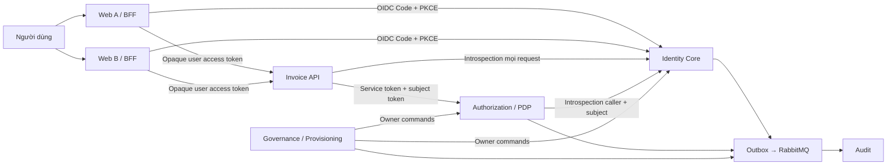
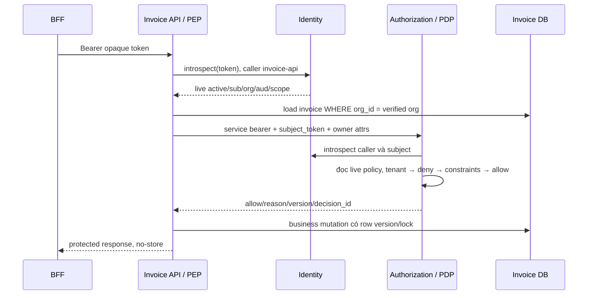

# Kiến trúc và luồng dữ liệu

Đọc cùng [implementation map](implementation-map.md), [quyết định thiết kế](decisions.md) và [security model](security-model.md).

## Context



Identity introspection xác thực confidential caller tại chỗ; không gọi PDP. Các control-plane lệnh được allowlist, scope và organization-bound. Điều này tránh dependency cycle khi Policy cần Identity để xác thực request.

## Container và quyền sở hữu dữ liệu

| Container | Database | Được ghi | Không được làm |
|---|---|---|---|
| Identity | identity | User/credential, directory/membership, client, grant/token/session | Đọc DB Invoice hoặc dựa vào event để xác nhận user active |
| Authorization | authorization | Roles, assignments, policy/version, relations | Nhận attributes browser làm sự thật tài nguyên |
| Audit | audit | Inbox, immutable audit records, export metadata | Quyết định live access từ event projection |
| Governance | governance | Workflow, approval, review, operation receipt | Ghi trực tiếp vào DB Identity/Policy |
| Invoice | invoice | Invoice, version, business transaction | Xem login thành quyền approve mặc định |
| BFF A/B | storage session riêng | OAuth transaction và token server-side được mã hóa | Đưa refresh token vào localStorage |

Monorepo chia sẻ contract và tiện ích thuần; không chia sẻ ORM model có quyền truy cập database các service. Một dependency `packages/contracts` không được import `identity/src/db.ts`.

## Luồng login và đổi code

```mermaid
sequenceDiagram
  participant Browser
  participant BFF
  participant IAM as Identity
  participant DB as Identity DB
  Browser->>BFF: GET /login
  BFF->>BFF: state, nonce, verifier; lưu server-side
  BFF-->>Browser: redirect /oauth2/authorize
  Browser->>IAM: client, redirect, challenge, scopes
  IAM->>DB: tạo authorization request sau validation
  IAM-->>Browser: login / org selection / consent
  Browser->>IAM: interaction có CSRF protection
  IAM->>DB: kiểm tra membership/app assignment; tạo grant + code
  IAM-->>Browser: redirect đã đăng ký + code + state
  Browser->>BFF: callback
  BFF->>BFF: kiểm tra state một lần
  BFF->>IAM: POST token, code, verifier, client authentication
  IAM->>DB: lock code, validate binding, consume và mint trong transaction
  IAM-->>BFF: token response sau commit
  BFF->>BFF: verify ID token, nonce; lưu token server-side
  BFF-->>Browser: cookie phiên mới HttpOnly
```

SSO là IAM session có thể dùng lại khi policy organization cho phép. Session Web A, Web B và IAM có lifecycle riêng. Một session đã login bằng password chưa đủ cho organization bắt buộc corporate IdP hoặc step-up.

## Luồng request nghiệp vụ



Một request ngoài có thể tạo nhiều introspection nội bộ. Capacity model phải đếm toàn bộ fan-out này. Để tối ưu có thể tái sử dụng dữ liệu trong cùng một request, nhưng không tái sử dụng positive result cho request sau. Một API no-op trong benchmark vẫn đi đủ đường xác thực và phân quyền.

## Atomicity và consistency

- Credential/challenge/code/refresh dùng một PostgreSQL transaction trong Identity. Trả thành công sau commit.
- Policy writer khóa version theo organization và cập nhật assignment/rule/version/outbox cùng transaction.
- PDP đọc policy trong snapshot ngắn, bắt đầu sau request; không giữ transaction read-only qua request.
- Business invariant thuộc Invoice transaction. Recheck khi tài nguyên đổi version trong khoảng giữa authorization và mutation.
- Không có transaction chung giữa Identity, Policy và Invoice. Request đã vượt check có thể còn đang chạy sau một revoke.
- Async events dùng cho audit/workflow/reconciliation. Live checks đọc owner có thẩm quyền.

## TLS và trust boundaries

Internet → Gateway/BFF → Resource API → IAM/Policy là các boundary khác nhau. Gateway routing/rate limit không thay việc API tự bảo vệ. Nội bộ production dùng TLS, service credential, NetworkPolicy và quyền audience; localhost HTTP chỉ là ngoại lệ lab đã bind loopback. Chỉ tin forwarded headers từ proxy đã cấu hình và số hop xác định.

Keys ký ID token nằm ngoài source/database payload đọc được: local dùng file private ngoài Git, production dùng Vault Transit. JWKS chỉ công bố public JWK. Public-key cache không phải authorization-result cache; cache public keys có thể dùng TTL/rotation phù hợp.

## Mở rộng sau phiên bản đầu

Native/mobile dùng external browser + PKCE; CLI dùng loopback redirect hoặc profile Device Flow được công bố sau. Streaming/WebSocket cần tái kiểm tra theo checkpoint, không suy luận một check khi mở socket có hiệu lực vô hạn. Custom issuer/domain theo tenant, multi-region active-active và risk scoring bằng ML là thiết kế riêng, không âm thầm thêm vào profile v1.
