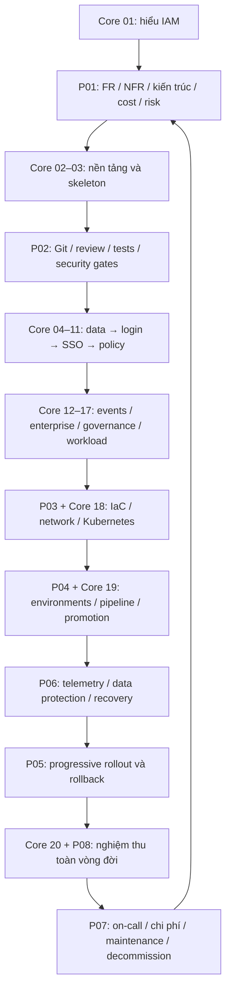

# Lộ trình toàn vòng đời: Solution Architect, Developer, DevOps và SRE

[Trang đầu](../../README.md) · [P01: bắt đầu từ yêu cầu](../delivery/01-requirements-solution-design.md) · [P08: capstone](../delivery/08-capstone-lifecycle.md)

Giáo trình có **hai tuyến đan xen**: 20 chương xây IAM và 8 bài P01–P08 xây quy trình giao sản phẩm. Học DevOps không bắt đầu ở lúc đã viết xong code; requirements, Git/review, infrastructure plan, testability và observability ảnh hưởng thiết kế từ đầu. Solution Architect và DevOps có trọng tâm khác nhau nhưng cùng chịu trách nhiệm làm hệ thống đáp ứng yêu cầu bằng bằng chứng.

## Đối chiếu đủ 10 nhóm

| Nhóm người học yêu cầu | Bài làm cụ thể | Artifact cần tạo | Gate kiểm chứng |
|---|---|---|---|
| 1. Yêu cầu và thiết kế | [P01](../delivery/01-requirements-solution-design.md), core 01/ADR | Charter, FR/NFR register, context/container/sequence, alternatives, capacity/cost/risk | Mỗi yêu cầu có ID, owner, test; review cả failure/cost assumptions |
| 2. Quy trình code | [P02](../delivery/02-git-security-workflow.md), core 03/19 | Git workflow, PR template, CODEOWNERS, required checks, SAST/SCA/secret scan | PR cố tình fail bị chặn; fork không nhận secrets; findings có xử lý |
| 3. Phát hành | [P04](../delivery/04-environments-promotion.md), [P05](../delivery/05-progressive-delivery.md), core 19 | Dev/staging/prod matrix, digest promotion, canary/rollback record | Một artifact qua các môi trường; canary lỗi tự/được dừng theo gate, schema còn tương thích |
| 4. Hạ tầng | [P03](../delivery/03-infrastructure-as-code.md), core 18 | Terraform/state/locks, VPC/subnets/routes/SG, EKS/RDS/LB, DNS/TLS, autoscaling | Reproduce plan; DB không public; egress/failure domains rõ; drift/cost kiểm tra |
| 5. Ứng dụng | core 03–11/18, [P06](../delivery/06-observability-data-recovery.md) | Config schema, shared durable session state, health/drain, deadline/pool, migration | Kill replica không mất phiên; dependency timeout fail closed; RLS/transaction tests |
| 6. Dữ liệu | core 04/20, [P03](../delivery/03-infrastructure-as-code.md), [P06](../delivery/06-observability-data-recovery.md) | DB ownership, encryption, scheduled backup/WAL/retention, PITR runbook | Restore thực vào môi trường cô lập, đo RPO/RTO và chặn stale credentials trước mở traffic |
| 7. Bảo mật | core 05–17, [P02](../delivery/02-git-security-workflow.md), [P03](../delivery/03-infrastructure-as-code.md), [P04](../delivery/04-environments-promotion.md) | Least privilege, secret/key custody, TLS, scans, SBOM/sign/provenance, audit | Negative/concurrency/tenant/rotation tests, scan gates, independent review |
| 8. Quan sát | [P06](../delivery/06-observability-data-recovery.md), core 12/20 | Logs/metrics/traces pipeline, dashboard, SLI/SLO và alert routes | Một request truy từ edge tới DB/PDP; critical alert đến owner, không PII/high-cardinality |
| 9. Độ tin cậy | core 08/18/20, [P03](../delivery/03-infrastructure-as-code.md), [P06](../delivery/06-observability-data-recovery.md) | Redundancy, rate/concurrency limit, error budget, DR/failover | Pod/node/dependency/recovery drills, revocation survives failover hoặc quarantine |
| 10. Vận hành và chi phí | [P07](../delivery/07-operations-cost.md), [P08](../delivery/08-capstone-lifecycle.md) | On-call/runbook/postmortem, patch/rotation calendar, cost tags/forecast/budgets, onboarding/cleanup | Người khác vận hành theo tài liệu; action có owner/due/test; cloud bill không còn tài nguyên mồ côi |

Các mục trên là công việc **người học phải thực hiện**, không phải trạng thái production hiện có của repository giáo trình. Không lấy ví dụ dự án `user-manager` trong bảng tham khảo làm dữ liệu cấu hình IAM.

## Thứ tự học và cổng bàn giao

P04 environment/identity matrix, P06 telemetry design và P07 cost assumptions nên đọc ngay từ P01; việc cài đặt chúng diễn ra khi có prerequisite. Đây là iterative delivery: mỗi feature lặp requirement → design → code → verify → release → operate → learn, không chờ đủ enterprise features mới xem một log.

| Gate | Nội dung bàn giao | Chưa được kết luận |
|---|---|---|
| G0 — Design ready | FR/NFR, trust/data ownership, cost/risk và review | Chưa chứng minh runtime |
| G1 — Code ready | Reproducible build, tests/security checks, review và immutable artifact | Chưa chứng minh deploy/recovery |
| G2 — Environment ready | IaC/network/TLS/secrets/data topology và drift/cost review | Chưa chứng minh user journey |
| G3 — Release ready | Staging E2E/security/load/recovery, migration compatibility, rollout/rollback plan | Chưa được gắn SLA production |
| G4 — Release verified | Canary/promotion probes, telemetry, approver và rollback drill | Chưa đủ bằng chứng 30 ngày SLO |
| G5 — Operable | On-call/runbook/postmortem/patch/restore/cost/onboarding thực hiện được | Cần tiếp tục maintenance và review |

## Track local và track cloud

- **Local:** đầy đủ code, review, CI, Compose/kind, TLS local, canary, observability, restore và incident lab; không cần tài khoản cloud. Ràng buộc khi chạy stack đầy đủ là RAM/CPU và thời gian.
- **Cloud reference:** AWS một region, nhiều AZ, Terraform/EKS/RDS/VPC; dùng để học hạ tầng và failure domain thực. Ngôn ngữ/protocol/business IAM không đổi. Các resource này có tính phí; bài chỉ hướng dẫn, không tự cấp tài nguyên.
- **Production:** cần data topology/security review/durability/backup/cost được chứng minh. Kết quả local hoặc compatibility matrix upstream không tự trở thành production sign-off.

Cloud profile là một lựa chọn tham chiếu cụ thể để bài học có lệnh và kiến trúc rõ ràng. Nếu đổi Azure/GCP, giữ FR/NFR và thay các module topology/IAM/runtime integration có test tương đương; đừng đổi đồng thời semantics token hoặc bỏ online checks.

## Thư mục hiện tại và thư mục thực hành

Workspace của bạn hiện có `iam-documents/` và `iam-experiement/`. Bộ giáo trình được sửa tại **iam-documents**. Quy ước của các lệnh trong sách là chạy tại root repository có `README.md`, `docs/` và thư mục `lab/` do người học tạo. Bởi vậy, nếu làm đúng các lệnh nguyên văn ở repo giáo trình, `lab/` sẽ nằm trong `iam-documents/`.

Bạn có thể dùng repository thực hành riêng, nhưng cần mang scaffold `lab/` và các reference được chỉ định sang đó, chạy workflow ở `.github/workflows` của **repository chứa code**, đồng thời ghi rõ `$CurriculumRoot` để copy SQL/template từ giáo trình. Đừng copy `.git` hoặc secrets giữa hai repo. Phần `iam-experiement` hiện tại được giữ nguyên; không có bước tự di chuyển hay xóa code của bạn.

## Evidence index

Giữ `lab/evidence/delivery/` theo bài và một release record chứa links, không chứa secret. Mỗi evidence gồm requirement/gate ID, commit/digest/config/schema version, môi trường, command, expected vs observed, thời gian và người review. `pending`, `failed`, `passed`, `N/A có lý do` là các trạng thái khác nhau. Một ảnh dashboard thiếu input/config hoặc một câu “đã backup” chưa đủ.

Sau tuyến này, bạn phải chỉ được **đường đi của một thay đổi sản phẩm**, không chỉ kể tên công cụ. [Capstone P08](../delivery/08-capstone-lifecycle.md) là bài nghiệm thu điều đó.
